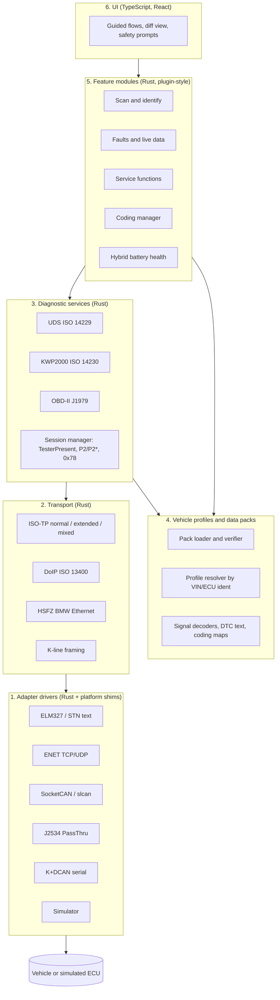
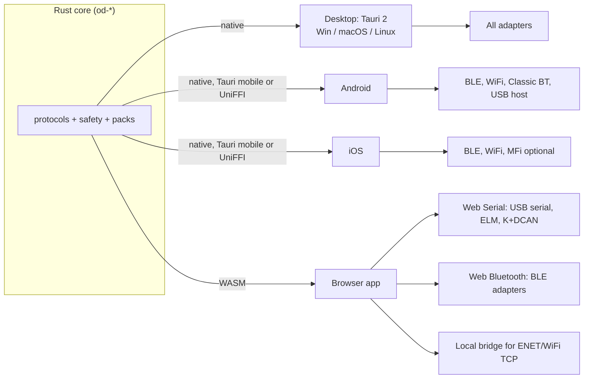
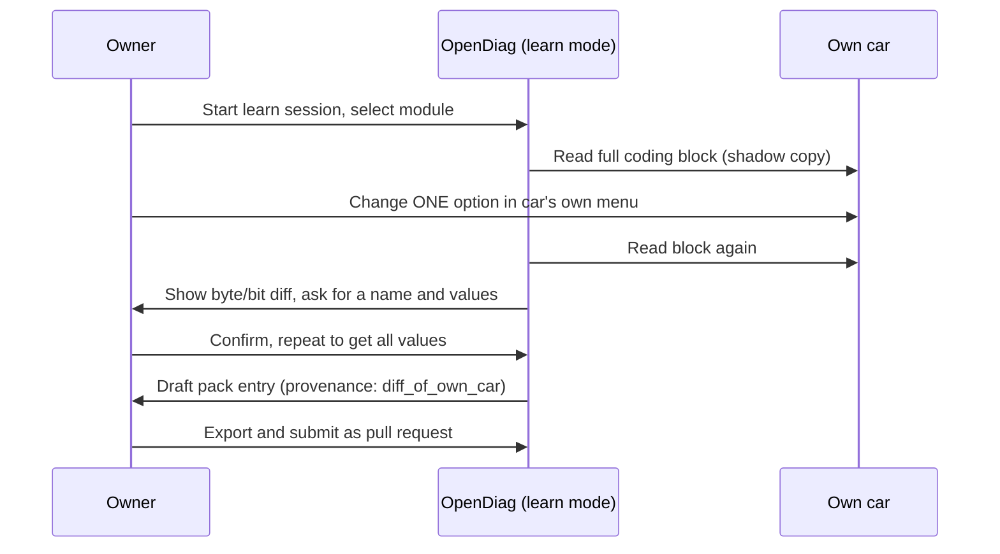
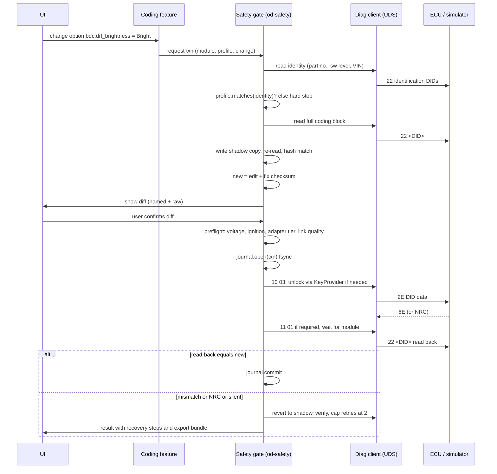
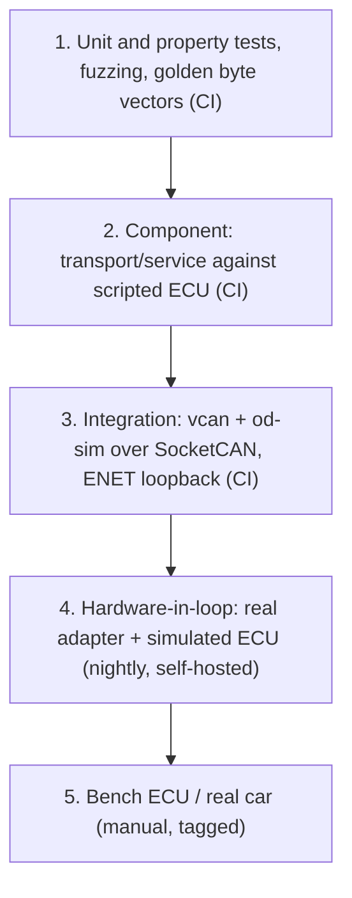

# OpenDiag system architecture

Status: design draft v0.1. Apache-2.0 project. Clean-room: this design is built from the research notes in `docs/research/` (public sources only). It contains no proprietary data and does not depend on any OEM tool, file or key. Claims marked "(unverified)" need a bench or source check before implementation relies on them.

## 1. Summary

OpenDiag is an independent, offline-first diagnostics and coding toolkit for BMW, Mercedes-Benz and Toyota/Lexus. It is an alternative to paywalled tools, not a copy of them.

Key decisions:

- **Rust core, TypeScript UI.** One Rust workspace holds every protocol and safety rule. It compiles to native (desktop, Android, iOS) and to WASM (browser). The UI is a single React/TypeScript app.
- **Six layers.** Adapter drivers, transport (ISO-TP, DoIP, HSFZ), diagnostic services (UDS, KWP2000, J1979), vehicle profiles and data packs, feature modules, UI. Each layer only talks to the one below it.
- **Data is the product.** The protocol layers are small and public (`protocols.md`). The paywall lives in per-ECU meaning: what a DID is, how to scale it, which bits are which option (`bmw-ista-architecture.md`, `bimmerlink-bimmercode-analysis.md`). So the data-pack model is a first-class design area, with an open versioned schema, provenance on every entry and community contribution.
- **Simulator first.** Every feature is built and tested against a simulated ECU before any real car. Fault injection (power loss mid-write, NRC 0x37, silent module) is mandatory, because real bricking cannot be a test method (`coding-security-failsafe.md`).
- **Safe by construction.** Read-only by default. Writes are transactions: backup, diff, preflight, journal, apply, read-back, auto-revert. A refusal list is enforced in code, not just in docs (`open-source-landscape-and-legal.md`).
- **Offline-first, telemetry off.** Everything works with no network. Pack updates are optional and signed. Nothing leaves the device unless the user exports it.

## 2. Goals and non-goals

| Goal | Non-goal |
|---|---|
| Read VIN, ECU list, faults, live data on all three brands | Copy or imitate ISTA, XENTRY/DAS, Techstream, BimmerCode UI or data |
| Reversible coding with backup and one-tap restore | Flashing ECU software in v1 (needs OEM-signed images) |
| Open community data packs with provenance | Ship or implement leaked seed/key algorithms, SGBD/PRG, CAFD, CBF, OEM ODX |
| Run on a laptop, a phone and in a browser | Bypass gateways, SCN, SERMI, TIS security |
| Work with cheap and good adapters, honestly labelled | Emissions, airbag, immobilizer or odometer defeat |

Support tiers per brand follow the research: Mercedes security-gated writes and Toyota immobilizer/reflash are out of scope (`mercedes-xentry-das.md`, `toyota-lexus-techstream.md`). The tool detects the gate (NRC 0x33 or 0x35) and tells the user plainly that the module needs manufacturer authorization.

## 3. Layered design



Rule: a layer never reaches past its neighbour. The UI cannot send a raw frame. A feature module cannot talk to an adapter. This keeps the safety gate (section 8) unavoidable, since it sits in the diagnostic-services layer where every write passes.

### 3.1 Layer 1: adapter drivers

One trait, many backends. The quirks of each device stay inside its backend (`hardware-adapters.md`).

```rust
trait Adapter {
    async fn open(&mut self, cfg: &BusConfig) -> Result<()>;
    async fn send(&mut self, frame: Frame) -> Result<()>;      // raw CAN frame or raw ethernet payload
    async fn recv(&mut self, timeout: Duration) -> Result<Option<Frame>>;
    async fn set_filter(&mut self, f: Filter) -> Result<()>;
    async fn voltage(&mut self) -> Result<Option<Volts>>;      // ELM "AT RV" or equivalent
    fn capabilities(&self) -> &CapabilityProfile;
}
```

| Backend | Link | Notes |
|---|---|---|
| ELM327/STN text | BLE, WiFi TCP, Android Classic BT, USB serial | Probes for clones. Adapter hides segmentation, so ISO-TP is delegated and flashing is blocked |
| ENET | TCP 6801 (HSFZ), DoIP 13400 | No adapter protocol, plain sockets. Needs a static or link-local address |
| SocketCAN/slcan | Linux kernel, serial | Raw frames, full ISO-TP control. Used heavily in CI via `vcan` |
| J2534 | Windows DLL | Optional. Wrap behind a small native helper process |
| K+DCAN | FTDI USB serial | E-series BMW. FTDI latency timer matters (unverified) |
| Simulator | In-process | First-class backend, see section 9 |

**Capability profile.** Every adapter gets a probed profile stored locally: chip family, firmware, CAN speeds, K-line, MS-CAN, BLE MTU, max safe write size, voltage readout, `supports_coding`, `supports_flash`. ELM clones lie about versions, so the probe tests behaviour: send known AT commands, count `?` replies, push a multi-frame read and check for `BUFFER FULL`. Tiers from the hardware research apply: Tier 3 clones are read-only.

**Voltage.** `voltage()` is a required part of the write gate. If the adapter cannot read it, coding is refused unless the user overrides with an explicit "I am on a charger" confirmation (logged).

### 3.2 Layer 2: transport

Pure functions plus small state machines, no I/O. They take frames in and emit frames out, which makes them trivially testable and WASM-friendly.

| Transport | Addressing | Source |
|---|---|---|
| ISO-TP normal | 11-bit IDs, e.g. functional 0x7DF, physical 0x7E0, reply 0x7E8 | `protocols.md` |
| ISO-TP extended | First data byte is target address; BMW uses CAN ID 0x6F1 with reply 0x600+addr (unverified, to confirm on a car) | `protocols.md` |
| ISO-TP mixed | Address extension byte | standard |
| HSFZ | TCP 6801, 4-byte length, 2-byte control word, 1-byte source and target. Tester address configurable (0xF4 on ENET, three sources; 0xF1 is the CAN-route tester on ID 0x6F1; corrected 2026-11-20) | `protocols.md`, `hardware-adapters.md`, `bmw-ista-architecture.md` |
| DoIP | 8-byte header (0x02, 0xFD, type, length), routing activation 0x0005, diagnostic message 0x8001 | `protocols.md`, `mercedes-xentry-das.md` |
| K-line | Format byte, optional addresses, checksum, 5-baud or fast init | `protocols.md` (unverified detail) |

ISO-TP must implement the full flow-control contract: FF `10 LL`, FC `30 BS STmin`, CF `2N` with wrap, STmin decoding (0x00 to 0x7F ms, 0xF1 to 0xF9 as 100 to 900 microseconds). The timing parameters are configurable per adapter because a Bluetooth hop adds jitter.

HSFZ has an open question: the research found one public example frame that contradicts its own text (`bmw-ista-architecture.md`, open question 1). The transport is therefore written against a **capture-driven test corpus**, and its length semantics stay behind a feature flag until verified on a real car.

### 3.3 Layer 3: diagnostic services

A typed client for UDS (ISO 14229), KWP2000 and J1979. Everything about *how to ask* lives here and nothing about *what the answer means*.

Responsibilities:

- Encode and decode services: 0x10, 0x11, 0x14, 0x19, 0x22, 0x27, 0x2E, 0x2F, 0x31, 0x3E, 0x85 (0x34/0x36/0x37 present in the type system but compiled out in v1).
- NRC handling: 0x78 means keep waiting (P2* timer), 0x22 means conditions not correct and is reported, never retried, 0x33/0x35/0x36/0x37 stop security flows immediately.
- Session manager: automatic TesterPresent (`3E 80`, suppress-reply) about every 2 s (S3 is ECU-specific, typically about 5 s), per-ECU P2 and P2* from the `10 03` response.
- **SecurityAccess as a plug-in point.** The client sends seed request, calls a `KeyProvider`, sends the key, honours 0x36/0x37, and aborts after the first failure. OpenDiag ships **no OEM key providers**. A provider can be user-supplied or backed by an official authorization service. This follows `coding-security-failsafe.md` section 2 and the DMCA trafficking risk in `open-source-landscape-and-legal.md`.
- UDS 0x29 Authentication is modelled as a second plug-in point, with no implementation shipped.

Example exchanges the test suite must reproduce byte for byte (from `protocols.md`):

```
Extended session   7E0: 02 10 03                 -> 7E8: 06 50 03 00 32 01 F4
Read VIN           7E0: 03 22 F1 90              -> 7E8: 10 14 62 F1 90 ..  (FF)
                   7E0: 30 00 00                    (FC from tester)
Negative response  7F 27 35  (invalidKey)    7F 2E 78 (response pending, keep waiting)
```

### 3.4 Layer 4: vehicle profiles and data packs

Resolves a connected car into a profile and loads the matching pack entries. Detailed in section 6.

### 3.5 Layer 5: feature modules

Each module is a Rust crate behind a common `Feature` trait with declared capabilities (what services it needs, what risk tier it has). Modules do not touch adapters. They issue typed requests to the service layer, which checks the safety gate.

| Module | Risk tier | Needs |
|---|---|---|
| Scan and identify | T0 | J1979 mode 09, UDS 0xF190, ECU address scan |
| Faults and live data | T0, DTC clear is T1 | 0x19, 0x14, J1979 modes 01-03, 07, 0A |
| Service functions | T1 | Scripted routines, per-vehicle pack entries |
| Coding manager | T1 or T2 | 0x2E, backup store, pack coding maps |
| Hybrid battery health | T0 | Mode 22 PIDs from Toyota hybrid pack |
| Learn mode | T0 | Passive capture and diff, produces contribution drafts |

Tier definitions come from `coding-security-failsafe.md`: T0 read, T1 reversible coding, T2 side-effect coding (off by default), T3 flash (not in v1), T4 immobilizer/airbag/steering/brakes (blocked).

### 3.6 Layer 6: UI

Thin. It renders state and collects confirmations. It never decides whether a write is allowed. See section 5 for how it ships.

## 4. Language and stack recommendation

### 4.1 Decision

**Rust core + TypeScript UI.**

| Concern | Rust core | TypeScript core |
|---|---|---|
| Timing-sensitive ISO-TP and flow control | Deterministic, no GC pauses | Workable, but jitter in browsers and RN |
| One codebase for native and browser | Native plus WASM (wasm-bindgen) | Native only through RN or Node, a different runtime per platform |
| Memory safety on untrusted ECU bytes | Yes, and fuzzable (a 2026 UDS C library CVE shows parser bugs are real, see `coding-security-failsafe.md`) | Yes (managed) |
| Embedded in a phone app | Via Tauri 2 mobile or UniFFI bindings | RN native |
| Contributor pool | Smaller | Larger |
| Ecosystem for BLE/serial/CAN | btleplug (desktop, iOS, Android) [1], serialport, socketcan | Web Serial, Web Bluetooth only in browsers |

Choosing Rust costs contributors. We reduce that cost by keeping the Rust surface small (protocols and safety), making data packs plain YAML and the UI plain TypeScript, so most contributors never touch Rust. Pack authoring needs no code at all.

### 4.2 Workspace layout

```
opendiag/
  crates/
    od-core        types, errors, frame, time abstraction
    od-adapter     Adapter trait + backends (elm, enet, socketcan, j2534, sim)
    od-transport   isotp, doip, hsfz, kline
    od-diag        uds, kwp, j1979, session, key-provider trait
    od-packs       schema types, loader, signature verify, profile resolver
    od-safety      gate, tiers, journal, backup store, refusal list
    od-features    scan, faults, live, coding, service, hybrid, learn
    od-sim         ECU simulator + fault injection
    od-wasm        wasm-bindgen facade
    od-ffi         UniFFI facade (Swift/Kotlin) if needed
  apps/
    desktop-mobile  Tauri 2 shell + React UI
    web             static browser build (WASM)
    cli             headless tool, used for CI and bench
  packs/            open data packs (own repo, own licence)
  docs/
```

### 4.3 Platform strategy



| Platform | Shell | Adapters reachable | Caveats |
|---|---|---|---|
| Windows, macOS, Linux | **Tauri 2** (Rust backend, web UI) | Everything, including J2534 (Windows), SocketCAN (Linux), ENET | Primary target and the reference platform |
| Android | Tauri 2 mobile, or native shell with the Rust core via UniFFI | BLE, WiFi, Classic BT, USB host (FTDI K+DCAN) | Android BLE default MTU is 23 bytes, so request larger and chunk writes (`hardware-adapters.md`). btleplug on Android needs a hybrid Rust/Java build [1] |
| iOS | Same as Android | BLE, WiFi TCP, MFi if ever licensed | No Classic SPP without MFi. Web Bluetooth is not available in Safari on iOS [2], so iOS must be a native app, not a web page |
| Browser (desktop Chrome/Edge) | Static site, WASM core | Web Serial (Chrome 89+), Web Bluetooth, WebUSB | Web Serial is not available on Android Chrome. TCP sockets are not available to web pages, so ENET needs a small local bridge (opt-in, localhost only) |

Honest risk: Tauri 2 mobile maturity was not verified in this pass (the search returned nothing about it). The architecture does not depend on it. The Rust core exposes a UniFFI facade (`od-ffi`) so a thin Swift or Kotlin shell is a fallback with no core rewrite. A prototype spike on both is milestone 1 (section 11).

**React Native** was considered and rejected as the main shell: it would force the protocol core into JavaScript or a second FFI path, and the browser build could not share it. A TypeScript-only core is viable for a web-only product, but the timing needs and the need for native BLE on iOS make Rust plus native shells the safer choice.

### 4.4 Licensing of dependencies

Apache-2.0 core, so (from `open-source-landscape-and-legal.md`):

- Use MIT/BSD/Apache crates freely. Check each crate's licence in CI (`cargo deny`).
- Do **not** link GPL code: python-OBD (GPL-2.0), EdiabasLib (GPL-3.0), ICSim, Scapy contrib. Read their public docs as behavioural reference only, and never paste code.
- LGPL (python-can) is irrelevant to a Rust core. Python tools (udsoncan, odxtools, can-utils) are used as **external dev and test tools**, not linked. For example, `odxtools` (MIT) is used in tests to cross-check our ODX import and to let users bring their own legally held ODX.

## 5. UI and user flows

Principles taken from the BimmerCode teardown (`bimmerlink-bimmercode-analysis.md`): a basic mode that shows named options only, an expert mode with raw values and no support promise, red marking for invalid values, hard block codes when module state is unsafe.

Core screens:

1. **Connect.** Adapter picker, capability probe result, tier badge ("read-only: clone adapter").
2. **Vehicle.** VIN, detected platform, ECU list with addresses discovered by scan (never a hard-coded table, since Toyota and BMW sources disagree on addresses).
3. **Faults and live data.** DTC text from packs, freeze frames, graphs, CSV export.
4. **Coding.** Pick module, pick named option, see **diff preview** (named fields plus raw byte diff, changed checksum highlighted), confirm, watch the transaction steps, see read-back result. Always one "Restore" button.
5. **Backups.** Every shadow copy, with export to file (iOS backups vanish when the app is deleted, so export is prominent).
6. **Learn mode.** Record a session, mark "I changed option X in the car's menu now", produce a contribution draft.

Accessibility and localisation: strings in message catalogues, no text in pack files except pack-author-written English plus optional translations keyed by id.

## 6. Plugin and data-pack model

### 6.1 Two kinds of extension

| Kind | What it is | Trust |
|---|---|---|
| **Data pack** | Declarative YAML/JSON: signals, DTC text, coding maps, service procedures. No code. | Signed, schema-validated, sandbox-free (it is only data) |
| **Feature plugin** | New code. In v1 only first-party Rust crates compiled in. Later: WASM components run in a sandbox with no I/O except the typed service API | Signed, capability-declared, user opt-in |

Rationale: community value is in data. Code plugins are the largest security risk (a plugin that writes is a plugin that can brick), so v1 deliberately has none outside the repo. Procedures that need logic (service functions) use a small **step language** in pack data, not arbitrary code: preconditions, typed requests, user prompts, postconditions. This is the OpenDiag-original answer to ISTA test plans and EDIABAS jobs, without copying a VM (`bmw-ista-architecture.md` implications).

### 6.2 Pack structure

A pack is a directory (or zip) with a manifest and entries, versioned independently from the app.

```
pack-bmw-fgi/
  pack.yaml            # manifest
  platforms/g20.yaml   # vehicle platform and ECU families
  ecus/dme-example.yaml
  dtc/en.yaml
  coding/bdc-body.yaml
  procedures/battery-register.yaml
  PROVENANCE.md
  signatures/          # detached signatures
```

Manifest:

```yaml
schema: opendiag.pack/1        # schema major version
id: org.opendiag.bmw-fgi
version: 0.3.1                 # semver of content
licence: CC-BY-4.0             # data licence, separate from the Apache-2.0 code
requires_app: ">=0.2"
brands: [bmw]
maintainers: [ ... ]
```

### 6.3 Entry schema (illustrative)

Three entry types cover most needs. All carry the same mandatory provenance and verification block.

**Signal (read):**

```yaml
- id: dme.coolant_temp
  ecu_match: { family: dme, ident: { did: 0xF18C, pattern: "..." } }   # how to recognise the variant
  request: { service: 0x22, did: 0x4000 }          # example numbers, not real data
  decode: { type: u8, scale: 1, offset: -40, unit: degC }
  provenance: { kind: owner_capture, contributor: gh:alice, vehicle: "G20 330i 2021", sw_level: "I-level 22-11" }
  verified: [ { by: gh:bob, vehicle: "G20 M340i", date: 2026-09-02 } ]
  status: verified      # verified | community | experimental
```

**Coding option (write):**

```yaml
- id: bdc.drl_brightness
  module: bdc_body
  applies_to: { platform: g2x, sw_range: ["I-level 22-03", "I-level 23-07"] }
  location: { did: 0x3F00, byte: 12, mask: 0x0C }  # example, not real
  values: { 0: "Standard", 1: "Bright" }
  checksum: { rule_id: crc16_ccitt_block, covers: [0, 31], stored_at: 32 }
  risk_tier: T1
  revertable: true
  preconditions: [engine_off, ignition_on, voltage_min_12_4]
  warnings: ["Back up first."]
  provenance: { kind: diff_of_own_car, method: "toggled option in car menu, read before/after" }
  status: community
```

**Procedure (service function):** ordered steps with preconditions, requests, user prompts, postconditions, and `abort_on` NRC lists.

### 6.4 Provenance and legal hygiene

`kind` is one of: `public_standard`, `owner_capture`, `diff_of_own_car`, `public_oem_doc`, `community_report`. This mirrors the legal strategy in `open-source-landscape-and-legal.md`: data packs are the product, entries need provenance, contributors attest they did not use ripped ISTA, PSdZData, SGBD, CAFD, CBF, SMR-D or leaked ODX.

Enforcement:

- A **contributor certificate** (DCO-style sign-off plus an explicit no-proprietary-source statement) on every pull request.
- CI lints: schema validation, required provenance, no bytes-for-bytes dumps above a size threshold (a heuristic against pasted OEM tables), duplicate-detection across entries.
- A **verification workflow**: `experimental` (one contributor), `community` (reported working, tested-on list), `verified` (two independent cars, maintainer reviewed). The app hides experimental entries behind expert mode.
- Entries are keyed to **software level**, since coding maps shift across releases (`bimmerlink-bimmercode-analysis.md`, `bmw-ista-architecture.md`). Unknown module or software level means read-only.

### 6.5 Versioning and updates

- Schema has a major version in `schema:`. The app refuses packs with a higher major version and offers migration for lower ones.
- Pack content uses semver. Entry IDs are stable. Removals are tombstoned, never silently deleted.
- Updates are **optional, signed, pull-based**: the user downloads a pack bundle (or the app fetches from a static host when the user asks), verifies a detached Ed25519 signature against keys pinned in the app, and installs it. Bundles can be moved by USB stick, so the app never needs a server. Maintainer keys are rotated through a signed key-rollover file. (Key custody must be recorded per project policy and is a launch task.)
- BYO data: if a user legally holds ODX/PDX for their own car, an importer (based on the same concepts as `odxtools`) can read it locally. It is never uploaded or redistributed and never goes into a shared pack.

### 6.6 Learning mode

The path from "no data" to "pack entry" for a new car, with no OEM files:



Learn mode is passive-read only. It never writes. Interfaces start silent (listen-only) so a cheap adapter cannot ACK frames on the car's bus, a risk documented for CAN tools in `toyota-lexus-techstream.md`.

## 7. Data flow for a coding change



This is the transaction sketch from `coding-security-failsafe.md` made concrete. Two properties matter most:

1. **A write can only be issued by the safety gate.** The service layer exposes write calls only through a `WriteToken` that the gate mints after preconditions pass. A feature module physically cannot construct one.
2. **Commit means read-back matched, after reset.** A positive `6E` proves nothing, since modules can clamp values or apply them only after reset.

## 8. Security and safety model

### 8.1 Threats

| Threat | Example | Control |
|---|---|---|
| User harm from a bad write | Brick, wrong variant, power sag | Transaction pattern, voltage gate, identity match, backups, revert |
| Malicious or wrong pack | Entry that writes the wrong byte | Signatures, schema checks, risk tiers, software-level keying, review workflow, diff preview shows what changes |
| Malicious plugin | Code that writes silently | No third-party code in v1. Later WASM sandbox with typed API and write tokens only |
| Hostile ECU bytes | Short or malformed reply crashes parser | Bounds-checked Rust, fuzzing of every decoder (cargo-fuzz), property tests |
| Hostile network peer | Fake DoIP/HSFZ endpoint, rogue pack host | Local-only bridges (127.0.0.1), pinned signing keys, no auto-update |
| Legal exposure | Defeat devices, immobilizer bypass, leaked keys | Refusal list in code (below), no key providers shipped, provenance rules |
| Privacy | VIN and drive data leaving the device | Telemetry off, no accounts, no cloud (section 10) |
| Supply chain | Compromised dependency | Locked deps, `cargo deny` and `cargo audit` in CI, reproducible builds, signed releases |

### 8.2 Capability tiers and the refusal list

Tiers (T0 to T4) are encoded in pack entries and checked by the gate. Defaults: T0 on, T1 on with safeguards, T2 off and opt-in per module, T3 off in v1, T4 blocked.

The **refusal list** from `open-source-landscape-and-legal.md` is compiled into the gate as a deny-list of module classes and operations, and mirrored in the pack linter so such entries cannot be merged:

- airbag/SRS fault deletion or deployment logic
- immobilizer, key learning, anti-theft bypass
- emissions defeat (DPF, EGR, SCR/AdBlue, catalyst, O2 monitors), clearing codes to hide a fault, editing readiness
- odometer changes
- speed limiter or safety-system removal, ADAS calibration bypass
- any leaked seed/key algorithm

Legal review is required before launch (DMCA 1201 trafficking exposure, EPA exposure for coding that touches emissions modules, project name search). This is recorded as a launch blocker in section 11.

### 8.3 Local data protection

- Backups and journals are stored in the app's data directory, append-only, with hashes. They contain the VIN, so they are treated as personal data and never uploaded.
- Exports are plain files the user chooses to save.
- No secrets are stored. The key-provider interface receives keys at call time and never persists them. (Project-level rule: never commit keys, per the dev-box policy.)
- Local bridges (browser ENET helper, any debug port) bind to 127.0.0.1 only, require a random per-session token, and refuse non-local origins.

### 8.4 Gateways and authenticated diagnostics

Where a gateway requires authentication (Stellantis AutoAuth style, Mercedes SERMI and flash roles, newer BMW and Toyota ECU Security), OpenDiag detects the denial, explains it, and stops. It does not document or implement physical or logical bypasses (`coding-security-failsafe.md`, `mercedes-xentry-das.md`). Official routes (SERMI, vendor authorization services) could be integrated later as `KeyProvider` implementations if an open project can legitimately join them. That is an open question, not a promise.

## 9. Simulator-first test strategy

Principle: no feature merges without passing against the simulator, and no write path runs on a real car until it has survived fault injection.

### 9.1 Test pyramid



| Level | What | Tools |
|---|---|---|
| 1 | Golden vectors for every example in `protocols.md` (ISO-TP FF/FC/CF, UDS NRCs, DTC decode, HSFZ and DoIP headers). Property tests: encode then decode is identity. Fuzz all decoders | `proptest`, `cargo-fuzz` |
| 2 | Scripted ECU answers `22 F1 90`, drives flow control, returns 0x78 loops, 0x37 timers | `od-sim` |
| 3 | Real kernel ISO-TP on Linux `vcan`, full stack, plus ENET loopback for HSFZ and DoIP | SocketCAN, vcan |
| 4 | Real ELM/STN/ENET adapters against a simulated ECU, to qualify adapters | Self-hosted runner with adapters attached |
| 5 | Real bench ECU (open ECU test benches such as RAMN [3] exist) and owner cars, tagged and manual | Bench rig |

### 9.2 `od-sim`: the ECU simulator

- **Declarative ECU models** in the same pack schema: DIDs, DTCs, sessions, coding blocks with checksums, security levels with a **test-only** key provider.
- **Behaviour switches:** P2/P2* timings, 0x78 pending counts, S3 timeout, session rules, lockout after N bad keys (0x36 then 0x37), ignition and voltage preconditions.
- **Fault injection API**, the part that makes write safety testable:
  - cut power at request N of a write sequence
  - drop or delay a flow-control frame
  - return NRC 0x22, 0x31, 0x72, 0x92 or 0x93 on demand (0x92/0x93 are in the standard but I found no fetched page quoting them, so unverified in the research)
  - accept a write but clamp the value
  - go silent after reset
  - corrupt a checksum on read-back
- **Record and replay:** a session captured from a user's own car can be turned into a simulator script (the idea behind UDSim [4]), so field bugs become regression tests.
- **Brand personalities:** BMW (extended-address ISO-TP, HSFZ, central gateway routing), Mercedes (DoIP with routing activation, auth-gated modules returning 0x33), Toyota (hybrid ECU on non-standard addresses, mode 22 ranges).

Ready-made helpers that fit (open-source, used as external tools): Linux vcan, `candump`, `isotpsend` from can-utils, ICSim for demos, an ELM327 emulator with a Toyota scenario (`toyota-lexus-techstream.md`).

### 9.3 Required write-path scenarios (gate for enabling any T1 feature)

1. Power loss between backup and write: no state change, journal shows open txn, next start offers recovery.
2. Power loss mid-write: app restarts, finds open txn, rewrites shadow, verifies.
3. Write accepted, read-back differs: auto-revert, verify, report.
4. Module silent after reset: slow wake-up probing, no hammering, export bundle shown.
5. Bad key: exactly one attempt, then stop on 0x36 (lockout test).
6. Wrong module variant: hard stop before any write.
7. Adapter drops during write on a BLE transport: link watchdog aborts between requests.
8. Low voltage mid-transaction: abort between requests, never mid-transfer.

### 9.4 Adapter qualification

A published, runnable qualification suite (level 4) produces a signed capability report per adapter model and firmware. Tier assignment (1, 2 or 3 per `hardware-adapters.md`) is data, not code, and updated via packs. Entries marked unverified in the adapter matrix do not ship as supported until a report exists.

## 10. Offline-first, privacy and telemetry

- **Offline by default.** All features, including packs, backups and procedures, work with no network. The app makes zero network requests unless the user starts a pack update or opens a link.
- **Telemetry off, and absent in v1.** No analytics SDK is included. If crash reporting is ever added it will be opt-in, per-report, local-preview-first ("here is exactly what will be sent"), with VIN and adapter IDs stripped. Ship a test that fails the build if the app opens an unexpected socket.
- **No accounts.** Licences and purchases do not exist. This also removes the platform-lock issue seen in BimmerCode (purchases bound to Apple or Google IDs) [`bimmerlink-bimmercode-analysis.md`].
- **Local storage:** SQLite for backups, journals, adapter profiles and installed packs. Files are the user's: open formats, one-click export.
- **Contributions are explicit.** Learn-mode drafts stay local until the user exports them.
- **Browser build:** the page is static. IndexedDB holds the same data. Nothing is uploaded.

## 11. Delivery plan

| Milestone | Scope | Exit criteria |
|---|---|---|
| M0 | Workspace, CI, licence checks, pack schema v1 draft, `od-sim` skeleton | Golden vectors for ISO-TP and UDS pass |
| M1 | Transports and UDS client, SocketCAN and simulator backends, CLI. **Platform spike:** Tauri 2 desktop, Tauri mobile and UniFFI shell, WASM build with Web Serial | Decision recorded on mobile shell. ISO-TP and UDS pass on vcan |
| M2 | ELM/STN backend with clone probing, J1979, scan, DTC read, live data. Desktop and browser UI | Read-only works on Tier 1 and 2 adapters on real cars |
| M3 | HSFZ and DoIP transports, ENET adapter, ECU scan. BMW F/G/I read-only | Capture-verified HSFZ framing on a real car |
| M4 | Safety gate, backups, journal, diff, revert; coding manager in simulator only | All 8 scenarios in 9.3 pass |
| M5 | First coding packs (one platform, comfort options, `community` status), Android and iOS apps | Owner-verified on at least two cars per entry |
| M6 | Toyota hybrid pack (read-only mode 22 PIDs, per-chemistry thresholds), Mercedes DoIP read. Roadmap phases and these milestones are numbered differently; `roadmap.md` is the schedule of record | Hybrid pack verified on two generations |
| Launch gate | Legal review (DMCA 1201, EPA, trademark and name search), security review, key custody plan | Written sign-off |

Flash (T3) is not scheduled. It needs OEM-signed images and a separate risk review.

## 12. Open questions

1. Is Tauri 2 mobile good enough for BLE-heavy apps, or do we ship Swift/Kotlin shells over UniFFI? (M1 spike.)
2. Tester source address for HSFZ on real F-series cars (0xF4 vs 0xF1; update 2026-11-20: 0xF4 has three sources, capture still needed) and the exact length semantics (`bmw-ista-architecture.md`, `hardware-adapters.md`).
3. Which BMW series speak DoIP instead of HSFZ, and whether any speak both.
4. Can adapters read battery voltage fast and accurately enough to be a safe gate? What default minimum per brand? (A BMW training document, now unverified, reportedly cites above 13 V, see `bmw-ista-architecture.md`; tuner sources cite about 12 V. Pick per profile, default conservative.)
5. Where checksums live per target module and whether the ECU or the tool computes them. Needs bench ECUs.
6. Can a coding map built from owner diffs be published without copyright or database-right issues? Needs counsel.
7. Pack signing: who holds the maintainer keys, and how is rollover governed?
8. Does a non-profit open tool have a route into SERMI or an official authorization service for gated modules?
9. How should the pack linter detect pasted OEM tables reliably without false positives?
10. Is MFi licensing worth it for iOS Ethernet or Bluetooth adapters?

## 13. Sources

Research notes in this repository (all paths under `docs/research/`): `protocols.md`, `hardware-adapters.md`, `bmw-ista-architecture.md`, `mercedes-xentry-das.md`, `toyota-lexus-techstream.md`, `bimmerlink-bimmercode-analysis.md`, `coding-security-failsafe.md`, `open-source-landscape-and-legal.md`. Facts about protocols, adapters, legal and OEM tools are cited there with their own source URLs.

Additional sources used for stack decisions:

1. btleplug (Rust BLE library: Windows, macOS, Linux, iOS, Android; Android needs a hybrid Rust/Java build). https://docs.rs/crate/btleplug/latest
2. Web Bluetooth is not available in Safari on iOS; W3C mailing-list note from a Google engineer, 2024. https://lists.w3.org/Archives/Public/public-web-bluetooth/2024Sep/0002.html
3. RAMN open ECU test bench. https://ramn.readthedocs.io/en/latest/userguide/diag_tutorial.html
4. UDSim (learns ECU diagnostic behaviour from traffic). https://github.com/zombieCraig/UDSim
5. Chrome Web Serial docs (desktop Chrome 89+). https://developer.chrome.com/articles/serial
6. python-doipclient automotive Ethernet primer (DoIP header, pins). https://python-doipclient.readthedocs.io/en/latest/automotive_ethernet.html
7. odxtools (MIT), ODX/PDX parsing. https://github.com/mercedes-benz/odxtools
