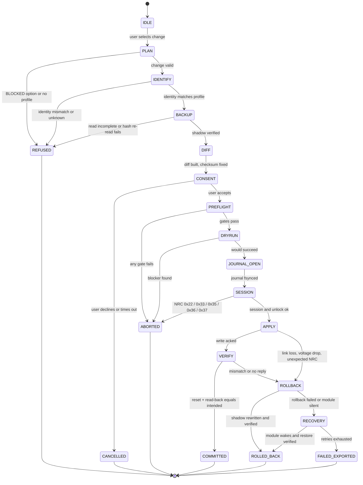

# OpenDiag Failsafe Coding Spec (Write Pipeline)

Status: normative draft v0.1. Applies to every write OpenDiag sends to a vehicle module, for BMW, Mercedes-Benz and Toyota/Lexus.
Words MUST, SHOULD and MAY follow RFC 2119. Numbers marked "(design choice)" are OpenDiag decisions, not OEM specs. Claims marked "(unverified)" were not confirmed from a public source.

Grounding: `docs/research/coding-security-failsafe.md` (primary), `protocols.md`, `hardware-adapters.md`, `bimmerlink-bimmercode-analysis.md`, `bmw-ista-architecture.md`, `mercedes-xentry-das.md`, `toyota-lexus-techstream.md`, `open-source-landscape-and-legal.md`, plus repo `SAFETY.md`.

## 1. Scope and goals

In scope: coding writes, meaning small configuration blocks written with UDS WriteDataByIdentifier (0x2E) or an equivalent block routine (coding-security-failsafe.md, section 3). Adaptations, service resets and similar routines use the same pipeline with their own profiles.

Out of scope for v1: flash programming (UDS 0x34/0x36/0x37). It is tier T3 in the research and is OFF. Section 12 lists what would have to exist before it is allowed.

Goals, in priority order:

1. Never leave a module worse than we found it, or say plainly before we start that we cannot promise that.
2. Never write anything the user has not seen as a diff.
3. Never write if we cannot prove what we are writing to.
4. Leave a record that a workshop or another tool can use to restore the car.

Non-goals: matching OEM unlock. OpenDiag ships no OEM seed-key algorithms or keys. Where an unlock is needed and not openly available the pipeline stops with a plain message (coding-security-failsafe.md, section 2; mercedes-xentry-das.md, "Do not bypass access control").

## 2. Definitions

| Term | Meaning |
|---|---|
| Module | One addressable ECU on one bus (CAN address, HSFZ address, or DoIP logical address). |
| Block | The bytes covered by one write unit: a DID value, or a named coding blob. |
| Profile | OpenDiag-authored, signed definition of a module family at a software range. Holds field map, checksum rule, limits, risk tiers, tested-on list. Never derived from OEM data files (open-source-landscape-and-legal.md, "Data packs"). |
| Change | A set of named field edits against one profile. |
| Transaction (txn) | One change applied to one module, from PLAN to a terminal state. |
| Shadow | Raw bytes of the block as read before the change, plus identity metadata and hash. |
| Journal | Append-only, fsynced log of every request and reply of a txn. |
| Simulator | The OpenDiag ECU simulator with fault injection (section 11). |

## 3. Architecture of the pipeline

One write path. No feature may call the adapter's write functions directly. The write engine is a single state machine (section 5) that owns the link while a txn is active.

```
UI/CLI -> Planner -> Gatekeeper -> Backup -> Differ -> Consent -> Preflight
       -> Applier -> Verifier -> (Committer | Rollbacker) -> Reporter
                 ^ Journal and Audit log written by every stage ^
```

Rules:

- A single txn at a time per vehicle. A second request is refused, not queued.
- The write engine runs in its own process or thread with a watchdog. If it dies mid-apply, the journal tells the next start what happened (section 6.7).
- The Applier is the only component allowed to emit 0x2E or 0x31 to a module. This is enforced by a code check in CI and by the adapter API (the `write` capability token exists only inside APPLY).

## 4. Risk tiers

Naming note: these four risk tiers (per coding option) are the finer-grained form of the capability tiers T0 to T4 in `architecture.md` section 8.2 and `coding-security-failsafe.md`. Mapping: T0 = read-only (no coding); GREEN and AMBER = T1; RED and anything with side effects across modules = T2; T3 = flash (out of v1); T4 and BLOCKED = refused. Adapter "Tier 1 to 3" in `hardware-adapters.md` is a separate scale (hardware quality).

Every coding option in a profile carries exactly one tier. The tier decides which gates and which consent text apply. Tiers come from the profile, not from the UI, and are signed with it.

| Tier | Meaning | Examples (illustrative) | Requirements beyond the base pipeline | Default |
|---|---|---|---|---|
| GREEN | Comfort or cosmetic, single module, no cross-module dependency, trivially revertible, tested on 3+ cars | Ambient light colour, tachometer redline, welcome light behaviour, mirror fold on lock (bimmerlink-bimmercode-analysis.md, option catalogue) | Base pipeline | Enabled |
| AMBER | Affects behaviour others rely on, needs a paired change in another module, depends on software level, or touches lighting or driver-assist behaviour | Daytime lamp mode, retrofit enable flags, auto start-stop default, camera or display options | Base plus: charger required, paired-change plan shown, 2-step consent, per-module opt-in | Disabled until user turns on "advanced options" |
| RED | Hard to revert, or a failure could disable a function the car needs to be driven or be road legal; module is gateway, body controller, cluster or head unit | Gateway routing, body controller power modes, regional lighting legality, anything requiring OEM online data | Base plus AMBER plus: expert switch, typed confirmation phrase, second full backup via independent read, ENET or DoIP adapter only, no 0x78 loops accepted, write count capped | Disabled in v1 for all profiles except those with a maintainer sign-off |
| BLOCKED | Never written by OpenDiag, whatever the user says | Section 8 | Not applicable | Always |

Tier assignment rules (normative):

1. A profile with no tested-on entry for the connected module and software level yields no tier. The module is read-only.
2. An option is GREEN only if its revert is a plain rewrite of the shadow. Options with a one-way component (counter, learned value, signed data) are at least AMBER, and RED if the one-way part cannot be undone by OpenDiag.
3. Any option that touches more than one module is at least AMBER.
4. Tier can be raised at runtime (for example by a low adapter score) but never lowered.
5. Mercedes SCN-class data and Toyota signed or key-related writes are BLOCKED by default because they need OEM online authorization we do not provide (mercedes-xentry-das.md; toyota-lexus-techstream.md, "Immobilizer, keys, reflash").

## 5. State machine

### 5.1 Diagram



### 5.2 State table

| State | Entry condition | Writes to car? | Exit |
|---|---|---|---|
| IDLE | No txn | No | PLAN |
| PLAN | Change object created, tiers resolved | No | IDENTIFY or REFUSED |
| IDENTIFY | Read identity (section 6.2) | No | BACKUP or REFUSED |
| BACKUP | Full block read, hashed, stored, re-read | No | DIFF or REFUSED |
| DIFF | Edit applied in memory, checksum recomputed | No | CONSENT |
| CONSENT | Diff on screen | No | PREFLIGHT or CANCELLED |
| PREFLIGHT | Voltage, ignition, link, gateway gates | No | DRYRUN or ABORTED |
| DRYRUN | Everything except the final 0x2E, against the real car where safe, always against the simulator | No (session control only) | JOURNAL_OPEN or ABORTED |
| JOURNAL_OPEN | Txn id, shadow ref and intended bytes fsynced | No | SESSION |
| SESSION | 0x10 03, TesterPresent on, 0x27 if needed | Session only | APPLY or ABORTED |
| APPLY | One 0x2E per block, no interleaved services | YES | VERIFY or ROLLBACK |
| VERIFY | 0x11 reset if profile says so, wait, re-read, compare | No | COMMITTED or ROLLBACK |
| ROLLBACK | Rewrite shadow, verify | YES | ROLLED_BACK or RECOVERY |
| RECOVERY | Low-rate wake probing | Only restore attempts | ROLLED_BACK or FAILED_EXPORTED |
| Terminal states | COMMITTED, ROLLED_BACK, FAILED_EXPORTED, ABORTED, REFUSED, CANCELLED | No | IDLE |

Invariants:

- I1: No transition into APPLY unless the journal contains `shadow_verified`, `consent`, `preflight_pass` records for this txn id.
- I2: Every state change is written to the journal before it takes effect.
- I3: Every non-COMMITTED terminal state that happened after APPLY started MUST write an export bundle (section 9).
- I4: ROLLBACK may only write bytes that match the shadow hash.

## 6. Pipeline stages in detail

### 6.1 Gatekeeper (PLAN)

- Reject any change containing a BLOCKED option (section 8) before any traffic is sent.
- Reject any option whose profile requires an unlock for which no key provider is configured. The message names what is missing, in plain words, and stops (coding-security-failsafe.md, section 2).
- Reject unqualified adapters for the tier: GREEN on adapter Tier 1 or 2, AMBER on Tier 1 or 2 with a passing link test, RED on ENET or DoIP only. Tier 3 clones are read-only (hardware-adapters.md, "Safety tiers").

### 6.2 Identity match (IDENTIFY)

The module MUST match the profile on all of the following. Any mismatch is a hard stop (REFUSED), not a warning (coding-security-failsafe.md, pattern 3).

| Check | Source on the wire | Notes |
|---|---|---|
| VIN | UDS `22 F1 90` returns `62 F1 90 <17 ASCII>` (protocols.md) | Must equal the VIN of the vehicle selected in the session, and the VIN read from the gateway or engine ECU |
| Module address | Bus address or DoIP logical address | Per-VIN scan result, not a static table (toyota-lexus-techstream.md, "What is hard") |
| Hardware and software identity | Standard identification DIDs where the module supports them (for example 0xF187, 0xF189, 0xF191, 0xF195 per ISO 14229 data identifier ranges, unverified here) plus the profile's own identity DIDs | Compare to profile software range |
| BMW only | I-level and SVK-style software list read via public UDS, not via ISTA files | I-level drift changes option availability (bimmerlink-bimmercode-analysis.md, "Software drift") |
| Module state | No fault that the profile marks as write-blocking | BimmerCode-style guards: modified head unit, low memory, corrupt boot area (bimmerlink-bimmercode-analysis.md, "Coding safety features") |
| Block length | Read length equals profile length | Length mismatch is the classic wrong-variant symptom (coding-security-failsafe.md, "What is hard", 3) |

If two reads of the identity within the session disagree (for example after a bus reset), the txn is REFUSED.

### 6.3 Full read backup with hash (BACKUP)

1. Read the whole block (every DID in the profile's `write_set`, plus any DID the checksum depends on).
2. Reject incomplete reads: positive reply required, correct length, no NRC 0x78 left unresolved.
3. Compute SHA-256 over a canonical encoding: `len || raw bytes` per DID, in profile order.
4. Store a shadow record in the local append-only store:

```
shadow/
  <vin>/<module>/<utc-timestamp>-<txn_id>.json
    schema_version, txn_id, tool_version, profile_id@version
    vin, module_addr, identity{hw, sw, ilevel}, adapter{type, fw, score}
    dids: [{did, len, hex}]
    sha256
    created_utc
```

5. Re-read the block from the car and compare with the stored shadow. Only then is the backup VALID. Failure of the re-read is REFUSED (a module that answers inconsistently must not be written to).
6. Shadow files are never overwritten or edited. The oldest shadow for a module is flagged `first_seen`. That is the equivalent of the "restore factory coding" entry other apps keep (bimmerlink-bimmercode-analysis.md, "Backups and recovery").
7. The store is outside the app sandbox where the platform allows it, and the user is prompted to export to a file at least once, because iOS backups vanish when the app is deleted (same source).

### 6.4 Diff preview (DIFF and CONSENT)

The diff has two views, both mandatory:

| View | Content |
|---|---|
| Named | Field name, old value, new value, tier badge, plain-language effect. Names come from the OpenDiag profile. |
| Raw | Offset-aligned hex of before and after, changed bytes highlighted, checksum bytes highlighted separately |

Rules:

- The checksum field is part of the data model. The Differ recomputes it per the profile rule. A profile without a verified checksum rule cannot write (coding-security-failsafe.md, section 4 "Design rule").
- Bytes changed that are NOT covered by a named field or the checksum are an error (an edit must not alter anything the profile does not understand). The txn is REFUSED with the offset list.
- The user confirms the diff itself. Confirming only a feature name is not accepted.
- The diff, intended bytes and their hash are written to the journal before CONSENT is shown, so the thing confirmed is the thing written (consent covers hash H, and APPLY re-checks that the bytes it sends hash to H).

### 6.5 Preconditions and preflight (PREFLIGHT)

All gates MUST pass at PREFLIGHT, and the voltage and link gates MUST be re-checked between every write request in APPLY.

| Gate | Requirement | Source of value |
|---|---|---|
| Battery voltage, GREEN | At or above 12.5 V engine off, stable (variation under 0.2 V over 10 s), measured by adapter (`AT RV` on ELM/STN, pin 16 reading) or vehicle DID if the profile has one | Design choice. Anchors: tuning guides use about 12 V minimum (coding-security-failsafe.md, section "What is hard", 1); a vendor article notes modules abort writes when voltage is too low; hardware-adapters.md suggests blocking below roughly 12.5 V |
| Battery voltage, AMBER and RED | At or above 13.0 V with a charger or maintainer connected, ripple under 0.2 V | Design choice. a BMW training document reportedly cites above 13 V (bmw-ista-architecture.md; unverified, source link removed) |
| Voltage unreadable | Refuse, unless the profile allows manual attestation (GREEN only, typed confirmation of "battery maintainer connected") | Design choice; hardware-adapters.md says refuse when unreadable |
| Charger | Recommended for GREEN, required for AMBER and RED. The tool cannot see a charger, it infers it from stable voltage at or above 13.0 V and asks the user to attest | Design choice |
| Engine state | Engine off, ignition ON (KL15), vehicle speed 0, transmission in park or neutral where readable (via standard PID 0x0D for speed on OBD-capable buses, protocols.md) | Interlocks cause NRC 0x22 (coding-security-failsafe.md, "What is hard", 5) |
| Charging or sleep events | No plug-in charging session, no timed pre-conditioning, no pending update on a hybrid or EV (unverified per vehicle). Profile may list DIDs to read | Per profile |
| Gateway | Authenticated if the profile says it is required. Otherwise the module is unreachable and the txn is REFUSED | coding-security-failsafe.md, section 5 |
| Link health | Adapter link score at or above threshold; no frame loss in the last 30 s; Bluetooth or Wi-Fi hop only for GREEN, ENET/DoIP for RED | hardware-adapters.md, adapter matrix |
| Adapter quality | Passing capability probe, not a suspected clone | hardware-adapters.md, "Clone detection" |
| Phone/tool environment | Flight mode or Bluetooth conflicts warned (car's own phone link), battery of the host above 30% or on power | bimmerlink-bimmercode-analysis.md, "Environment advice" |
| Time | Host clock sane (journal timestamps) | Design choice |
| Disk | At least 50 MB free for journal and bundle | Design choice |
| Single actor | No other diagnostic tool or telematics session detected on the bus (periodic 0x3E or unexpected 0x10 from another tester address, where visible) | Design choice, best effort |

### 6.6 Dry run (DRYRUN)

Dry run is mandatory before every real apply.

A. Simulator dry run (always). The intended write, the profile and the shadow are replayed against the OpenDiag simulator loaded with the shadow as the module state. This proves the parser, the checksum rule and the rollback path work with these exact bytes. It runs the full fault matrix of section 11 on the chosen block, in a few seconds.

B. Car dry run (when safe). Against the real car, execute every step except 0x2E:

- 0x10 03, TesterPresent running, 0x27 seed request and key via the key provider (if any). Exactly one key attempt. Any NRC 0x35, 0x36 or 0x37 aborts and never retries (coding-security-failsafe.md, pattern 12).
- Re-check voltage and ignition.
- Confirm no NRC 0x22 with a harmless read in the same session.

The result is "would succeed" or the first blocker, shown in plain words. A car dry run that already consumed an unlock attempt is not repeated in APPLY without a fresh seed (the unlock is re-requested, since seeds are single use).

### 6.7 Journaling and resumable apply

Journal format: newline-delimited JSON, one record per event, `fsync` after each record, hash-chained (each record carries the SHA-256 of the previous record) so a truncated or edited journal is detectable.

```
{"seq":1,"txn":"…","ev":"state","to":"JOURNAL_OPEN","t":"…","prev":"…"}
{"seq":7,"txn":"…","ev":"tx","bytes":"2E 40 10 …","t":"…"}
{"seq":8,"txn":"…","ev":"rx","bytes":"6E 40 10","t":"…","dt_ms":38}
```

Rules:

1. Write the `tx` record and fsync BEFORE the bytes leave for the adapter. Write the `rx` record on reply.
2. Record every NRC, including 0x78 pending-response loops with counts.
3. On start-up the app scans for txns that did not reach a terminal state. Each is an OPEN txn and the app blocks all new writes (to any module of that VIN) until the user resolves it.
4. Resume decision table, based on the last journal record:

| Last record | Meaning | Resume action |
|---|---|---|
| Before `JOURNAL_OPEN` complete | No write was possible | Discard, mark ABORTED |
| `tx` of the 0x2E with no `rx` | Unknown: write may or may not have landed | Read the block. If equals shadow, mark ABORTED. If equals intended, run VERIFY. If neither, ROLLBACK |
| `rx` positive, no VERIFY record | Written, unverified | Run VERIFY |
| ROLLBACK started, no ROLLBACK_VERIFIED | Restore unknown | Read the block and compare to shadow. Equal means ROLLED_BACK. Otherwise rewrite shadow, bounded retries |
| RECOVERY | Module was silent | Resume RECOVERY probing |

5. The resume path ALWAYS reads before it writes. It never "continues sending the rest of the script" blindly.
6. A resumed txn needs fresh preflight (voltage, ignition) and a fresh consent only if the next action is a write the user has not seen. Restoring the shadow does not need extra consent because the user already accepted the risk; it is announced, not asked.

### 6.8 Apply (APPLY)

- One 0x2E per block. No other service interleaved except TesterPresent (suppress-response form `3E 80`) at the profile's cadence (default every 2 s, protocols.md "Timing").
- The Applier waits for the full reply. NRC 0x78 means keep waiting up to the P2* limit announced in the 0x10 reply (for example `50 03 00 32 01 F4`, P2 50 ms and P2* 5000 ms in the protocols.md example). A timeout is treated as write-unknown and goes to VERIFY via read, never to a blind retry.
- Voltage and link are sampled between write requests. A drop under threshold aborts before the next write and goes to ROLLBACK if any block was already written.
- Multi-block changes write blocks in the profile order and record per-block acknowledgement. Rollback restores in reverse order.
- Block-write cap: a txn may send at most `profile.max_writes` write requests (default 4 for GREEN, 8 for AMBER, 2 for RED, design choice). Exceeding it aborts.
- Between blocks of an AMBER or RED change the engine re-reads the previously written block (cheap, catches modules that revert on neighbour writes).

### 6.9 Verify after write (VERIFY)

1. If the profile requires it, send ECU reset (`11 01` or the profile's reset sub-function) and wait for the module to answer again, up to `profile.boot_wait` (default 10 s GREEN, 30 s AMBER and RED, design choice). Many ECUs only apply new coding after reset (coding-security-failsafe.md, "What is hard", 4).
2. Re-enter a session, re-read the full block.
3. Compare byte for byte with the intended bytes. Ignore only bytes the profile lists as `volatile` (counters, timestamps) and report them.
4. If the ECU clamps or normalizes a value (positive acknowledgement, different stored bytes) the result is MISMATCH. It is not silently accepted.
5. Read DTCs on the module and on the gateway (`19 02 08`, protocols.md). New DTCs that did not exist in the pre-write snapshot are shown, and for AMBER and RED they trigger ROLLBACK unless the profile lists the DTC as expected after the change.
6. Only now is the journal committed: `COMMITTED` with the hash of the verified block.

### 6.10 Auto-rollback

Triggers: read-back mismatch, unexpected NRC during APPLY (anything other than the profile's expected set), module silent after reset beyond `boot_wait`, voltage or link loss mid-apply, new blocking DTC, user pressing Abort after APPLY started.

Procedure:

1. Stop. Do not send anything else to the module for 2 s (settle).
2. Wake the module with a harmless read. If it answers, continue. If not, go to RECOVERY.
3. Re-enter session. Rewrite the shadow bytes (I4: the bytes must hash to the stored shadow hash).
4. Reset if the profile requires it, re-read, compare to the shadow.
5. Success is ROLLED_BACK and is reported as "your car is back to how it was, nothing changed".
6. Retry cap: 2 rewrite attempts. Respect NRC 0x36 and 0x37 timing: after any 0x36 the engine stops all unlock attempts for the delay the module reports or 10 minutes, whichever is longer (the delay value is not standardised, coding-security-failsafe.md section 1).
7. A rollback that fails is not hidden. Go to RECOVERY.

Caveat stated in the UI: rollback restores the coding block. It does not undo effects the module applied outside the block (learned values, counters, or data pushed to other modules). Profiles must list `side_effects`. If a change has non-revertible side effects, the profile tier is at least AMBER and the consent text says so (coding-security-failsafe.md, "What is hard", 7).

### 6.11 Recovery mode (RECOVERY)

- Probing at a low fixed rate: one harmless read every 5 s for the first minute, every 30 s up to 10 minutes (design choice). The tool never floods a silent module.
- Guidance shown in order: turn ignition off and wait 60 s, then on; check adapter and cable; for known stuck states disconnect the 12 V battery for 15 minutes or more (bimmerlink-bimmercode-analysis.md reports this for a non-answering body controller; it is a vendor workaround, not a spec).
- On module recovery, finish the rollback and verify.
- If the module stays silent after the probing window, enter FAILED_EXPORTED. The export bundle (section 9) is written. The UI gives the exact restore steps with the saved files and tells the user to take the car to a workshop if the car is not safe to drive.

## 7. Abort conditions

Abort means stop at the next safe point. Before APPLY: state ABORTED, nothing written. During APPLY: finish or fail the current request, then ROLLBACK if anything was written.

| Condition | Where checked | Result |
|---|---|---|
| Voltage below gate or ripple above gate | Preflight, between every request | Abort, rollback if written |
| Ignition off, engine started, or speed above 0 | Between every request | Abort |
| NRC 0x22 (conditions not correct) | Any | Abort, report, no retry |
| NRC 0x33, 0x35 | Unlock | Abort, no retry |
| NRC 0x36 or 0x37 | Unlock | Abort, start lockout timer, no retry |
| NRC 0x31 or 0x72 on write | APPLY | Rollback if state unknown, abort otherwise (checksum or length bad) |
| NRC 0x92 or 0x93 (voltage too high or low reported by ECU) | APPLY | Abort, rollback (unverified wire values, standard code names only) |
| NRC 0x78 beyond P2* budget | APPLY | Treat as write-unknown, read then decide |
| Adapter disconnect, frame loss spike, BLE write error | Any | Abort, resume rules apply |
| Module identity changes (different SW after reset) | VERIFY | Rollback, flag module as modified |
| Host crash or app kill | Any | Journal resume on next start |
| User pressing Abort before APPLY | Any | CANCELLED |
| User pressing Abort during APPLY | APPLY | Finish current request, then rollback |
| Unknown bytes changed in diff | DIFF | Refuse |
| Journal write or fsync fails | Any | Abort before the next car write (disk full is a car-safety event) |
| Wall-clock timeout of whole txn (default 15 min GREEN, 30 min AMBER and RED, design choice) | Any | Abort |

## 8. Blocked-by-policy list

These are BLOCKED tier: the engine refuses at PLAN. They are also enforced in profile CI (a profile that declares a write DID inside a blocked class is rejected at review). The list extends `SAFETY.md` and follows the legal notes in open-source-landscape-and-legal.md.

| Class | What is blocked | Notes and basis |
|---|---|---|
| Airbag and restraint | Any write to the restraint control module (ACSM/SRS class), crash sensors, seatbelt pretensioner config, occupant detection, and any option that disables airbag fault reporting | Safety law (49 U.S.C. 30122) and SAFETY.md. Reads of DTCs stay allowed. |
| Brakes and steering | Writes to ABS/ESC/DSC, EPS/steering and brake-by-wire modules | coding-security-failsafe.md tier T4 |
| Immobilizer and keys | Key learning, key adaptation, immobilizer or EWS/CAS/FBS data, VIN-binding rewrites, smart-key reset, anything that bypasses anti-theft | SAFETY.md, UN R116 note in open-source-landscape-and-legal.md, Toyota reset pass-code flow (toyota-lexus-techstream.md) |
| Emissions defeat | Disabling or masking DPF, EGR, SCR/AdBlue, catalyst, O2 monitors; editing readiness monitors; clearing DTCs to hide a standing emissions fault; engine map writes | Clean Air Act 40 CFR 1068.101 (open-source-landscape-and-legal.md). Writing an ordinary code-clear after a repair is a separate read/clear feature, with confirmation, not part of the coding pipeline. |
| Odometer and mileage | Any write to mileage, service-interval-linked distance, or cluster/engine/gateway data that encodes distance travelled | Odometer-fraud laws (not researched in detail, unverified) |
| Gateway security | Disabling or editing diagnostic firewall behaviour, secure gateway bypass, authentication bypass | coding-security-failsafe.md section 5 |
| Authorization circumvention | Any step that relies on leaked seed-key algorithms, leaked keys, SCN emulation, remote-coding resellers, or OEM data files | SAFETY.md, mercedes-xentry-das.md |
| Flash programming | Any 0x34, 0x35, 0x36, 0x37 or erase routine | Off in v1 (section 12) |
| Speed limiter, ADAS calibration | Speed limiter removal, ADAS radar/camera calibration data | Safety and legal grey area, design choice to block until a legal review (unverified) |
| Unknown writes | Any DID or routine not defined in a signed profile | Prevents "raw write" backdoor |

There is no "expert unlock" for this table. Expert mode in OpenDiag exposes raw byte editing of NON-blocked, profile-covered blocks only (RED tier and an extra switch), never the blocked classes.

"Ignoring a fault" in OpenDiag remains a local display feature only, per `SAFETY.md`.

## 9. Audit log and export bundle

### 9.1 Audit log

A separate, user-visible log (distinct from the byte-level journal) with one entry per txn:

```
txn_id, utc_start, utc_end, tool_version, profile_id@version, profile_signature_ok
vin_hash (salted SHA-256 by default), module, sw_identity
tier, adapter{type, fw, score}, voltage{min, max, charger_attested}
changes[{field, old, new}], diff_hash, shadow_hash, readback_hash
consent{text_version, time, typed_phrase_if_red}
result: COMMITTED|ROLLED_BACK|FAILED_EXPORTED|ABORTED|REFUSED|CANCELLED
nrc_events[], dtc_before[], dtc_after[]
```

Privacy: the audit log stays on the device. VIN is stored in full in the shadow (needed for restore) and hashed in the export unless the user chooses to include it. Nothing is uploaded by default.

### 9.2 Export bundle

A single zip with a manifest, written automatically on every non-COMMITTED terminal state after APPLY started, and on request after any txn.

| File | Content |
|---|---|
| `manifest.json` | Versions, hashes of every file, txn id, result |
| `shadow/*.json` | The shadow(s) used |
| `journal.ndjson` | Hash-chained journal |
| `diff.txt` and `diff.json` | Human and machine readable diff |
| `report.md` | Plain-language story: what was tried, what happened, current module state, next steps |
| `restore.md` | Step-by-step restore using OpenDiag or manual hex write instructions a workshop can follow (service, session, DID, bytes) |
| `adapter.json` | Adapter capability profile and link stats |

The bundle never contains keys, key-provider output or seed/key pairs. Hash-chain lets a third party verify the journal was not edited.

## 10. User consent text

Consent is per txn. A saved "don't ask again" does not exist for writes. Text versions are numbered and stored in the audit log. Draft text (plain language, shown in full, not collapsed):

GREEN:

> You are about to change settings in your car's **{module}**.
> Changes: {named diff list}.
> Before anything is written, OpenDiag has saved a copy of the current settings (backup {id}, check code {short hash}). If something goes wrong, OpenDiag will put them back automatically and tell you.
> Keep the ignition on and the engine off. Do not touch the car or adapter while this runs. A battery charger is strongly recommended.
> OpenDiag is free software with no warranty. Writing to a car module can cause faults, and in rare cases a module may stop responding until a workshop fixes it. This may affect your warranty.
> [ ] I own this car or have the owner's permission. [Cancel] [Write changes]

AMBER adds:

> This change also affects {other modules/features}: {list}. Some effects cannot be undone by restoring the backup: {side_effects or "none known"}.
> A charger is required and has been detected as stable at {V} V. [ ] I have connected a battery charger.

RED adds:

> This is a high-risk change. Failure could leave a module not working and the car not drivable until it is repaired. Type **WRITE {module}** to continue.

Rules for the consent screen:

- Shows the diff on the same screen as the button.
- The primary button text is the action ("Write changes"), never "OK".
- Cannot be dismissed by timeout into acceptance. A 5-minute idle timeout cancels.
- Never says "safe" or "guaranteed". Says what backup exists and what rollback will do.
- Rollback text after a failure says what is true now: "Settings restored and checked" or "We could not confirm your settings were restored. Do not drive if warning lights are on. Export saved to {path}."
- Localisation must keep the same facts. Consent text changes bump the version.

## 11. Dry-run against a simulator and test matrix

### 11.1 Simulator requirements

The OpenDiag ECU simulator (built on a virtual CAN bus per open-source-landscape-and-legal.md, plus loopback DoIP and HSFZ servers) MUST:

- Model session control, TesterPresent timeout (S3), SecurityAccess with attempt counters and lockout, 0x2E with length and checksum validation, 0x11 reset with a boot delay, and 0x19 DTC store (protocols.md).
- Load module state from a shadow file (so the simulator mirrors the user's real bytes).
- Offer fault injection points: power cut at byte N of a write, NRC injection (0x22, 0x31, 0x33, 0x35, 0x36, 0x37, 0x72, 0x78 loops), silent module for T seconds, clamping or normalising a stored value, spontaneous revert after reset, duplicate or lost reply, adapter disconnect, voltage ramp, host kill at any journal seq.
- Be deterministic with a seed, so any failing case is replayable.
- Be strictly separate from any OEM data. It is driven by OpenDiag profiles only.

Reference open-source test targets: RAMN (ECU test bench) and UDSim (learns ECU behaviour from traffic) are named in coding-security-failsafe.md and protocols.md. Check licences before reuse. The iso14229 library CVE noted in coding-security-failsafe.md means the UDS parser MUST be fuzzed.

Real-car dry run is section 6.6 B. A real car is never a fault-injection target.

### 11.2 Test matrix

Every row runs in CI against the simulator (S) and the rows marked B also on a bench ECU before a profile is marked "verified". Pass criterion for write-path rows: the module ends equal to the shadow OR equal to the intended bytes, never in a third state, and the journal explains why.

| # | Scenario | Injected fault | Expected result | Env |
|---|---|---|---|---|
| T01 | Happy path GREEN | none | COMMITTED, read-back equals intended | S, B |
| T02 | Happy path AMBER with charger | none | COMMITTED | S, B |
| T03 | Blocked option requested | none | REFUSED at PLAN, zero bus traffic | S |
| T04 | No profile for software level | SW out of range | REFUSED, read-only | S |
| T05 | VIN mismatch between session and car | wrong VIN | REFUSED | S |
| T06 | Block length differs from profile | short read | REFUSED | S |
| T07 | Backup re-read differs | module flips a byte | REFUSED, no write | S |
| T08 | Unknown bytes changed in diff | profile bug | REFUSED with offsets | S |
| T09 | Checksum missing from profile | none | REFUSED | S |
| T10 | Voltage below gate at preflight | 11.9 V | ABORTED, no write | S |
| T11 | Voltage unreadable | adapter lacks `AT RV` | REFUSED (GREEN with attestation allowed) | S |
| T12 | Voltage drop between blocks | ramp to 11.8 V after block 1 | ROLLBACK, ROLLED_BACK | S |
| T13 | Engine running | RPM > 0 | ABORTED | S |
| T14 | NRC 0x22 on write | conditionsNotCorrect | ABORTED, no retry | S |
| T15 | NRC 0x35 on key | invalidKey | ABORTED, exactly one key attempt | S |
| T16 | NRC 0x36 then 0x37 | lockout | ABORTED, lockout timer, no auto-retry | S |
| T17 | NRC 0x31/0x72 on write | bad checksum | ROLLBACK or ABORTED per state, never loop | S |
| T18 | NRC 0x78 loop short | 3 pendings then OK | Waits, COMMITTED | S |
| T19 | NRC 0x78 beyond P2* | endless pending | Write-unknown, read, decide | S |
| T20 | Power cut mid-write | cut at byte N of 2E | Next start finds OPEN txn, reads, rolls back | S |
| T21 | Host killed after tx, before rx | kill at each journal seq (fuzz) | Resume matches table in 6.7 | S |
| T22 | Host killed during rollback | kill | Resume completes rollback | S |
| T23 | Module clamps value | stored differs from sent | MISMATCH, ROLLBACK | S |
| T24 | Module reverts after reset | spontaneous revert | VERIFY fails, ROLLBACK or ABORTED, reported | S |
| T25 | Module silent after reset | 40 s silence | RECOVERY, wake, rollback | S |
| T26 | Module silent forever | no wake | FAILED_EXPORTED, bundle written, restore.md present | S |
| T27 | Rollback write refused | NRC 0x22 on restore | Retry cap 2, RECOVERY, export | S |
| T28 | New DTC after write | injected DTC | AMBER/RED rollback; GREEN reports | S |
| T29 | Adapter disconnect mid-apply | drop link | Abort, resume on reconnect | S |
| T30 | Clone adapter | probe fails | Read-only, write refused | S |
| T31 | Journal disk full | fsync fails | Abort before next car write | S |
| T32 | Journal tampering | edit a record | Hash chain breaks, resume refuses, user warned | S |
| T33 | Consent hash mismatch | bytes differ from consented diff | APPLY refuses | S |
| T34 | Second txn while OPEN txn exists | none | Refused until resolved | S |
| T35 | Profile signature invalid | tamper | Profile not loaded | S |
| T36 | UDS parser fuzz | random 0x27/0x2E/0x7F frames | No crash, no OOB | S (fuzz) |
| T37 | HSFZ and DoIP transports | same as T01 and T20 | Same outcomes as CAN | S |
| T38 | Tester address variants (0xF1 and 0xF4 for HSFZ) | config | Works with configured value (hardware-adapters.md, open question) | S, B |
| T39 | Export bundle round trip | none | Restore from bundle alone restores simulator | S |
| T40 | Consent text version bump | none | Old text rejected, audit logs new version | S |

A change to the write path may not merge unless T01 to T40 pass. A profile moves from "community-reported" to "verified" only after its T01, T02, T20 and T25 cases pass on a bench module of that family (T-series B column) and the tested-on list names the car.

## 12. What is deliberately not in v1

- Flash programming. Before it is allowed: bench power supply integration, no-abort window handling after erase, signed-image handling, anti-rollback awareness, and a recovery plan per module family (coding-security-failsafe.md, patterns 9 and "What is hard", 2 and 7).
- OEM online authorization (Mercedes SCN-style, Toyota signed calibrations, Stellantis-type secure gateway services). Without an official route, OpenDiag shows the plain message and stops (mercedes-xentry-das.md).
- Unlock key providers shipped in the repo. The interface exists. The implementations are user supplied.

## 13. Open questions

1. Per module family, where is the checksum and who computes it, the module or the tool? Needs bench verification (coding-security-failsafe.md, open question 3). Until then the profile CI forbids writes for that family.
2. Voltage thresholds above are design choices. Measure real voltage sag during coding on bench and car, and sampling rate per adapter, then tighten.
3. Can adapters measure voltage fast enough to catch a sag between two writes? If not, the gate is advisory and the consent text must say so.
4. Which profile fields can be learned legitimately from users' own cars by diffing, without OEM files (open-source-landscape-and-legal.md, legal review item)?
5. How should a module with signed or anti-rollback configuration be marked? A `revertable: false` profile flag forces RED or BLOCKED, but the right rule needs examples.
6. Should RED exist at all in v1 or stay a schema reservation only? The recommendation is reservation only until maintainers sign off a first profile.
7. Is a detected "other tester on the bus" gate reliable enough to ship, or is it noise?
8. Legal text for consent: needs a lawyer review per region (right-to-repair, warranty statements).

## Sources

Repository documents (primary grounding):

- docs/research/coding-security-failsafe.md
- docs/research/protocols.md
- docs/research/hardware-adapters.md
- docs/research/bimmerlink-bimmercode-analysis.md
- docs/research/bmw-ista-architecture.md
- docs/research/mercedes-xentry-das.md
- docs/research/toyota-lexus-techstream.md
- docs/research/open-source-landscape-and-legal.md
- SAFETY.md

External sources, as cited inside those documents (not re-fetched in this pass):

- UDS services and NRCs: https://en.wikipedia.org/wiki/Unified_Diagnostic_Services
- UDS session management and security access: https://pyudskit.readthedocs.io/en/latest/services/session-management/ and https://pyudskit.readthedocs.io/en/latest/concepts/security-access/
- UDS knowledge base (attempt limiting): https://uds.readthedocs.io/en/v0.0.2/pages/knowledge_base.html
- Programming voltage: https://www.vehicleservicepros.com/training-and-resources/guest-blogs/blog/55375852/clore-automotive-the-great-programming-uh-oh-when-voltage-drops-below-the-line
- BimmerCode safety guards: https://bimmercode.app/faq/ and https://bimmercode.app/manual
- Failed restore example: https://www.supramkv.com/threads/2023-supra-mt-bimmercode-recovery-failing.18674/
- Linux can327 clone limits: https://docs.kernel.org/networking/device_drivers/can/can327.html
- RAMN test bench: https://ramn.readthedocs.io/en/latest/userguide/diag_tutorial.html
- UDSim: https://github.com/zombieCraig/UDSim
- iso14229 CVE note: https://fieldguide.lutrasecurity.com/CVE-2026-54413/
- UNECE R156 summary: https://www.ul.com/sis/insights/software-update-management-systems-according-unece-r156
- Standard identification DIDs (0xF187, 0xF189, 0xF191, 0xF195): from ISO 14229 general knowledge (unverified in this pass; confirm against a public reference before profile CI uses them).
