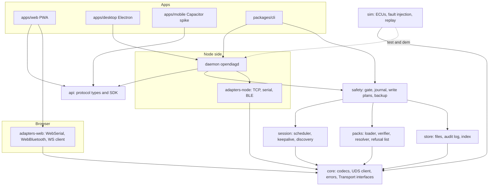
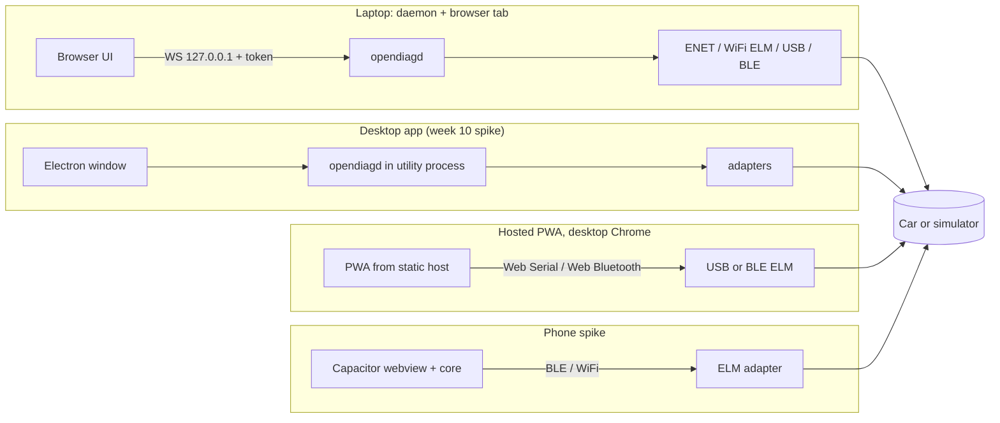
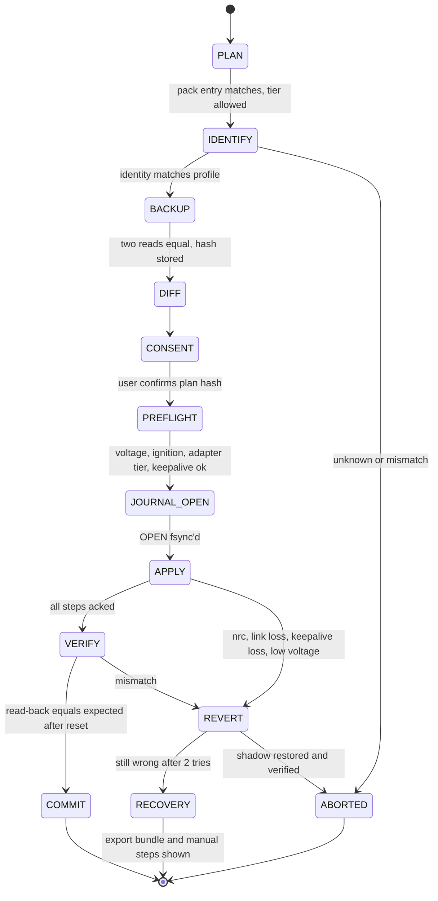
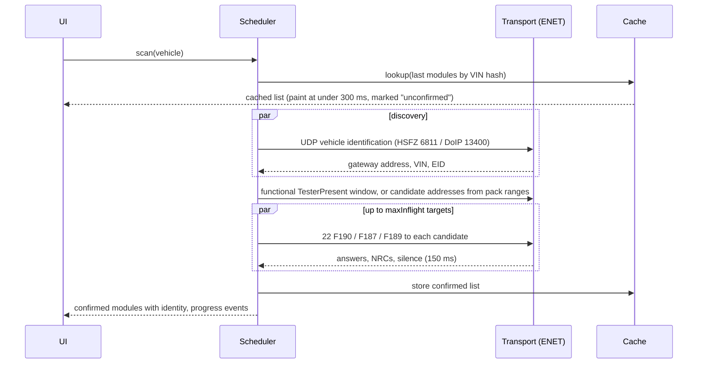

# OpenDiag: 12-week architecture and build plan

Status: plan v0.1, written 2026-11-19, before further code. Covers weeks 1 to 12, Mon 2026-11-23 to Fri 2027-02-12 (calendar is an estimate; capacity assumption: one human part-time at about 15 h/week plus Claude doing the bulk of implementation).

Clean-room rule (unchanged): public standards, public docs, owner captures, open-source projects only. No leaked OEM software or data. Claims marked "(unverified)" were not confirmed from a fetched source in this pass. OSS facts marked "verified" were read from the GitHub API or npm registry on 2026-11-19/20.

Relationship to existing docs: `docs/design/architecture.md` stays the layer and safety model (its sections 3, 7, 8, 9 are kept). Its section 4 (Rust core, Tauri) is superseded by ADR-001 and ADR-004 below. `docs/design/roadmap.md` stays the phase list; section 8 here maps phases to calendar weeks.

## 1. Where the code is today (baseline, read 2026-11-19)

1,794 lines of TypeScript in `packages/core/src` and `packages/cli/src`. Node 26.5 on this machine (repo requires `>=22.18`, CI uses 24), type stripping, no build step, `erasableSyntaxOnly`. `node --test` reports 27 passing tests. Uncommitted work in progress exists (`backup.ts`, `diff.ts`, `pack.ts`, `demo.ts`, a `client.ts` edit); this plan treats it as the starting point for weeks 1 and 5.

| Area | What exists | Gap this plan closes |
|---|---|---|
| Transport seam | `DiagTransport { name, open, close, request(target, data, timeoutMs) }` in `transport.ts`. Three impls: `Elm327Transport` (serialises through a promise chain), `HsfzTransport`, `DoipTransport` (both call `inbox.clear()` per request, so one request at a time, unsolicited frames dropped), `SimTransport`. | No capabilities, no concurrency, no cancellation, no event stream, no voltage, no broadcast or discovery. |
| Session | `DiagClient` is stateless. `testerPresent()` exists as a builder only. `scanUds` probes addresses one by one at 300 ms each (worst case 256 x 0.3 = 77 s). | No session state, no keepalive, no scheduler, no parallel scan. |
| Write safety | `readOnly(t)` wrapper allows SIDs 01 02 03 07 09 0A 19 22 3E and `10 01`; `WriteBlockedError`. `DiagClient` has `clearUdsDtcs` but no write API. | No gate, no token, no journal, no write plan, no revert. |
| Backups | `createBackup` reads identity DIDs, reads each block twice, hashes canonical bytes (SHA-256), `Backup` schema v1. `diffBackups`, `suggestField`. | No store, no restore, no bundle, no audit log, no signing. |
| Packs | `pack.ts`: JSON-only `Pack` v1 with coding options, CRC16 and sum8 checksums, `parsePack`. | No signature check, no provenance enforcement, no DTC or live-data entries, no resolver. |
| Errors | Ad hoc classes (`NegativeResponse`, `TimeoutError`, `BackupError`, `PackError`, `WriteBlockedError`), each `extends Error`. | No stable codes, no retry or severity semantics. |
| Sim | `SimEcu`/`SimVehicle`, `SimTransport`, HSFZ and DoIP loopback servers, `SimElm` text stream. | No fault injection, no latency model, no trace record or replay, no write handlers (0x2E, 0x10, 0x11, 0x27, 0x31). |
| CI | typecheck, test, link check, secret grep. | No licence scan, coverage, fuzz, bench, release. |
| Hazard | `index.ts` and `sim.ts` import `demo.ts`; tree was mid-edit while this was read. Run `pnpm typecheck && pnpm test` before week 1 starts. | |

## 2. Resource inventory

### 2.1 People and time

| Role | Who | Notes |
|---|---|---|
| Maintainer, product owner, car owner | The owner | Needs: access to at least one BMW (F/G series preferred), ideally a Toyota hybrid. Unknown today: which cars exist. Ask in week 1. |
| Implementation | Claude, in sessions | Parallelisable by package. Needs written interfaces (section 5) to avoid drift. |
| Safety reviewer for write path | Not yet identified | Must be a human who is not the author. Needed by week 8 (gate G-D). Candidates: an embedded or automotive contact, a forum volunteer. |
| Legal counsel | Not yet engaged | Launch blocker per roadmap (DMCA 1201, emissions, trademark). One scoping consult before week 12; cost (estimate) a few hundred to a few thousand USD, unverified. |

### 2.2 Hardware to buy or confirm (prices are estimates, not fetched)

| Item | Why | Est. price | Needed by |
|---|---|---|---|
| BMW ENET cable (OBD to RJ45) | HSFZ and DoIP real captures, fastest path | 15 to 30 USD | Wk 3 (capture), Wk 11 |
| OBDLink MX+ or CX (STN) | Tier 1 BLE/WiFi adapter, voltage readout | 100 to 130 USD | Wk 3 |
| Vgate vLinker FS or MC (ELM-compatible) | Tier 2, comparison | 30 to 50 USD | Wk 3 |
| Generic ELM327 clone | Tier 3 negative tests only | 10 USD | Wk 3 |
| K+DCAN cable | E-series, later | 20 to 30 USD | Out of 12-week scope |
| Bench ECU or donor module with 12 V supply | Fault-injection reality check, write validation | 50 to 200 USD used (estimate) | Wk 8 for decision, Wk 11 |
| Bench power supply (12 V, 5 A+) or AGM maintainer | Battery-safe tests, voltage gate tests | 40 to 80 USD | Wk 8 |
| iPhone + Android phone (any recent) | BLE and WiFi spike | owned? ask | Wk 10 |
| Linux box or VM with `vcan` | Kernel ISO-TP cross-check | 0 (VM) | Wk 11 stretch |

Rust is not installed on the dev machine; ADR-001 removes it from the critical path.

### 2.3 Accounts and services (free-first)

| Service | Use | Cost | Constraint |
|---|---|---|---|
| GitHub (public repos `opendiag`, `opendiag-packs`) | Code, CI, Releases, Discussions | free | Standard runners free on public repos. Limits from `roadmap.md` fetched Nov 2026, recheck. |
| Cloudflare Pages + Workers (domain `endyland.com` already held) | Landing page, hosted PWA, pack index | free tier | Workers free: 100k requests/day, 10 ms CPU (roadmap.md, fetched Nov 2026). New public subdomain needs owner approval and a DNS record note (dev-box rule). |
| Supabase free | Deferred. Not needed in 12 weeks. | free | Pauses after a week idle. Git stays source of truth. |
| Apple Developer Program | iOS TestFlight, macOS notarisation | 99 USD/yr (Apple published price, not re-fetched) | Needed only if mobile or signed desktop ships; decision at week 10. |
| Google Play developer | Android store | 25 USD one time (not re-fetched) | Optional; sideload APK first. |
| Windows code signing | Avoid SmartScreen warnings | 100 to 400 USD/yr (estimate) | Defer; ship checksums and signed provenance first. |
| Pack signing keys | Ed25519 root and release keys | 0 | Create only with owner approval, register in `~/.claude/CREDENTIALS.md`, store in Keychain (dev-box rule). |
| Self-hosted CI runner on the Mac | HIL tests | 0 | See ADR-009 and threat T9. |

### 2.4 Open source to build on (verified 2026-11-19/20)

"Use mode": **depend** = import it; **tool** = run as external dev/test tool, never bundled; **reference** = read public docs for behaviour only, no code copied; **data** = importer with licence handling; **avoid** = not usable in an Apache-2.0 core.

| Project | Licence | Last push / release | Use mode | How it extends our work |
|---|---|---|---|---|
| commaai/opendbc | MIT | 2026-11-19, 3.5k stars | data + reference | CAN signal DBC database for 300+ models (count unverified). Use for Toyota CAN signal naming ideas and as test signal source. Not UDS DIDs. |
| commaai/panda | MIT | 2026-11-19 | reference | Open CAN/J2534-ish hardware and firmware; reference for safe CAN output gating ("safety model"). |
| pylessard/python-udsoncan | MIT | 2026-10-26 | tool | Reference UDS client; run it against our simulator in CI as a cross-implementation check (second opinion on byte formats). |
| pylessard/python-can-isotp | MIT | 2026-11-10 | tool | Cross-check ISO-TP framing and flow-control edge cases against `isotp.ts` golden vectors. |
| mercedes-benz/odxtools | MIT | 2026-11-17 | tool | Parse user-supplied ODX/PDX locally; cross-check our pack importer. Never ship OEM ODX. |
| driftregion/iso14229 | MIT | 2026-09-29, 380 stars | tool | C UDS server/client with a test harness; use its server as an independent ECU emulator for client tests. |
| driftregion/isotp-c | MIT | 2026-09-27, 1 star | reference | Tiny ISO-TP state machine, low community signal. |
| eclipse-opensovd/opensovd and classic-diagnostic-adapter | Apache-2.0 | 2026-11-19 (49 and 31 stars) | reference | Eclipse SDV effort for Service-Oriented Vehicle Diagnostics; the CDA is Rust. Watch for a REST diagnostic API shape worth aligning our daemon API with (ADR-003). Early and small, so no dependency. |
| uholeschak/ediabaslib | GPL-3.0 | 2026-11-19, 964 stars | avoid (reference docs only) | Active BMW tooling; copying or linking would force GPL on the core. Behavioural reference from public docs only. |
| Ircama/ELM327-emulator | LICENSE file is CC BY-NC-SA 4.0 (GitHub shows NOASSERTION; see oss-leverage.md row 26) | 2026-09-17 | avoid | NonCommercial. Do not vendor, bundle, or run in CI we redistribute. Our own `sim.ts` stays. |
| OBDb organisation (per-vehicle signalset repos, e.g. OBDb/Toyota-bZ4X) | CC-BY-SA-4.0 | pushed 2026-11-20 | data (separate pack) | Crowd-sourced OBD signal definitions including many Toyota models. ShareAlike means an importer must produce a separate CC-BY-SA pack, never merged into our CC-BY packs or code. Needs counsel check before shipping. |
| tauri-apps/tauri | Apache-2.0 / MIT | 2026-11-19, 113k stars | deferred | Strong desktop shell but needs Rust toolchain; see ADR-004. |
| electron/electron | MIT | 45.4.1 (npm, 2026-11-19) | depend (desktop shell, week 10 spike) | Runs the TypeScript core unchanged. |
| @capacitor/core 8.6.2, @capacitor-community/bluetooth-le 8.4.0 | MIT | 2026-11-12 / 2026-11-18 | depend (mobile spike) | Web-view app with native BLE. |
| capacitor-tcp-socket 8.0.0 | MIT | npm modified 2026-11-01; repo not checked | evaluate | Needed for WiFi ELM and ENET from a phone. Verify before relying. |
| react-native-ble-plx 3.5.1 | MIT | 2026-02-18 | alternative | Only if Capacitor spike fails. |
| serialport 13.0.0 | MIT | 2024-12 release, npm touched 2025-10 | depend (node adapters) | USB ELM and STN. Slow release cadence, acceptable. |
| @stoprocent/noble 2.8.0 | MIT | 2026-08 release | depend (node BLE) | Maintained noble fork. `@abandonware/noble` last published 2025-02, so avoid it. |
| socketcan (npm) 4.3.2 | MIT | 2026-10-03 | optional, Linux only | vcan integration test helper. |
| ws 8.23.0, hono 4.13.19 | MIT | 2026-11 | depend (daemon) | WebSocket and HTTP. `node:http` alone is also fine. |
| @noble/ed25519 3.2.0, @noble/curves 2.4.0 | MIT | 2026-08-27 | depend | Pack and release signature verification, runs in browser and Node. |
| tuf-js 6.0.3, @sigstore/verify 4.1.3 | MIT / Apache-2.0 | 2026-11 | later | Full TUF or Sigstore verification if our simpler scheme (ADR-006) proves too weak. |
| zod 4.6.7, yaml 2.9.1 | MIT / ISC | 2026-10 / 2026-09 | depend | Pack and API schema validation, YAML authoring. |
| fast-check 4.10.3 | MIT | 2026-11-18 | depend (dev) | Property tests for codecs and the write state machine. |
| @jazzer.js/core 4.0.0 | Apache-2.0 | 2026-04-15 | depend (dev) | Coverage-guided fuzzing of decoders in Node. |
| better-sqlite3 13.2.0 / @sqlite.org/sqlite-wasm 3.54.1 | MIT / Apache-2.0 | 2026-11 / 2026-10 | depend | Rebuildable index store (ADR-007). Built-in `node:sqlite` is the first choice if stable in Node 24 (unverified). |

Not re-verified this pass (GitHub API rate limit hit after about 25 calls): can-utils, python-doipclient, Scapy HSFZ contrib, UDSim, RAMN, SavvyCAN. Their licences and cadence are in `docs/research/open-source-landscape-and-legal.md`; recheck before use.

Reuse conclusion: no open-source project gives us a ready BMW/Toyota/Mercedes diagnostic app under a compatible licence. What we reuse is (a) standards-compliant reference implementations as independent test oracles, (b) JS/TS libraries for BLE, serial, crypto, schema, UI shells, (c) community signal data under compatible licences through importers. The product (session engine, safety gate, packs, UX) is ours.

## 3. Decisions (ADRs)

Format: context, decision, consequences. Each is binding for the 12 weeks and revisited only at the trigger named.

### ADR-001: TypeScript core now, Rust only behind a measured trigger

Context. `docs/design/architecture.md` chose a Rust core compiled to native and WASM. Reality since: 1,794 lines of working TypeScript exist, 27 tests pass, Rust is not installed, owner is solo, and the roadmap's first bottleneck is cars and captures, not CPU. In the three transports we have in 12 weeks (ELM, HSFZ/ENET, DoIP), segmentation and ISO-TP timing are done by the adapter or the gateway, not by the host. Host-side ISO-TP timing (STmin, FC wait) only matters for SocketCAN, J2534 and slcan, which are out of this window. Node 24 can run `.ts` directly; browsers, Capacitor and Electron all run the same code.

Decision. Core, session, safety and packs are TypeScript (strict, `erasableSyntaxOnly`, no enums, no parameter properties). The Rust core is deferred, not cancelled. We keep the option cheap by:
1. Pure seams: codecs and state machines take `Uint8Array` in and out, no I/O, no `node:` imports (enforced by the boundary check in ADR-002).
2. Golden vectors and fuzz corpora live in `packages/*/test/vectors/` as language-neutral JSON, so a Rust port must pass the same files.
3. A written revisit trigger: start a Rust spike only if any of (a) raw-CAN backends (SocketCAN, J2534, slcan) become a priority and flow-control jitter in Node exceeds the ECU's N_Cr/STmin tolerance in measurement, (b) an iOS native BLE path needs a shared core that Capacitor cannot give, (c) we want sandboxed third-party WASM plugins, (d) a measured CPU bottleneck. The tier-0 target hardware (WiFi/BLE ELM and ENET) hits none of these.

Consequences.
- Positive: ships sooner, larger contributor pool, one runtime for CLI, daemon, web, desktop and mobile, no toolchain install.
- Negative: no memory-safety guarantee beyond managed runtime, so fuzzing and bounds-checked readers (`at()` already throws on out-of-range) are mandatory. Timing under GC is looser. Publishing needs a compile step because Node refuses to strip types inside `node_modules` (documented behaviour, verified from Node docs memory, treat as unverified until tested): add `tsc --rewriteRelativeImportExtensions` emit at release time only.
- Edit required: add a banner to `docs/design/architecture.md` section 4 pointing to this ADR (week 1 task).

### ADR-002: Monorepo and package layout

Context. `packages/core` mixes pure codecs (`isotp.ts`, `uds.ts`, `obd.ts`, `dtc.ts`, `hsfz.ts`, `doip.ts`), Node I/O (`net.ts` imports `node:net`), the simulator, packs and backups. Browser and mobile builds cannot import `node:net`.

Decision. pnpm workspace (already in use). Split by dependency direction, one-way only:

| Package | Contents | May import | Runs in |
|---|---|---|---|
| `@opendiag/core` | util, errors, isotp, uds, obd, dtc, hsfz, doip codecs, `Transport` interfaces, `DiagClient` | nothing | any |
| `@opendiag/session` | Scheduler, Session, keepalive, discovery logic, ELM tuning profiles | core | any |
| `@opendiag/packs` | schema, loader, verifier, resolver, provenance lint, refusal list data | core | any |
| `@opendiag/safety` | WritePlan, Journal, Gate, WriteToken, GuardedTransport, backup logic, diff | core, session, packs | any |
| `@opendiag/store` | `Store` interface plus file and memory impls; audit log | core | node, browser (IndexedDB impl later) |
| `@opendiag/sim` | SimEcu/Vehicle, fault injection, trace replay, loopback servers | core, packs | node (servers), any (in-memory) |
| `@opendiag/adapters-node` | TCP (ENET, DoIP, WiFi ELM), serial, BLE (noble), later SocketCAN | core | node/electron |
| `@opendiag/adapters-web` | WebSerial, WebBluetooth, WebSocket-to-daemon transports | core | browser |
| `@opendiag/api` | daemon protocol types (zod), client SDK | core | any |
| `@opendiag/daemon` | `opendiagd`: HTTP and WS server, auth, rate limit | all node-side | node |
| `@opendiag/cli` | thin client of core+daemon | | node |
| `apps/web` | PWA (React + Vite, versions pinned at week 4, not checked here) | api, adapters-web | browser |
| `apps/desktop` | Electron shell around daemon + web | | desktop |
| `apps/mobile` | Capacitor shell, spike only in 12 weeks | | iOS/Android |
| repo `opendiag-packs` (separate) | data packs, CC-BY, own CI and signing | | |

Enforcement: a 40-line script `scripts/check-boundaries.ts` run in CI parses import specifiers and fails on (a) any `node:` import outside node-only packages, (b) any upward or cyclic dependency, (c) any import of `@opendiag/safety` internals from outside the package (ADR-010). No dependency needed.

Migration: existing files move with `git mv`, `packages/core` keeps its name and its `index.ts` re-exports so the CLI and tests keep working through weeks 1 and 2. `net.ts`, `elm327.ts` stream glue and `sim-net.ts` move first.

Consequences. More package boundaries to maintain for one person; mitigated by one `tsconfig` project with path aliases and a single `pnpm test`.

### ADR-003: How a browser or PWA reaches TCP and serial adapters

Context. Web pages cannot open TCP sockets. WiFi ELM (port 35000 is common; the default IP is unconfirmed, evidence shows 192.168.4.1 port 23 on an ESP8266-style dongle and 192.168.100.1 on a BMW ENET router adapter; 2026-11-20), HSFZ (6801), DoIP (13400) are TCP/UDP. Web Serial is Chromium desktop only and needs a secure context and a user gesture (MDN, fetched). Web Bluetooth is absent in Safari on iOS (W3C list note cited in architecture.md). Chrome's restrictions on public pages calling `127.0.0.1` (Private/Local Network Access prompts) are version-dependent (unverified).

Decision. Three tiers, in order of preference:
1. **Local daemon (`opendiagd`) is the primary path.** It binds `127.0.0.1` only, serves the web UI itself (same origin, so no CORS, no Local Network Access prompts), and exposes JSON over WebSocket plus a small HTTP API. All adapter types work: TCP, serial, BLE. `npx opendiag serve` from week 4; bundled in the desktop app from week 10.
2. **Direct browser transports (no daemon)** for hosted PWA use on desktop Chrome/Edge: Web Serial for USB ELM/STN, Web Bluetooth for BLE ELM. Read-only and learn-mode only until week 12; writes through a browser tab are not enabled in this window.
3. **Hosted PWA to local daemon** (`https://app.<domain>` talking to `ws://127.0.0.1:PORT`) is optional and last, behind a pairing code, because of mixed-content and Local Network Access behaviour that must be tested per browser.

Daemon API: JSON-RPC 2.0 over one WebSocket per client, plus `GET /healthz`. Methods mirror the Session interface (section 5.2). Events: `link.state`, `scan.progress`, `session.lost`, `txn.state`. Align naming with the Eclipse OpenSOVD REST API only where it costs nothing (project is early).

Consequences. The UI never sends raw frames; it calls typed methods and the daemon enforces the gate (ADR-010). A daemon is a local attack surface, handled in section 7 (T1, T2).

### ADR-004: Desktop shell

Context. Options: Tauri 2 (Apache/MIT, 113k stars, needs Rust toolchain, small bundles, uses system webview; the Tauri docs fetched do not state mobile maturity), Electron (MIT, bundles Node so the TypeScript core and `serialport`, `noble` run unchanged, large download), or no shell, just the daemon plus a browser tab.

Decision. Weeks 1 to 9: no shell. The daemon plus browser tab is the desktop product (`npx opendiag serve`, later a single downloadable binary via Node SEA, unverified for Node 24). Week 10: Electron spike wrapping the daemon in a utility process. Tauri is not chosen because it would force a Node sidecar or a core rewrite, and Rust is not installed.

Consequences. Early users need Node installed, which is acceptable for contributors but not for the public; the week 10 spike decides whether the Electron beta is built in weeks 11 and 12. Electron's patch cadence forces a monthly rebuild; accepted. Revisit Tauri if ADR-001's Rust trigger fires.

### ADR-005: Mobile strategy

Context (from `hardware-adapters.md` and Apple docs). iOS: no Classic Bluetooth SPP without MFi, so BLE or WiFi adapters only; WiFi/LAN access triggers the Local Network permission prompt and needs `NSLocalNetworkUsageDescription` (Apple documentation, fetched, content from the page title only so treat details as unverified). Android: BLE (default MTU 23, request larger), WiFi, Classic BT SPP, USB host. iOS app backups disappear when the app is deleted.

Decision. 12-week scope: a read-only spike, not a release. Capacitor 8 app hosting the same web UI, BLE through `@capacitor-community/bluetooth-le`, TCP through `capacitor-tcp-socket` after verification, running the core in the web view. Success test (week 10): connect to an ELM BLE adapter on one iPhone and one Android phone, read VIN and DTCs from the simulator-backed ELM bridge and from a real car if available, with scan under 5 s. No writes on mobile in this window. A UniFFI/native shell is not planned (it depended on Rust).

Consequences. If the spike fails on iOS BLE throughput, fall back to "iOS via WiFi adapters or the desktop daemon" and ship Android first. Platform store accounts only after the spike passes (ADR-004 cost table).

### ADR-006: Plugin and data-pack loading and signing

Context. `docs/design/data-schema.md` defines YAML packs compiled to signed JSON, Ed25519 detached signature. Current `pack.ts` parses JSON with no verification. Code plugins are the biggest risk (a plugin that writes can brick).

Decision.
- **No third-party code plugins in this window.** Extensions are data only. Procedures use the step language (week 9) with declared DIDs and no loops beyond bounded retries.
- **Pack file**: a `.odpack` zip containing `manifest.json` (id, version, schema, licence, min_app, file list with SHA-256, `created`, `expires`), `entries/*.json`, `PROVENANCE.md`, and `manifest.sig` (Ed25519 over the canonical JSON of the manifest, via `@noble/ed25519`). Verification lives in `@opendiag/packs` and is the only way to obtain a `LoadedPack`; there is no `parseUnsigned` outside `sim` and test code (simulator packs carry `simulator_only: true`, existing field).
- **Keys**: one offline root key and one release key (rotate every 90 days, estimate). Clients embed the root public key and accept release keys listed in a root-signed `trust.json` with validity windows and a revocation list. This is TUF-lite; if it grows, move to `tuf-js`. Key creation, storage in Keychain and registry rows require owner approval per dev-box rules.
- **Rollback and freeze**: manifest `version` is monotonic per pack id, `expires` is checked, last seen version stored locally.
- **Policy enforcement in the loader**: entries must carry provenance (`source_type`, contributor attestation id), licence, risk tier, "verified on" list; entries on the refusal list are rejected at load (not just in CI).
- **Unknown or unmatched identity means read-only** (existing rule, enforced in the resolver, ADR-010).

Consequences. A compromised release key can ship a bad pack; mitigations are the diff preview, software-level keying, tiers, and revocation. Pack signing happens in CI from a protected environment, not on the dev Mac.

### ADR-007: Storage of backups, journals and caches

Context. Backups contain the VIN (personal data). Users must be able to move them off a device (iOS loses app data on delete). The failsafe spec needs fsync'd append-only journals.

Decision.
- **Source of truth is files**: `<data dir>/backups/<vin-hash>/<txn_id>.backup.json` (existing `Backup` schema v1), `journals/<txn_id>.jsonl`, `audit/<yyyy-mm>.jsonl`, `traces/*.odtrace`. Content-addressed by SHA-256 in the filename of blobs, human readable, open format.
- **SQLite is a rebuildable index only** (search, UI lists, scan cache). Delete it and nothing is lost. Use built-in `node:sqlite` if stable on Node 24 (unverified) else `better-sqlite3`; `@sqlite.org/sqlite-wasm` in the browser.
- **Platform dirs**: macOS `~/Library/Application Support/OpenDiag`, Linux `$XDG_DATA_HOME/opendiag`, Windows `%APPDATA%\OpenDiag`; files mode 600 where the OS supports it.
- **Sync is the user's choice**: point the data dir or the export folder at iCloud Drive, Syncthing or similar. OpenDiag runs no cloud in this window. Export bundle (`.odbundle` zip: raw blocks, hashes, journal, human report, tool version) from week 5.
- **Optional encryption at rest** (WebCrypto AES-GCM, key from passphrase via scrypt) is week 11 stretch; default off, VIN also hashed in directory names.

Consequences. Two code paths for mobile and browser (filesystem vs IndexedDB/OPFS) behind the `Store` interface; only the file store is needed for the CLI and daemon in 12 weeks.

### ADR-008: Logging, audit and error model

Decision.
- **Three streams**: (1) `log` (debug, rotating, may contain frame hex, redacts VIN to last 4), (2) `audit` (append-only JSONL, one line per user-visible decision and every write, hash-chained: each line stores `prev` = SHA-256 of the previous line, so truncation or edits are detectable), (3) `trace` (`.odtrace` JSONL of `{t, dir, target, hex}`, usable for bug reports and for simulator replay). Correlation ids: `session_id`, `txn_id`, `req_id`.
- **Error model**: one base class `OdError extends Error` with `code` (stable string, e.g. `NRC_0x33`, `LINK_LOST`), `kind` (`transient | permanent | safety | user | bug`), `retryable` boolean, `context` object. Existing classes become subclasses (`NegativeResponse`, `TimeoutError`, `PackError`, `BackupError`, `WriteBlockedError`). Rules: `safety` and NRC 0x33/0x35/0x36/0x37 are never retried; `transient` retries are bounded and owned by the Scheduler, never by features; every error crossing the daemon boundary is `{code, kind, message_key, context}` so the UI can localise.
- **Throw, don't return** inside packages; the daemon converts to the wire shape.

Consequences. Log redaction needs a test that fails when a full VIN appears in a log fixture.

### ADR-009: Transaction and journal engine for writes

Context. `failsafe-coding-spec.md` defines the state machine and stages; `architecture.md` section 7 sketches the sequence. Today nothing implements it.

Decision. Implement exactly the spec's states in `@opendiag/safety`, simulator-only until gate G-D, with these engine rules:
- A **WritePlan** is an immutable value: target module, identity requirements, ordered `WriteStep`s (each a request with SID, DID/routine, bytes, expected positive response, revert bytes), preconditions, risk tier, pack entry ids. Plans are hashed; the hash is what the user consents to.
- **Journal** is append-only JSONL with `fsync` after every record. Record types: `OPEN`, `BACKUP_OK`, `CONSENT`, `PREFLIGHT_OK`, `STEP_SENT`, `STEP_ACK`, `READBACK`, `REVERT_START`, `REVERT_OK`, `COMMIT`, `ABORT`, `RECOVERY_REQUIRED`. `STEP_SENT` is written before the bytes leave the process, `STEP_ACK` after the response.
- **Recovery on start**: any journal without `COMMIT`/`ABORT`/`REVERT_OK` is an open transaction. The app refuses new writes until the user chooses revert or inspect. Revert re-reads current state first and compares with the backup hash; it never blindly rewrites.
- **Commit means read-back matched after reset**, not a positive `6E`.
- **Retry budget**: max 2 revert attempts, none on 0x36/0x37, back off on 0x37 using the module's own delay.
- **Abort points**: only between requests, never mid-transfer; keepalive loss (2 missed tester-present cycles), voltage below profile minimum, link drop, or user cancel.
- **Voltage gate**: write requires a readable voltage at or above the profile minimum (default 12.5 V per the aligned failsafe spec); unreadable voltage blocks unless the user records an "on a charger" override in the audit log.

Consequences. About 600 to 900 lines plus a large test suite; this is the critical path of weeks 7 and 8.

### ADR-010: Write capability, WriteToken and the refusal list

Context. In TypeScript there is no true private access, and code in the same process can call any export. The existing `readOnly()` wrapper is a SID allow-list that callers opt into.

Decision. Defence in depth, honest about limits:
1. **Default-deny at the lowest layer**: every transport returned to application code is wrapped by `GuardedTransport`, which rejects any SID outside the read allow-list unless the request carries a `WriteToken` minted by the gate for that exact request hash, single use, expiring in 10 s, bound to `txn_id`.
2. **The gate is the only minter**; `mintWriteToken` is not exported from the package index, only from `@opendiag/safety/internal`, and the boundary script (ADR-002) fails CI if any other package imports it.
3. **Refusal list as data and code**: module classes and operations (SRS/airbag, immobilizer and key learning, emissions defeat, odometer, speed limiter, any seed/key calculators) are compiled into `@opendiag/safety/refusal.ts`, mirrored in the pack linter, and checked by the loader and the gate. The gate has no override flag.
4. **Unknown identity or software level means no write path exists in the UI** (button absent, per roadmap Phase 4), and the daemon rejects the call even if a client forges it.
5. **Release channel gating**: stable builds ship with the write engine compiled but `features.writes=false` until Phase 4 exit; beta builds enable it only on the simulator and on modules whose pack entry is `verified`.
6. Residual risk: malicious code in the same process can bypass all of this; the control for that is review, signed releases, no third-party code plugins, and the dependency policy in section 7.

Consequences. Contributors who want to experiment use the simulator or fork; the policy is stated in `SAFETY.md`.

### ADR-011: Simulator and hardware-in-the-loop test strategy

Decision. Test pyramid per `architecture.md` section 9 with TypeScript tooling:
- **L1 unit/property/fuzz**: golden vectors from `protocols.md` in JSON; `fast-check` for encode/decode identity and state-machine invariants; `@jazzer.js/core` for decoders (ISO-TP reassembler, HSFZ, DoIP, UDS parsers, pack loader). Target: 1M random inputs per decoder per nightly run, no crash, no unbounded allocation.
- **L2 component**: `SimEcu` extended with write services (0x10, 0x11, 0x27 with test-only key provider, 0x2E, 0x31), timing model (P2/P2*, 0x78 counts, S3 expiry), and a **FaultScript**: `[{ at: {req: N}|{t: ms}|{match: hex}, do: "dropLink"|"silent"|"nrc:0x72"|"clampWrite"|"corruptReadback"|"powerCut"|"delay:ms" }]`.
- **L3 integration**: loopback HSFZ/DoIP servers (exist) and `SimElm` (exists) driven through the daemon; `.odtrace` record and replay so field bugs become regression tests.
- **Cross-implementation oracle**: run `python-udsoncan` and `driftregion/iso14229` against our simulator, and our client against the `iso14229` server, as nightly jobs (dev tools, never bundled).
- **L4 HIL**: real adapters (OBDLink, vLinker, ENET cable) against a simulated ECU on the owner's Mac via a self-hosted runner; also bench ECU for week 11. Runs only on `main` and manual dispatch.
- **L5 car**: manual, tagged, logged to `.odtrace` plus audit.

Consequences. Sim fidelity is the main risk to safety claims; every simulator behaviour that a real-car capture later contradicts becomes a bug in the sim first.

### ADR-012: CI/CD and release channels

Decision.
- **CI (GitHub Actions, Node 24)**: typecheck, test with coverage (`node --test --experimental-test-coverage`), boundary check, licence scan (fail on any GPL, AGPL or SSPL (all -only and -or-later variants), CC-BY-NC, or unknown/missing licence in the shipped dependency tree; LGPL is flagged for manual review, not auto-allowed; a ~50-line script over `pnpm licenses list --json`, tool not verified), `pnpm audit`, secret grep (exists), link check (exists), bench smoke, fuzz smoke (60 s). Pin third-party actions by commit SHA. `permissions: contents: read` (exists).
- **Dependency policy**: lockfile frozen, no install scripts except an allow-list (pnpm `onlyBuiltDependencies`), new dependency needs an ADR line or PR note (licence, last release, maintainers).
- **Channels**: `nightly` (every `main` commit, unsigned artifacts, simulator writes only), `beta` (tag `vX.Y.Z-beta.N`, GitHub Release, checksums + provenance attestation (GitHub feature, unverified details)), `stable` (tag `vX.Y.Z`, only after the gates of the relevant phase). Pack channels mirror this: `nightly`, `community`, `verified`.
- **Nothing auto-updates** the app. Packs update on user action (offline-first rule).
- **HIL runner**: only on the owner's trusted branches, never on fork pull requests (see T9).

## 4. Architecture overview

### 4.1 Package and layer diagram



### 4.2 Deployment topologies



### 4.3 Write transaction (state machine, from the failsafe spec)



### 4.4 Fast scan sequence



## 5. Interfaces (TypeScript)

All additive: `DiagTransport` and `DiagClient` keep working so the 27 existing tests stay green. Types are sketches to be tightened in week 1 and 2; names are final unless an ADR changes.

### 5.1 Transport v2 (extends `packages/core/src/transport.ts`)

```ts
import type { Bytes } from "./util.ts";

/** What a link can do. Probed once per connection, cached per adapter model+firmware. */
export interface TransportCaps {
  kind: "elm327" | "stn" | "hsfz" | "doip" | "sim" | "bridge";
  addressing: "can11" | "hsfz8" | "doip16";
  /** ELM = 1 (text, half duplex). HSFZ/DoIP = 8 or more (correlate by source address). */
  maxInflight: number;
  functional: boolean;            // 0x7DF-style broadcast to all ECUs
  unsolicited: boolean;           // link can deliver frames nobody asked for
  voltage: boolean;
  /** Adapter tier from docs/research/hardware-adapters.md. Tier 3 means read-only. */
  tier: 1 | 2 | 3;
  writeCapable: boolean;
  /** Largest request the link handles safely (BLE MTU, clone buffer). */
  maxPayload: number;
}

export interface RequestOptions {
  timeoutMs?: number;             // P2 for the first byte, existing default 2000
  pendingTimeoutMs?: number;      // P2* total budget while 0x78 loops
  signal?: AbortSignal;           // cancels the wait, never a half-sent frame
  /** Present only for writes; checked by GuardedTransport. */
  token?: WriteToken;
  trace?: { reqId: string };
}

export type LinkEvent =
  | { type: "link.up" | "link.down"; reason?: string }
  | { type: "voltage"; volts: number }
  | { type: "unsolicited"; source: number; data: Bytes };

export interface Transport extends DiagTransport {
  readonly caps: TransportCaps;
  /** Overload of request() with options; positional timeoutMs form keeps working. */
  send(target: number, data: Bytes, opts?: RequestOptions): Promise<Bytes>;
  voltage?(): Promise<number | undefined>;
  /** Broadcast and collect every answer within the window (functional addressing). */
  broadcast?(data: Bytes, windowMs: number): Promise<Array<{ source: number; data: Bytes }>>;
  /** Gateway discovery: HSFZ UDP 6811, DoIP vehicle identification. */
  discover?(opts?: { timeoutMs?: number; iface?: string }): AsyncIterable<GatewayInfo>;
  onEvent(cb: (e: LinkEvent) => void): () => void;
}

export interface GatewayInfo {
  kind: "hsfz" | "doip";
  host: string;
  port: number;
  vin?: string;
  logicalAddress?: number;        // DoIP gateway address
  eid?: string;
}
```

Changes needed in existing code: `HsfzTransport` and `DoipTransport` replace `inbox.clear()` with per-target correlation so several targets can be in flight; `Elm327Transport` keeps its chain (maxInflight 1) and gains `voltage()` via `ATRV`, an ELM tuning profile (section 6), and probing for `caps` (clone detection by behaviour, per `hardware-adapters.md`).

### 5.2 Session and Scheduler (new `@opendiag/session`)

```ts
export type DiagSessionType = 0x01 | 0x02 | 0x03 | 0x40 | 0x4f; // default, programming, extended, + vendor (data-driven)

export interface Timing {
  p2Ms: number;                   // from 10 xx response, default 50
  p2StarMs: number;               // default 5000
  s3Ms: number;                   // session timeout, default 5000
  keepaliveMs: number;            // default 2000, always < s3Ms / 2
}

export interface SessionState {
  target: number;
  type: DiagSessionType;
  timing: Timing;
  unlockedLevel?: number;         // 27 level, tracked for audit only
  lastTrafficAt: number;
  health: "ok" | "degraded" | "lost";
}

export interface Session {
  readonly state: SessionState;
  /** Switches session (10 xx), reads timing from the response, starts keepalive. */
  enter(type: DiagSessionType): Promise<void>;
  request(data: Bytes, opts?: RequestOptions): Promise<Bytes>;   // goes through the scheduler
  /** Stops keepalive and returns to default session; idempotent. */
  leave(): Promise<void>;
  onLost(cb: (why: "keepalive" | "link" | "ecu-reset") => void): () => void;
}

export interface SchedulerOptions {
  maxInflight?: number;           // clamped to transport.caps.maxInflight
  retry?: { transient: number; backoffMs: number };  // default 1 retry, only kind "transient"
  clock?: { now(): number; sleep(ms: number): Promise<void> };  // injectable for tests
}

export class Scheduler {
  constructor(t: Transport, opts?: SchedulerOptions);
  /** One logical channel per ECU. Serial within a target, parallel across targets. */
  session(target: number, timing?: Partial<Timing>): Session;
  /** Priority: keepalive (0) > user-interactive (1) > live-data poll (2) > background scan (3). */
  run<T>(prio: 0 | 1 | 2 | 3, target: number, fn: () => Promise<T>): Promise<T>;
  scan(plan: ScanPlan, onProgress?: (p: ScanProgress) => void): Promise<ScanResult>;
  close(): Promise<void>;
}
```

Keepalive rules: send `3E 80` (suppress response) every `keepaliveMs` per target in a non-default session, skip if the target had traffic within `keepaliveMs / 2`; keepalive jobs are priority 0 but never interrupt a multi-frame exchange; on an ELM link (one in flight) the scheduler budgets keepalive time into poll rate (section 6); two consecutive missed keepalives mark the session `lost`, which `@opendiag/safety` treats as an abort condition. Everything uses the injectable clock so tests run in virtual time.

### 5.3 ModuleProfile and resolver (new `@opendiag/packs`)

```ts
export interface ModuleIdentity {
  address: number;
  vin?: string;
  partNumber?: string;            // F187
  softwareNumber?: string;        // F188 / F194
  softwareVersion?: string;       // F189 / F195
  hardwareNumber?: string;        // F191
  raw: Record<string, string>;    // DID hex -> value, as read
}

export interface DidSpec {
  did: number;
  name: string;
  length?: number;
  decode?: { kind: "ascii" | "uint" | "scaled" | "enum" | "bits"; scale?: number; offset?: number; unit?: string; map?: Record<string, string> };
  verified: VerificationRecord[];
}

export interface ModuleProfile {
  id: string;                     // e.g. "bmw.example-body"
  brand: "bmw" | "mercedes" | "toyota" | "generic";
  family: string;
  reach: { transport: Array<"hsfz" | "doip" | "elm"> ; addresses: number[] | { from: number; to: number } }; // hints, never a hard-coded car table
  applicability: Array<{ match: Partial<Pick<ModuleIdentity, "partNumber" | "softwareVersion" | "hardwareNumber">>; versions?: { min?: string; max?: string } }>;
  timing: Partial<Timing>;
  dids: DidSpec[];
  dtcText?: Record<string, string>;
  coding?: CodingBlockSpec[];     // extends CodingOption in pack.ts
  tierMax: "T0" | "T1" | "T2";
  security: { level?: number; keyProvider?: "none" | "user" };
  provenance: Provenance;
}

export type ProfileMatch =
  | { status: "exact"; profile: ModuleProfile }
  | { status: "family"; profile: ModuleProfile; reason: string }   // read-only features only
  | { status: "unknown"; reason: string };                          // read-only, raw view

export interface ProfileResolver {
  resolve(id: ModuleIdentity): ProfileMatch;
}
```

Rule: only `exact` can lead to a WritePlan. `family` enables named read-only decode. The existing `CodingOption` in `pack.ts` becomes `CodingBlockSpec.options[]` unchanged (so `decodeOption`, `applyChecksum`, `suggestField` keep working).

### 5.4 Pack loader (`@opendiag/packs`)

```ts
export interface TrustRoot {
  rootPublicKeys: Uint8Array[];   // embedded in the app build
  now(): Date;
  minVersions?: Record<string, string>;   // rollback protection per pack id
}

export interface VerificationReport {
  signatureOk: boolean;
  signedBy: string;               // key id
  expired: boolean;
  fileHashesOk: boolean;
  provenanceOk: boolean;
  refusalViolations: string[];
  warnings: string[];
}

export interface LoadedPack {
  manifest: PackManifest;
  profiles: ModuleProfile[];
  report: VerificationReport;     // always present; loader throws PackError if not fully ok, unless simulator_only
}

export interface PackLoader {
  load(source: Uint8Array | { dir: string }, trust: TrustRoot): Promise<LoadedPack>;
  /** Local-only overlay from files the user owns (e.g. their own ODX via odxtools); never uploaded, tier capped at T0. */
  loadUserOverlay(source: { dir: string }): Promise<LoadedPack>;
}
```

### 5.5 WritePlan, Journal and gate (`@opendiag/safety`)

```ts
export type RiskTier = "GREEN" | "AMBER" | "RED" | "BLOCKED";   // per-option, failsafe spec section 4

export interface WriteStep {
  id: string;
  request: Bytes;                  // exact bytes, e.g. 2E <DID> <data>
  expectPositive: Bytes;           // prefix of the positive response
  revert?: Bytes;                  // exact bytes restoring the pre-write value, from the backup
  resetAfter?: boolean;            // 11 01 then wait and re-establish session
}

export interface WritePlan {
  readonly planHash: string;       // SHA-256 over canonical encoding of everything below
  readonly target: number;
  readonly identity: ModuleIdentity;
  readonly profileId: string;
  readonly packEntryIds: string[];
  readonly tier: RiskTier;
  readonly steps: readonly WriteStep[];
  readonly preconditions: { minVolts: number; ignition: "on"; speedZero?: boolean };
  readonly expectedAfter: Array<{ did: number; hex: string }>;   // read-back targets
}

export type JournalRecord =
  | { t: "OPEN"; txn: string; planHash: string; at: string; tool: string }
  | { t: "BACKUP_OK"; backupSha256: string }
  | { t: "CONSENT"; planHash: string; ui: string }
  | { t: "PREFLIGHT_OK"; volts: number; adapterTier: number }
  | { t: "STEP_SENT"; step: string; hex: string }
  | { t: "STEP_ACK"; step: string; respHex: string }
  | { t: "READBACK"; did: number; hex: string; match: boolean }
  | { t: "REVERT_START"; cause: string }
  | { t: "REVERT_OK" }
  | { t: "COMMIT" }
  | { t: "ABORT"; reason: string }
  | { t: "RECOVERY_REQUIRED"; reason: string };

export interface Journal {
  append(rec: JournalRecord): Promise<void>;   // resolves only after fsync
  open(): Promise<Array<{ txn: string; records: JournalRecord[] }>>;  // unfinished transactions
}

export interface WriteToken { readonly id: string; readonly reqHash: string; readonly expiresAt: number; readonly txn: string }

export interface Gate {
  /** Builds a plan or throws OdError(kind "safety") with a plain-language reason. */
  plan(input: PlanInput): Promise<WritePlan>;
  /** Runs the full state machine. Resolves with the final state; never throws after OPEN, returns ABORTED/RECOVERY instead. */
  execute(plan: WritePlan, consent: Consent, hooks: TxnHooks): Promise<TxnResult>;
  recover(txn: string, choice: "revert" | "inspect"): Promise<TxnResult>;
}
```

Extends existing code: `createBackup`, `hashDids`, `verifyBackupHash`, `diffBackups` move into `@opendiag/safety` unchanged and become the `BACKUP_OK` and diff-preview stages; `readOnly()` becomes `GuardedTransport` with the same allow-list plus token path; `Backup.txn_id` is the journal id.

### 5.6 Store (`@opendiag/store`)

```ts
export interface Store {
  putBackup(b: Backup): Promise<void>;
  getBackup(txn: string): Promise<Backup>;
  listBackups(filter?: { vinHash?: string }): Promise<BackupSummary[]>;
  journal(txn: string): Journal;
  audit: AuditLog;                 // hash-chained append, verify()
  exportBundle(txns: string[]): Promise<Uint8Array>;
  importBundle(zip: Uint8Array): Promise<{ added: string[]; rejected: Array<{ file: string; why: string }> }>;
}
```

## 6. Performance budget and latency targets

Estimates, not measurements. Every row becomes a benchmark in `packages/bench` (week 3), run against the simulator with injected latency and then against real adapters in week 11; numbers are replaced with measured p50/p95 and the budget is adjusted by the owner, never silently. Protocol timing facts: UDS default P2 50 ms and P2* 5 s, tester-present about every 2 s with ECU S3 around 5 s (`protocols.md`, ISO 14229 summaries, ECU-specific).

### 6.1 Targets

| Scenario | Link | p50 target | p95 target | Basis |
|---|---|---|---|---|
| Connect and init, WiFi ELM or STN | WiFi TCP | 1.5 s | 3 s | `ATZ` reset dominates (up to 1 s); skip full `ATZ` on re-connect with `ATWS`/state probe, cache capabilities |
| Quick OBD-II read: VIN + stored/pending/permanent DTCs + 10 PIDs | ELM WiFi | 3 s | 6 s | 4 service calls plus one multi-PID request |
| Quick OBD-II read, BLE ELM | BLE | 4 s | 8 s | BLE MTU and connection interval overhead (estimate) |
| Gateway discovery (HSFZ UDP / DoIP vehicle identification) | ENET | 400 ms | 1.5 s | Broadcast then first answer; DoIP announcements are sent a few times after link-up so listen about 1.5 s (ISO 13400 detail, unverified) |
| Full module scan, BMW-style car over ENET | ENET | 2 s | 4 s | Parallel 16-way, 150 ms silence timeout per candidate; sequential today would be up to 77 s |
| Same scan, cached | ENET | first paint 300 ms, confirmed 1 s | 2 s | Re-verify cached modules with one `22 F190` each in parallel, then probe only candidates not seen before |
| Module scan, ELM (one in flight) | ELM WiFi | 12 s | 25 s | Functional `3E` broadcast with `ATST`-tuned wait and `ATCRA` per reply id, then identify each responder serially |
| Read one DID | ENET | 25 ms | 80 ms | LAN RTT plus ECU P2 |
| Read one DID | ELM WiFi | 120 ms | 300 ms | Adapter text round trip |
| Live data, 8 PIDs/DIDs | ENET | 20 Hz per signal | 10 Hz | Bounded by ECU rate |
| Live data, 8 PIDs | ELM (clone/WiFi) | 3 Hz per signal | 1.5 Hz | Combine up to 6 PIDs per mode-01 request, STN faster (estimate) |
| Backup of one module (identity + 3 blocks, each read twice) | ENET | 1.5 s | 4 s | 8 reads plus hash |
| Tester-present jitter | any | within +/-250 ms of period | within +/-500 ms | Must stay below half of S3 |
| Journal fsync per record | disk | 5 ms | 30 ms | 12 records per typical transaction, negligible vs. link time |
| Daemon request overhead (WS to transport) | loopback | 1 ms | 5 ms | JSON-RPC encode/decode |
| Web UI first load (desktop) | local | under 150 KB gzip JS | under 250 KB | Budget enforced in CI by bundle-size check |

### 6.2 How we hit them

- **Parallel discovery**: scheduler fans out up to `caps.maxInflight` targets; HSFZ and DoIP correlate by source address, so parallel is safe. ELM stays serial but avoids per-address waits with functional broadcast and listens for all replies in one window.
  - Evidence update 2026-11-20: no public source shows how a BMW gateway treats concurrent requests or a second tester, and sources conflict on polite polling (300 to 500 ms vs immediate next request). Treat 16-way parallel as a hypothesis to measure on the owner's car.
- **Candidate pruning**: addresses come from pack ranges, the gateway's own routing table where readable (unverified for BMW), and the last scan. No hard-coded car tables (existing rule).
- **Silence timeout**: 150 ms default on Ethernet, 300 ms on ELM, adapt up if the first N probes show high latency (measure RTT with a known-present target).
- **Caching**: per VIN-hash: module list with identity strings, ELM capability profile per adapter model and firmware, supported-PID bitmaps (they do not change per drive). Cache entries are hints; they are re-verified in the same scan and never used for write decisions.
- **ELM tuning profile** (data, per adapter family): `ATE0 ATL0 ATS0 ATH0/1` as needed, `ATCAF1`, `ATAT1/2` adaptive timing (`ATST` set low for scans, high for slow ECUs), `ATSP6` or `ATSP7` when the car's protocol is known to skip auto-detect (auto-detect `ATSP0` costs seconds, cache the detected protocol), `ATCRA` filters so the adapter ignores other traffic, multi-PID requests, optional baud raise on STN (`STBR`) where tested. Per-adapter values are verified in week 11.
- **No per-request allocations in hot loops** (reuse buffers in the decoders) only if the benchmarks demand it; do not pre-optimise.
- **Budget enforcement**: `pnpm bench` fails CI if simulator-with-latency results regress by more than 20% against the stored baseline (estimate threshold).

## 7. Security and threat model

Scope: an application that can write to cars on the user's own machine and phone, with an optional local network surface. Out of scope: defending against a user who deliberately modifies their own copy; attacks on the car's own security (we detect and stop, per `architecture.md` 8.4); physical attackers on the car.

### 7.1 Assets

A1 the car's integrity (no bricked or unsafe module). A2 the user's backups and VIN. A3 the signing keys and release pipeline. A4 the project's legal position (no OEM data, no defeat tooling). A5 the user's machine (the daemon must not become a remote control).

### 7.2 Threats and controls

| ID | Threat | Example | Control | Test |
|---|---|---|---|---|
| T1 | Malicious web page drives the local daemon | Page JS opens `ws://127.0.0.1:PORT` and sends a write | Bind 127.0.0.1; random per-launch token required in the first message and in an HttpOnly same-origin cookie; verify `Origin` equals the daemon's own origin; verify `Host` header (blocks DNS rebinding); writes need a fresh user consent event that originates from the daemon-served UI | Test client from another origin and with a spoofed Host is rejected |
| T2 | Other local user or process uses the daemon | Another account on a shared machine | Token file mode 600; optional Unix socket / named pipe for CLI; no default network bind; `--listen` for LAN requires explicit flag and TLS (not in 12 weeks) | Port scan test on startup config |
| T3 | Malicious or wrong pack | Entry writes wrong byte, hides a refused operation | Signature + manifest hashes + expiry + rollback protection; provenance required; refusal list in loader and gate; plan hash shown in diff preview; identity and software-level keyed applicability; tier cap | Loader rejects tampered, expired, unsigned, rolled-back, and refusal-list packs |
| T4 | Compromised release key or CI | Bad pack or build shipped | Root key offline; release key short-lived and revocable; protected CI environment; reproducible-enough builds with checksums and provenance attestation; two-person review for `safety/` and signing paths once a second maintainer exists | Revocation test with a revoked key id |
| T5 | Hostile ECU or adapter bytes | Short UDS reply, overlong ISO-TP length, fake HSFZ length | Bounds-checked readers, max frame sizes, max reassembly 4095 (existing), fuzzing in CI, no `eval`, no dynamic code from data | Fuzz corpus; `at()` throws on OOB reads (exists) |
| T6 | Rogue WiFi adapter or fake gateway | Open-AP adapter returns spoofed identity | Treat adapter output as untrusted; identity from the module, adapter tier shown; write gate requires tier 1 or 2; DoIP/HSFZ endpoints are user-selected, not auto-trusted for writes beyond VIN match | Sim returns identity mismatch between gateway VIN and module VIN; gate stops |
| T7 | Dependency or supply-chain attack | Malicious npm update runs install script | Lockfile frozen in CI; `onlyBuiltDependencies` allow-list; licence and audit scan; pin actions by SHA; minimum package age policy (pnpm `minimumReleaseAge`, setting name unverified); prefer zero-dependency core; native modules (serialport, noble) confined to `adapters-node` | CI fails on new install scripts |
| T8 | Confused deputy in-process | UI or feature module constructs a raw write | `GuardedTransport` default-deny, token minted only in the gate, boundary check, daemon-side re-validation | Boundary test and token unit tests (expired, replayed, wrong hash) |
| T9 | CI compromise through the self-hosted runner | Fork PR runs code on the owner's Mac with adapters and keys nearby | HIL runner restricted to `main`, manual dispatch and trusted branches; never `pull_request` from forks; runner under a separate OS user without Keychain access; no secrets in the runner environment | Workflow lint rule in CI |
| T10 | Privacy leak | VIN in logs, shared bug report | Telemetry absent; redaction in `log`; trace export dialog shows content and strips VIN by default; backups local only; test fails the build if the app opens an unexpected socket (existing design promise) | Log redaction test; network-deny test |
| T11 | Legal and misuse | Users or contributors add defeat features or OEM data | Refusal list enforced in code (no override flag), pack linter, provenance attestation, `SAFETY.md`, no key providers shipped, name and affiliation disclaimers; counsel review before stable | Lint cases per refused class |
| T12 | Data loss or tampering of local records | Edited audit log to hide a failure | Hash-chained audit, journal append-only with fsync, backups verified by hash on read | Tamper test: modify one line, `verify()` fails |
| T13 | Unsafe vehicle state at write time | Engine running, low battery, moving | Preconditions in the plan; voltage gate; unreadable voltage blocks; keepalive loss aborts; abort only between requests | Fault-injection scenarios (section 8, gate G-D) |

### 7.3 Key custody (dev-box rules apply)

No key is created, rotated or deleted without owner approval. Each key gets a row in `~/.claude/CREDENTIALS.md` (name, service, account, purpose, location, scope, created, expiry) in the same step it is stored. Private keys in the macOS Keychain or a protected CI secret, never in the repo. Reads via `security find-generic-password -w` straight into the signing command. Public daemon endpoints do not exist in the 12-week plan; any public pack index lives behind Cloudflare with a request cap and a log, on its own subdomain, after owner approval and recording current DNS first.

## 8. Calendar, deliverables and gates

Phase mapping to `roadmap.md`: weeks 1 to 4 deliver Phase 0 completion and Phase 1 (generic UDS, scan); weeks 5 to 6 deliver Phase 3 groundwork (backup, packs); weeks 7 to 8 deliver the Phase 4 engine in simulator only; week 9 delivers Phase 2 live data and service functions; weeks 10 to 12 validate on hardware and platforms. Real-car writes are not in this window.

### 8.1 Week by week

| Wk | Dates (Mon) | Deliverables | Exit check |
|---|---|---|---|
| 1 | Nov 23 | Commit or fix the in-flight tree. Error model (`OdError`, codes). Package split steps 1 (core pure / adapters-node / sim), boundary script, licence scan, coverage in CI. `.odtrace` format and recorder. Banner on `architecture.md` section 4. Ask owner: cars, adapters, bench. | G-A |
| 2 | Nov 30 | Transport v2 caps and options on all four transports. Correlated multi-in-flight for HSFZ and DoIP. Scheduler with priorities, injectable clock, retry policy. Session with keepalive and loss detection. | Keepalive and parallel tests green on sim |
| 3 | Dec 7 | Discovery (HSFZ UDP, DoIP identification), parallel scan, scan cache, ELM probe and tuning profiles, `packages/bench`. First real captures if ENET cable arrives (resolves HSFZ length question and confirms tester address 0xF4). | G-B |
| 4 | Dec 14 | `opendiagd` v0: JSON-RPC over WS, token and Origin/Host checks, rate limit. CLI uses it. Web app skeleton: connect, scan, DTCs, VIN, 10 live PIDs. Phone-width layout. | Daemon security tests green; demo on sim |
| 5 | Dec 21 | `@opendiag/store`: file store, audit log with hash chain, SQLite index, export and import bundle. Backup and restore-read flow moved to `safety`. Diff view in web. (Holiday week: scope kept small.) | G-C part 1 |
| 6 | Dec 28 | Pack v1 schema (zod + JSON Schema), loader, verifier, Ed25519 signing CLI, provenance and refusal linter, resolver (`exact/family/unknown`). Bootstrap `opendiag-packs` repo with generic OBD-II PIDs and UDS common DIDs in own wording. OBDb importer design note and counsel question. | G-C |
| 7 | Jan 4 | WritePlan, Journal, Gate, WriteToken, `GuardedTransport`. Sim write services (0x10, 0x11, 0x27 test key, 0x2E, 0x31). State machine implemented against sim. | Happy path txn on sim; token tests |
| 8 | Jan 11 | FaultScript and the 8 scenarios from `architecture.md` 9.3 plus roadmap Phase 4 acceptance cases. Kill-and-recover test (spawn process, `SIGKILL` between write and read-back, restart). Property tests on state machine. Safety review package prepared for the external reviewer. Decide bench ECU purchase. | G-D |
| 9 | Jan 18 | Live data engine from pack entries, CSV logging, voltage reading and gate, step-language engine with dry-run and DID allow-list (service functions, simulator only). Web UI for coding diff and transaction progress (sim). | Dry-run blocker report test |
| 10 | Jan 25 | Platform spikes: adapters-web (Web Serial, Web Bluetooth) read-only; Electron shell around daemon; Capacitor BLE and TCP on one iPhone and one Android phone. Go/no-go memo per platform. | G-E |
| 11 | Feb 1 | Real hardware week: adapter qualification run (OBDLink, vLinker, clone, ENET) producing capability reports; measured benchmarks replace estimates; HSFZ/DoIP framing confirmed on captures; bench ECU read-only trials; optional SocketCAN vcan cross-check on a Linux VM. Fix list. | G-F part 1 |
| 12 | Feb 8 | Hardening: fuzz 1M per decoder, dependency and licence review, threat-model walkthrough against the build, docs (user guide, contributor guide, pack authoring), beta tag `v0.2.0-beta.1` with checksums, retrospective, next 12-week plan. | G-F |

Schedule risks: week 3 and 11 depend on hardware arriving (order in week 1). Week 5 overlaps the holidays. If behind by more than a week at G-B or G-D, cut in this order: web UI polish, step language, Electron spike, mobile spike. The safety engine and fault-injection suite are not cut.

### 8.2 Definition of done (every task)

1. Typecheck strict clean; tests added or updated; `pnpm test` green, no network used.
2. New public interface documented in the package README with one example.
3. No new dependency without licence, last-release and maintainer check recorded in the PR.
4. Errors use `OdError` codes; no `catch` that swallows.
5. Any behaviour derived from a real car carries a trace file in the repo and a "verified on" note; anything else is marked simulator-only.
6. Safety-relevant code (`safety/`, `packs/` verification, daemon auth) needs a second look: another Claude review pass at minimum, a human review before beta (target: week 8 reviewer).

### 8.3 Quality gates per milestone

| Gate | Week | Must be true (measurable) |
|---|---|---|
| G-A Foundation | 1 | Existing 27 tests still pass after split; boundary script and licence scan run in CI and pass; `OdError` covers all existing error classes; no `node:` import in core, session, packs, safety; line coverage reported (baseline recorded). |
| G-B Scan and session | 3 | Simulated 40-ECU car scanned over loopback ENET in under 2 s p50 with 20 ms injected latency (benchmark in CI); ELM scan in sim under 12 s; keepalive holds a session 60 s of virtual time with no more than 1 missed cycle; fake clock makes tests deterministic; decoders fuzzed 100k inputs each with no crash; if cable arrived, one real HSFZ capture stored. |
| G-C Data | 6 | Round trip: backup, export bundle, import on a clean directory, hashes verify; audit chain tamper test fails as expected; unsigned, expired, tampered, rolled-back, and refusal-list packs all rejected by tests; every entry in the `generic` pack has provenance; resolver returns `unknown` for a changed software level and no write option appears. |
| G-D Write engine (simulator) | 8 | All 8 scenarios of `architecture.md` 9.3 pass; roadmap Phase 4 acceptance cases pass (kill app mid-transaction, forced mismatch with at most 2 reverts, unknown software level hides write, low voltage blocks before any 0x2E, NRC 0x33 gives plain message and zero retries); property test: for random fault scripts the final state is always COMMIT with matching read-back, or the original bytes restored, or RECOVERY with an exportable bundle (never "unknown"); `GuardedTransport` rejects a write without a valid token 100% in tests; fuzz of journal parser; write path coverage at least 90% lines and every state-machine edge exercised (estimate threshold); independent human reviewer signed off or an explicit "not yet" is recorded and writes stay disabled on real cars. |
| G-E Platforms | 10 | Daemon security tests T1 and T2 pass in browsers (Chrome and Firefox against a hostile origin page); each platform has a one-page go/no-go with measured scan time; web bundle under 150 KB gzip (initial). |
| G-F Real hardware and beta | 12 | At least 2 adapter models qualified and published as capability reports; measured numbers replace every estimate in section 6 with p50 and p95; budget misses carry an explicit owner-approved exception; all T1 to T13 controls have a passing test or a recorded reason; 1M-input fuzz run clean on every decoder; licence scan clean; beta release artifacts have checksums; `SAFETY.md` and in-app disclaimers updated; counsel consult scheduled or done; no real-car write exists in any build. |

### 8.4 What stays out of the 12 weeks

Flash/reprogramming, Mercedes writes, Toyota customise items, K-line and K+DCAN, J2534, SocketCAN as a shipped backend, public pack index, accounts, cloud sync, third-party code plugins, store releases on iOS or Android. They remain on the roadmap in their phases.

## 9. Risks and open questions

| Risk | Likelihood | Impact | Mitigation |
|---|---|---|---|
| Hardware and cars arrive late, so measurements and captures slip | High | Medium | Order in week 1; sim-first plan keeps weeks 2 to 9 independent |
| TS single-process cannot isolate the write gate from a bug elsewhere | Medium | High | ADR-010 layers, review, tests; revisit Rust or process isolation (daemon in separate OS user) after week 12 |
| Simulator is too forgiving, safety tests give false confidence | Medium | Very high | Cross-implementation oracles, replay of real traces, bench ECU in week 11, no real-car writes in this window |
| One-person capacity (about 15 h/week) | High | High | Cut order in 8.1; Claude sessions per package against written interfaces |
| Web security behaviour differs by browser (Local Network Access, mixed content) | Medium | Medium | Daemon serves the UI same-origin; hosted-PWA-to-daemon is optional and last |
| OBDb CC-BY-SA licensing conflicts with our CC-BY packs | Medium | Medium | Separate pack and repo path, counsel check, never merge |
| Capacitor TCP plugin quality unknown | Medium | Medium | Spike in week 10, fall back to desktop-only plus Android |
| Claims in this plan that depend on unverified sources | Medium | Low | Each marked inline; week 11 replaces them with measurements |

Open questions for the owner:
1. Which cars, which adapters and which bench equipment exist today? This decides weeks 3, 8 and 11.
2. Approve ordering the hardware in section 2.2.
3. Approve creating the Ed25519 root and release keys (with Keychain storage and registry rows) before week 6, and a public subdomain for the hosted PWA and pack index before week 10.
4. Who is the independent safety reviewer for the write path (needed by week 8)?
5. Is Node-installed-required acceptable for early users until the week 10 Electron decision?

## 10. Sources

Internal: `docs/design/architecture.md`, `docs/design/roadmap.md`, `docs/design/failsafe-coding-spec.md`, `docs/design/data-schema.md`, `docs/research/hardware-adapters.md`, `docs/research/protocols.md`, `docs/research/open-source-landscape-and-legal.md`, and the code under `packages/core/src` read on 2026-11-19.

External (fetched 2026-11-19/20 unless noted):
- GitHub repository API, `https://api.github.com/repos/<owner>/<repo>` for commaai/opendbc, commaai/panda, pylessard/python-udsoncan, pylessard/python-can-isotp, mercedes-benz/odxtools, driftregion/iso14229, driftregion/isotp-c, eclipse-opensovd/opensovd, eclipse-opensovd/classic-diagnostic-adapter, Ircama/ELM327-emulator, uholeschak/ediabaslib, tauri-apps/tauri, electron/electron, capacitor-community/bluetooth-le, and `https://api.github.com/orgs/OBDb/repos`.
- npm registry `https://registry.npmjs.org/<package>` for all npm packages in section 2.4. crates.io API for btleplug 0.13.5 (updated 2026-10-10; licence not read).
- MDN Web Serial API: https://developer.mozilla.org/en-US/docs/Web/API/Web_Serial_API (secure context, user gesture; per-browser table did not load, support statements elsewhere are from `architecture.md` and unverified).
- Tauri 2 intro: https://v2.tauri.app/start/ (mobile support not stated as stable).
- Apple Local Network usage key: https://developer.apple.com/documentation/bundleresources/information-property-list/nslocalnetworkusagedescription (page body did not load; details unverified).
- Cloudflare Workers limits, Supabase pricing, GitHub Actions billing: as cited in `docs/design/roadmap.md`, fetched Nov 2026, recheck.
- Not fetched: all hardware prices, Apple/Google/Windows signing costs, counsel cost, ISO 13400 announcement timing, Node type-stripping behaviour in `node_modules`, `node:sqlite` stability, GitHub artifact attestation details, pnpm `minimumReleaseAge`.
