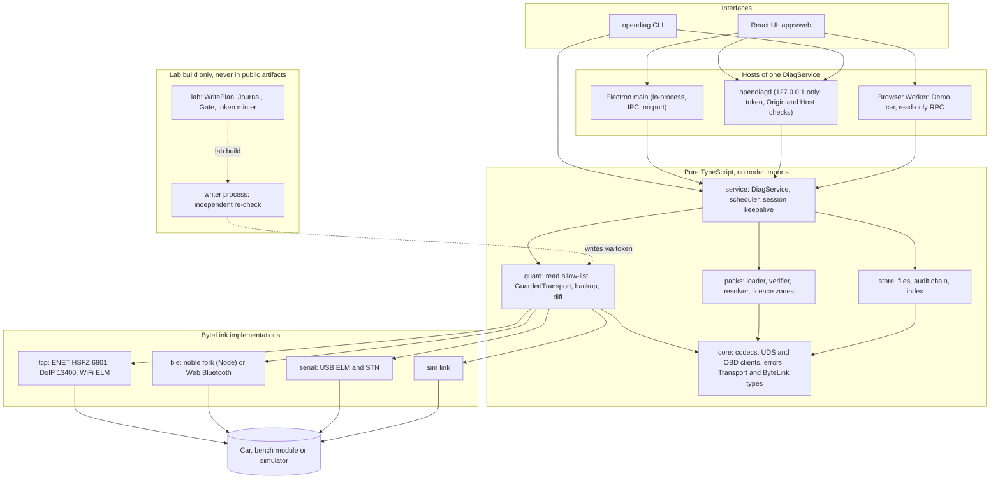
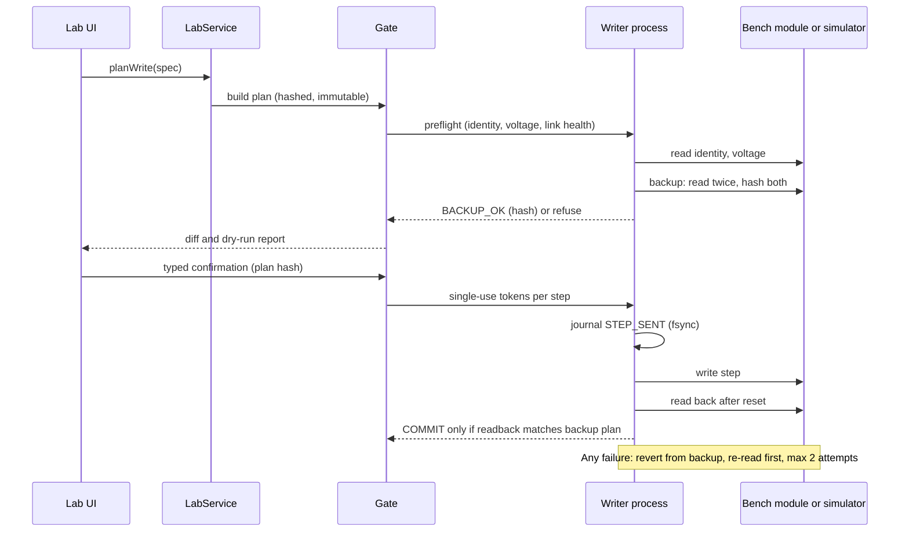

# OpenDiag architecture v2 (final, for the 12-week window)

Written 2026-11-20 by the judge and lead architect. Window: Mon 2026-11-23 to Fri 2027-02-12. Not legal advice. Supersedes `architecture-12wk.md` only where section 14 says so; everything else in that file still stands.

Confidence tags: **high** = read directly in a repo doc that itself read a primary source; **medium** = one secondary source or two agreeing docs; **low** = my inference or arithmetic. All scores in section 3 are **my judgement** (low confidence as numbers, medium as a ranking). No new web pages were fetched for this document (see Gaps), so every external fact is relayed from the repo's own research with that doc's tag.

Clean-room: nothing here needs, requests or uses leaked OEM files, keys or databases.

## Executive summary

1. **Decision.** One primary platform: **a desktop app on the owner's Mac** (macOS first), made of one TypeScript core, one React web UI, and one typed service that the UI calls. Windows and Linux follow from the same code.
2. **Two hosts, one service.** The app hosts the service in-process inside Electron (no open network port). The same service also runs headless as `opendiagd` for the CLI, CI and contributors. A browser "Demo car" build runs the simulator in a Worker.
3. **Why.** It is the only shape that reaches both of the owner's adapters (OBDLink CX over BLE, WiFi ENET over raw TCP) with no helper, uses the code that exists, needs no Rust install, and keeps G8 and G12 reachable [adapter-and-transport-constraints exec 2, 8].
4. **Deferred, not cancelled.** Tauri and Rust (Rust link host and second gate), the native phone plugin and any iPhone work, hosted-page-to-local-bridge, signed Windows builds, store submissions. Each has a measured trigger in section 4.2.
5. **Scores (section 3, out of 75).** Web-first 55, desktop-first Tauri 50, mobile-first 44, existing plan 54, merged v2 60. The web-first proposal wins the three-way contest; v2 beats it by taking its demo, bundle audit and capability screen onto a desktop primary.
6. **Merged ideas.** From web-first: Demo car, write code absent from public builds with a bundle audit, capability screen. From Tauri: no listening port, a second write check that web code cannot reach (done as a separate process in TypeScript, not Rust). From mobile: the byte-level `ByteLink` contract, a link conformance suite, the phone-or-laptop gate.
7. **Safety.** Public build has zero write code. Writes exist only in a Lab build, bench modules only, inside a separate writer process that re-checks the plan, the backup hash and the voltage by itself.
8. **Data.** Three licence zones in three repos with three keys: code Apache-2.0, own-wording packs CC-BY/CC0, OBDb-derived pack CC-BY-SA-4.0 downloaded on user action and never bundled or merged.
9. **Owner needs to answer** (section 16): phone or laptop in the car, exact adapter models, Rust not needed, Apple fee exception yes or no, whether "clear fault codes" counts as a write in the window.

---

## 1. Inputs and what they constrain

### 1.1 Binding inputs (not reopened here)

| Source | Binding point |
|---|---|
| `decisions.md` #2 | No write on a real car in the window. Bench modules only. Verified backup (read twice, hashed) is mandatory. |
| `decisions.md` #1 | OBDb-derived data is allowed as a separate CC-BY-SA-4.0 pack, never merged into CC-BY/CC0 packs. Code stays Apache-2.0. |
| `decisions.md` #3, #4, #7 | Friday scoreboard decides cuts. Goals are KPIs. First 3 days research only, coding from Thu Nov 26, G-A Tue Dec 1. |
| `decisions.md` hardware | Owner has 3 adapters (WiFi and Bluetooth), cables, a bench power supply. No bench module until about week 7. New cash about $100 to $150. |
| `kpis.md` G1 to G12 | Targets at week 4, 8, 12. Quality gates: tests green on Node 24 and 26, no GPL/AGPL/non-commercial dependency, **no write capability reachable from a public build**. |
| Brief | Owner's real adapters: OBDLink CX (BLE) and a WiFi ENET adapter. The ENET adapter is not an ELM device (`kpis.md` evidence update). |

### 1.2 Research facts that decide the platform

| # | Fact | Consequence | Source, confidence |
|---|---|---|---|
| F1 | Browsers have no raw TCP. HSFZ is TCP 6801, DoIP is TCP/UDP 13400. Direct Sockets is limited to Isolated Web Apps. | The owner's ENET adapter cannot be used from a plain web page. A local host process is mandatory for the headline G2 path. | adapter-and-transport-constraints exec 2, high |
| F2 | The CX is BLE only, MTU max 247, no queued writes, bonding window 5 minutes after power-on. Fine in Chrome-family browsers and on all desktop OSes. | CX works through Web Bluetooth or Node BLE. One write in flight, chunk to the negotiated size. | same, exec 1, high |
| F3 | Safari and Firefox have no Web Bluetooth; Safari has no Web Serial. Every iOS browser uses Apple's engine. | iPhone means a native shell. A web-only plan serves iPhone owners with a demo and nothing else. | same, exec 4, medium |
| F4 | iOS WiFi dongles work but are flaky (Local Network permission, "no internet" WiFi). Android 14 caps the first MTU request, and routes away from no-internet WiFi unless the app binds. | Phone ENET is the weakest path. Phone work needs a native plugin and real devices. | same, exec 5 and 6, high/medium |
| F5 | Ship order that matches evidence: (1) macOS desktop with CX over BLE and ENET, (2) Android, (3) iOS, (4) Windows/Linux, (5) browser demo restricted to BLE. | The primary platform is the owner's Mac. | same, section 9.3, medium |
| F6 | Node cannot run `.tsx` and refuses TypeScript under `node_modules`. The UI always needs Vite. | UI is built by Vite. Shared erasable `.ts` can be consumed unchanged. Electron main and published packages need a compile step. | ui-library-landscape exec 4, high |
| F7 | Electron bundles Node, runs the core and `serialport` unchanged, and supports Web Bluetooth via a handler. Tauri 2 forces a Node sidecar or a core rewrite. | Electron is the lower-risk shell for one person. | ui-library-landscape 7.3 and exec 6, medium |
| F8 | The CX reach question is open: can it talk to body modules or only the engine module? | Browser BLE could be shallow. Do not bet the product on it. | web-first A2, unresolved, low |
| F9 | Nobody publishes a flash or coding failure rate. Low battery voltage is the one agreed cause. | Voltage is a gate, not a hint. | EVIDENCE summary 5, high (absence) |
| F10 | Reading is safe everywhere researched. Writing is where law, stores and liability bite. Recommended: a reader build with no write code; writes behind a compile flag, verified backup, typed confirmation. | Public build = reader. Lab build = writes, bench only. | legal-safety-liability exec 1, 8, medium |
| F11 | Writing is also where newer BMW cars refuse open tools (signatures, gateway, authentication). Nothing supports writing to G-series from an open tool. | Read, snapshot, diff, plain "this car does not allow it". | bmw-g-series-coding-reality exec 9, medium |
| F12 | The moat is data, not code. Incumbents' defensible asset is the curated per-chassis catalog. | Data pipeline and licence zones get first-class architecture, not an afterthought. | direction.md section 4, medium |

---

## 2. The three proposals in one paragraph each

| Proposal | Thesis | Best idea | Biggest weakness |
|---|---|---|---|
| **Desktop-first, Tauri 2** (`arch-desktop-first-tauri.md`) | Keep TS core, add a Rust link host in a Tauri shell that owns sockets, serial, BLE and acts as a second compiled write gate. | A write gate that web-layer code cannot bypass; no listening port. | Rust is not installed; two transport implementations; two gates drift; Tauri BLE rests on one community plugin; G8 from clone gets worse; G12 tight with notarisation. Its own section 16.3 says Electron is the lower-risk shell. |
| **Mobile-first, Capacitor + own native bridge** (`arch-mobile-first-native-bridge.md`) | Phone app first, one TS core in a web view, a native link plugin we own, desktop later. | `ByteLink` binary contract, link conformance suite, D0 phone-or-laptop gate, absence-of-write bundle check. | ENET is weakest on iPhone; every transport change needs a device; 600 to 1,000 lines Swift/Kotlin (its estimate); iOS beta likely breaks G12; owner may be a laptop user (unmeasured). |
| **Web-first PWA + optional bridge** (`arch-web-pwa-first.md`) | Static installable PWA, core in a Worker, Web Bluetooth for the CX, bridge only for TCP and bench writes. | Demo car in the browser (G8, G9 at $0), writes absent from the hosted build with a bundle audit, capability screen, same-origin bridge. | iPhone gets nothing; Chromium-first; Web Bluetooth reliability unmeasured (G10); ENET and G2 need the bridge anyway; two BLE paths and two stores for one maintainer. Its own section 15 says the gain is mostly ordering. |

---

## 3. Scoring

Scale 1 (poor) to 5 (strong) against `kpis.md` week-12 targets and the three constraint rows. Scores are my judgement from the proposals' own week plans and "loses" sections, not measurements. "v2" is the merged design in this file; the "existing" column is `architecture-12wk.md` as written (daemon plus browser tab, Electron week 10) for reference.

| Criterion | Tauri desktop | Mobile-first | Web-first | Existing 12wk | **v2** | Reason (short) |
|---|---|---|---|---|---|---|
| G1 real-car sessions (25) | 4 | 3 | 4 | 4 | **5** | v2 has CLI, desktop app and CX in the same week 2; phone sessions cost device loops |
| G2 ENET scan under 4 s | 3 | 3 | 4 | 4 | **4** | Limits are the adapter, not host language [adapter doc 1.3]; Rust adds IPC risk; mobile ENET is flaky |
| G3 quick read, cheap adapters | 3 | 4 | 4 | 3 | **4** | CX over BLE is native on phone and works in Chrome; btleplug/Tauri unproven |
| G4 write-restore round trips | 3 | 3 | 4 | 4 | **4** | Same TS journal engine; Rust adds fsync glue; mobile diverts weeks |
| G5 no unsafe write | 5 | 4 | 4 | 4 | **4** | Tauri's two gates are strongest on paper but drift [its R5]; v2 gets process isolation plus absence in TS |
| G6 plain-English faults | 3 | 3 | 3 | 3 | **3** | Data-bound in every design |
| G7 modules backed up (15) | 4 | 3 | 3 | 3 | **4** | Needs real cars and BLE reach; desktop store and snapshot UI by week 5 |
| G8 clone to first read, 5 min | 2 | 2 | 4 | 3 | **4** | Demo car plus `pnpm demo`; Rust or Xcode in the clone path is slow |
| G9 outside users (10) | 3 | 3 | 4 | 3 | **4** | Demo link and a download; iOS blocked without TestFlight |
| G10 finish without retry | 3 | 3 | 2 | 3 | **3** | Web Bluetooth hides MTU and interval; unmeasured everywhere, so v2 measures from week 2 |
| G11 clean contributions | 3 | 3 | 4 | 4 | **4** | Pack linter plus licence-zone checks; Rust and native crates widen the scan |
| G12 cash under $200 | 3 | 2 | 5 | 4 | **4** | Bench $100 to $150 plus any Apple fee exceeds $200; v2 ships unsigned first and asks before spending |
| Owner's adapters (CX BLE, WiFi ENET) | 5 | 3 | 3 | 4 | **5** | Both reachable on one Mac with no helper |
| 12-week feasibility (one part-time person plus Claude) | 2 | 2 | 4 | 4 | **4** | Rust and native code are new languages; v2 adds one shell and zero languages |
| Research-constraint fit | 4 | 3 | 3 | 4 | **4** | F1 to F12 above |
| **Total (max 75)** | **50** | **44** | **55** | **54** | **60** | |

Reading the table honestly:

- The three-way contest is won by **web-first (55)**, narrowly over the existing plan (54). That matches web-first's own admission that about 70 percent of it is the existing plan reordered.
- v2 scores 5 points higher than web-first because it fixes the three things the web proposal says it loses on: ENET (a host process is primary, not a footnote), long unattended sessions (a real app, not a tab), and crash-safe journals (file system in Node, not OPFS).
- v2's G5 is 4, not 5. Tauri's compiled second gate is genuinely stronger against same-process attack; we accept the gap because the control that matters in this window (no write code in public builds, bench-only writes, human reviewer) does not depend on it.
- G6, G7 and G11 barely move between designs. The architecture is not the bottleneck for them; cars and data are.

Sensitivity: if the owner answers "I work from an iPhone in the garage" (D0, section 16), mobile-first gains about 8 points (G1, G3, G9, adapters, constraints) and v2's primary stays desktop only if the owner accepts a laptop-at-the-car workflow. That is the one answer that can flip the decision.

---

## 4. Decision

### 4.1 One primary platform

**Primary: the owner's Mac, as an installable desktop app.** Same code later reaches Windows and Linux.

| Layer | Choice |
|---|---|
| Language and runtime | TypeScript everywhere (ADR-001 kept). Node for hosts. No Rust in the 12 weeks. |
| UI | One React web UI built by Vite (section 6.4 for the library stack). |
| Desktop shell | **Electron**, brought forward from week 10 to a working shell by week 4 to 5. Main process hosts the service in-process; the UI talks to it over Electron IPC. No listening port in the app. |
| Headless host | `opendiagd` (daemon), same service code, WebSocket on `127.0.0.1` only, for CLI, CI, HIL, contributors. Demoted from "primary path" to "second host". |
| Browser | A static **Demo car** build (simulator in a Worker, read-only RPC). Optional Web Bluetooth for the CX in Chrome, only as a demo tier unless the week-4 measurement says otherwise. |
| Phone | **Not built in the window.** One read-only Capacitor memo spike in week 10, sharing a test with the desktop (section 12). |

### 4.2 What is deferred, and what trips it

| Deferred | Why | Trigger to revisit (all measured) |
|---|---|---|
| Tauri and a Rust link host | Rust not installed; second transport; gate duplication; Electron runs the existing code unchanged [F7] | Node BLE and Web Bluetooth both fail a 30-minute CX session on the owner's Mac **and** Electron size or patch cadence is a real complaint |
| Rust write gate | Replaced by a separate TypeScript writer process plus build-time absence (section 10) | Reviewer finds same-language isolation unconvincing |
| Native phone plugin (Swift/Kotlin) | Highest cost, unmeasured benefit, ENET weakest on phones [F4] | D0 answer says the owner works from a phone **and** the week-10 spike passes a real iPhone and Android read |
| iPhone app and TestFlight | $99 fee likely breaks G12; no device loop on a Mac simulator for BLE | Owner approves the G12 exception |
| Hosted PWA talking to a local bridge | Local Network Access behaviour is version-dependent and unproven | Week-10 test passes in current Chrome |
| Signed Windows builds, store listings | Cash and not needed for KPIs | Real outside demand (G9) |
| Real-car writes | Dropped by owner decision 2 | Not in this plan |

### 4.3 Why not the other two as primary

- **Web-first as primary** loses on the one adapter the owner trusts most for speed. G2 is measured over ENET, which needs the bridge, so the "web" part becomes a skin. We keep its benefits (demo, bundle audit) without making the browser the home.
- **Mobile-first as primary** pays the highest per-change cost (device loops) for the platform where the best transport is weakest, and where no writes can run. It is also untested against the owner's actual habit (A9).
- **Tauri as primary** is a sound design argued by its own author into second place (its section 16.3). We take its security idea, not its toolchain.

---

## 5. Merged best ideas

| Idea | From | How v2 adopts it | Cost |
|---|---|---|---|
| One typed `DiagService` with two hosts | mobile (M1), existing ADR-003 | UI and CLI call the same interface; Electron main hosts it in-process; `opendiagd` hosts it over WebSocket; Worker hosts a sim-only copy | Small; interface written in week 1 |
| `ByteLink` binary contract | mobile (M5) | Replaces the string-based `ByteStream` for network and BLE links; every link implementation must pass one conformance suite | Medium; refactor of `elm327.ts` stream glue |
| Link conformance suite | mobile | Same test file runs against loopback TCP, noble BLE, Web Bluetooth, serial | Medium; written before the second implementation |
| Demo car in browser | web | Static build, simulator in a Worker, typed read-only RPC; serves G8 and G9 | Small once the service exists |
| Write code absent from public build plus bundle audit | web, mobile | CI greps the built artifacts (app, demo, CLI) for the lab package and write SIDs; 100 bypass attempts run against the built artifact | Small |
| Capability screen ("what this adapter can and cannot do") | web, Tauri A8, direction.md | First-class screen fed by adapter probing | Medium |
| No listening port in the app | Tauri | Electron IPC instead of a local server. `opendiagd` keeps token, Origin and Host checks for headless use | Small |
| Second write check that web code cannot reach | Tauri (Rust gate) | Writer runs as a separate Node child process that revalidates the plan hash, backup hash, voltage and refusal list from files it reads itself | Medium; replaces Rust |
| Phone-or-laptop gate D0 | mobile | Asked Nov 24 or 25 in the sprint; recorded in the decision log | Free |
| Mac-hosted bench BLE peripheral for self-tests | mobile (Q5) | **Not adopted** in the window; revisit if BLE tests need repeatability | n/a |
| IPC overhead budget (1 ms p50, 5 ms p95) | Tauri | Applied to Electron IPC and to the daemon WebSocket; measured week 3 | Small |
| Time-boxed read-only Capacitor spike | existing ADR-005, mobile | Week 10, one iPhone and one Android if available, memo only | Small |
| Conformance-first, measured triggers, honest "where it loses" | all three | Section 15 triggers | Free |

Ideas explicitly **not** adopted: Rust link host (Tauri), own Swift/Kotlin plugin (mobile), OPFS as a primary store (web; the snapshot promise needs durable files), hosted public PWA before beta (web; dev-box rule needs owner approval and an unguessable link), Mantine or PrimeReact (section 6.4).

---

## 6. Architecture

### 6.1 Diagram



Rules the diagram encodes:

1. Every byte to a car passes through `GuardedTransport`. No host, UI or CLI holds a raw link.
2. `lab` and `writer` appear in no public artifact (section 10.1).
3. `core`, `service`, `guard`, `packs` and `store` interfaces import no `node:` module. Node-only code lives in the host and link packages. Enforced by the boundary script (ADR-002 of the old plan, rules kept).

### 6.2 Deployment topologies

| # | Topology | Used for | Writes |
|---|---|---|---|
| T1 | Electron app, in-process service, IPC | The product on the owner's Mac | Public build: none. Lab build: bench only |
| T2 | `opendiagd` plus browser tab or CLI | Contributors, CI, HIL, the clone-to-first-read path | Lab build only |
| T3 | Static Demo car (simulator in a Worker) | G8, G9, docs, store-free sharing | None, absent from bundle |
| T4 | Chrome with Web Bluetooth to the CX | Optional demo tier, A2 and G10 measurement | None |
| T5 | Capacitor read-only spike | Week-10 memo only | None, absent from bundle |

### 6.3 Where state lives

| State | Location | Notes |
|---|---|---|
| Backups, journals, audit, traces | Plain files under the OS data dir (ADR-007 kept) | Source of truth. SQLite is a rebuildable index only. |
| Packs | Files, verified on load | Each licence zone in its own directory (section 9) |
| UI preferences | `localStorage` equivalent in the renderer | Convenience only, never required |
| Secrets (pack signing keys) | macOS Keychain, row in `~/.claude/CREDENTIALS.md` | Created only with owner approval; signing happens in CI, not on the dev Mac |

### 6.4 UI stack (provisional, locked by the UI design doc)

From `ui-library-landscape.md` (medium): React 19, Vite, Tailwind v4, shadcn/ui on Base UI, TanStack Table v9 with TanStack Virtual for fault, module and frame lists, uPlot for live traces, hand-built SVG gauges driven by CSS variables. All MIT or Apache-2.0.

Constraints this architecture adds:

- The UI never sends raw frames. It calls typed `DiagService` methods only.
- Every screen works with the Demo car, so UI work never waits on a car.
- The renderer has no Node access (`contextIsolation` on, preload exposes only the typed client). Medium confidence; standard Electron guidance, not re-fetched here.
- **Avoid PrimeReact 11** (licence moved to a size-gated commercial licence) and treat Mantine as the fallback only if shadcn/Base UI slows weeks 3 to 4 [ui-library-landscape exec 3, high].
- uPlot has no accessibility story and its last npm release was 2025-03-14 [ui-library-landscape exec 5, medium]; accept for live traces, provide a table view of the same data.

---

## 7. Package layout

```
opendiag/                      # Apache-2.0
  packages/
    core/          codecs (isotp, uds, obd, dtc, hsfz, doip), clients, OdError, Transport + ByteLink types
    session/       scheduler, keepalive, discovery logic, ELM tuning profiles
    service/       DiagService (host-neutral), capability probing, scan cache
    guard/         read allow-list, GuardedTransport, backup (read twice, hash), diff
    packs/         schema, loader, verifier, resolver, licence-zone rules, refusal list data
    store/         Store interface, file + memory impls, hash-chained audit, .odbundle export
    sim/           SimEcu, SimVehicle, FaultScript, trace record/replay, loopback servers
    links-node/    tcp, serial, ble (@stoprocent/noble), conformance harness consumer
    links-web/     Web Bluetooth link, Worker host glue
    api/           typed RPC schema (zod), client SDK, error wire shape
    daemon/        opendiagd (headless host)
    cli/           thin client of service or daemon
    lab/           LAB BUILD ONLY: WritePlan, Journal, Gate, token minter, writer process entry
  apps/
    web/           React UI (also builds the static Demo car)
    desktop/       Electron main + preload; hosts DiagService in-process
    mobile/        week-10 Capacitor spike, read-only, deleted if the memo says no
  scripts/         check-boundaries, check-licences, audit-bundle, check-licence-zones
  test/            conformance, safety, vectors (language-neutral JSON), traces

opendiag-packs/                # CC-BY-4.0 and CC0 data in our own wording; own CI, own signing key
opendiag-packs-obdb/           # CC-BY-SA-4.0; importer output only; own CI, own signing key
```

Dependency direction is one way (core up). Differences from `architecture-12wk.md` ADR-002:

| Old | v2 | Reason |
|---|---|---|
| `adapters-node`, `adapters-web` | `links-node`, `links-web` | Named for what they implement (`ByteLink`) |
| `@opendiag/safety` (everything) | `guard` (read side) and `lab` (write side) | Public builds import `guard` only; `lab` can be left out of the build graph |
| `apps/desktop` week 10 | `apps/desktop` week 3 skeleton, usable week 5 | Primary platform |
| `daemon` primary | `daemon` second host | Same code, demoted |
| none | `service` | One typed surface for three hosts |

Boundary script rules (extends the old list): (a) no `node:` import in core, session, service, guard, packs, store; (b) no upward or cyclic imports; (c) nothing outside `lab` may import the token minter; (d) **no package outside `lab` and `apps/desktop-lab` may import `lab`**; (e) the Demo and public app entry points must not reach `lab` in the import graph; (f) licence zone rules from section 9.

---

## 8. Interfaces (design sketches; names are proposals)

All sketches are mine (low confidence on exact shapes, high confidence on the seams). Types are `erasableSyntaxOnly`-compatible (no enums, no parameter properties).

### 8.1 Link layer

```ts
// core: binary, byte-oriented. Replaces the string ByteStream for network and BLE links.
export interface ByteLink {
  readonly name: string;
  readonly caps: LinkCaps;                     // mtu, writeChunk, maxInFlight, canMeasureVoltage, ...
  open(opts: LinkOpenOptions, signal: AbortSignal): Promise<void>;
  write(bytes: Uint8Array, signal: AbortSignal): Promise<void>;   // one in flight when caps.maxInFlight === 1
  onData(cb: (bytes: Uint8Array) => void): Unsubscribe;
  onState(cb: (s: LinkState) => void): Unsubscribe;               // connected | degraded | lost
  close(): Promise<void>;
}

export interface LinkCaps {
  mtu: number;                 // negotiated, e.g. up to 247 for the CX
  maxInFlight: number;         // CX: 1 (no queued writes)
  framing: "raw-tcp" | "ble-serial" | "serial";
  voltage: "none" | "adapter-reports" | "pid-42";
  discovery: "none" | "udp-broadcast" | "ble-scan";
}
```

Conformance suite (written before the second implementation): open/close idempotence, abort mid-write, one-in-flight enforcement, chunking at `caps.mtu`, reconnect with the same device id, unsolicited data delivery, no data loss under 1,000 echo round trips. Same file runs against loopback TCP, noble BLE (hardware, manual), Web Bluetooth (hardware, manual), serial, sim.

### 8.2 Transport v2 (above the link)

```ts
export interface DiagTransport {
  readonly caps: TransportCaps;                 // concurrency, supportsBroadcast, addressing
  request(req: DiagRequest, opts: { timeoutMs: number; signal: AbortSignal }): Promise<DiagResponse>;
  events(): AsyncIterable<TransportEvent>;      // unsolicited frames, link state, 0x78 pending
  close(): Promise<void>;
}
// HSFZ and DoIP correlate by (source, target, sequence) so multiple requests can be in flight.
// ELM and CX are serialised by the scheduler, because maxInFlight is 1.
```

### 8.3 The service surface

```ts
export interface DiagService {
  // discovery and connection
  listAdapters(): Promise<AdapterInfo[]>;
  connect(adapterId: string, opts?: ConnectOptions): Promise<SessionInfo>;   // returns capability report
  capabilityReport(sessionId: string): Promise<CapabilityReport>;            // what this adapter can and cannot do

  // reads (public build)
  scan(sessionId: string, opts: ScanOptions): AsyncIterable<ScanEvent>;      // progress + modules
  readFaults(sessionId: string, target?: ModuleId): Promise<FaultList>;
  readLive(sessionId: string, channels: ChannelId[]): AsyncIterable<LiveSample>;
  readVoltage(sessionId: string): Promise<VoltageReading | { status: "unavailable" }>;
  snapshot(sessionId: string, target: ModuleId): Promise<SnapshotRef>;       // read twice, hash, store
  diff(a: SnapshotRef, b: SnapshotRef): Promise<SnapshotDiff>;
  explain(code: string, ctx: VehicleContext): Promise<Explanation>;          // from packs, with provenance and confidence

  // data and housekeeping
  listPacks(): Promise<PackInfo[]>;
  exportBundle(refs: SnapshotRef[]): Promise<BundleRef>;
  getTrace(sessionId: string): Promise<TraceRef>;                            // .odtrace for reports and replay

  // events: link.state, scan.progress, session.lost
}

// Lab build adds a second interface, NOT part of DiagService and never imported by the public UI:
export interface LabService {
  planWrite(sessionId: string, spec: WriteSpec): Promise<WritePlan>;          // immutable, hashed
  dryRun(plan: WritePlan): Promise<DryRunReport>;
  apply(plan: WritePlan, consent: TypedConsent): AsyncIterable<TxnEvent>;     // runs in the writer process
  revert(txnId: string): AsyncIterable<TxnEvent>;
  recover(): Promise<OpenTransaction[]>;
}
```

Errors: one `OdError` base (`code`, `kind`, `retryable`, `context`) as in ADR-008. Anything crossing a host boundary is `{code, kind, message_key, context}`. `safety` kind and NRC 0x33/0x35/0x36/0x37 are never retried.

### 8.4 Pack and data interface

```ts
export interface PackLoader {
  load(path: string, trust: TrustStore): Promise<LoadedPack>;   // only way to obtain a LoadedPack
}
export interface Resolver {
  describeFault(code: string, ctx: VehicleContext): Resolved<FaultText>;   // value + provenance + zone + confidence
}
type Zone = "code-cc0-ccby" | "share-alike";       // zone travels with every resolved value
```

There is no `parseUnsigned` outside `sim` and tests. Unknown vehicle identity means read-only. Unknown fault code means "no description yet", never a guess.

---

## 9. Data and pack licensing separation

### 9.1 Three zones

| Zone | Repo | Licence | Contents | Signing | Shipped how |
|---|---|---|---|---|---|
| Z1 Code | `opendiag` | Apache-2.0 | All code, schemas, test vectors we author | Release signing in CI | Installer, source |
| Z2 Own-wording data | `opendiag-packs` | CC-BY-4.0 (CC0 for generic OBD-II facts we author) | Fault descriptions in our own words, module names, generic UDS DIDs, coding option catalog entries from owner captures | Own Ed25519 key, offline root, CI release key | Small generic pack bundled; per-brand packs downloaded on user action |
| Z3 Share-alike data | `opendiag-packs-obdb` | CC-BY-SA-4.0 (owner decision 1) | Importer output from OBDb signal sets | **Separate** key and trust list | **Never bundled in the installer.** Downloaded on user action, shown with attribution and licence text |

Source rationale: owner decision 1; CC BY content can go into a CC BY-SA work but not the reverse, so Z2 can feed Z3 and Z3 can never flow back [dtc-crowd-curation-model exec, high (CC FAQ)]. OBDb's own licence is CC-BY-SA-4.0 [open-source-reuse-map, medium].

### 9.2 Enforced by tools, not memory

| Control | Where | Fails when |
|---|---|---|
| `zone` and `license` fields in every manifest | packs schema | Missing, or a licence not allowed in that zone |
| Zone linter | CI in `opendiag-packs` and `opendiag-packs-obdb` | A Z3 entry id, text or hash appears in Z2; a Z2 entry lacks provenance |
| Cross-zone import ban | `scripts/check-licence-zones` | Any code path copies Z3 bytes into a Z2 output |
| Loader: separate trust roots | `packs` | A Z3 pack is signed with the Z2 key or vice versa |
| Resolver returns the zone with every value | `packs` | UI cannot show a value without its zone and source |
| "Data sources and licences" screen | UI | Always shown; lists zone, licence, source, version for the pack in use |
| No Z3 bytes in the installer or the Demo bundle | `audit-bundle` | Any Z3 file hash found in a public artifact |
| Similarity gate on submitted fault text | `opendiag-packs` CI | Overlap with open text sets or hash fingerprints of commercial text [dtc-crowd-curation-model 9, medium] |
| Contributor terms with relicensing room | CONTRIBUTING | Decided before the first outside pull request (OSM lesson [dtc-crowd-curation-model exec, high]) |

### 9.3 What is not claimed

- Whether shipping SA data alongside Apache code in one download creates a combined work is a legal question; downloading Z3 on user action and keeping it a separate file is the conservative design, not a legal conclusion (low). Decision 1 already asks for a short legal check before the first public release of the pack.
- Fault-code text has no clean public BMW source [direction.md section 4]. Z2 coverage will be uneven; G6 is reported per source and per chassis family, not as one global number.

---

## 10. Safety pipeline

### 10.1 Layers (defence in depth, with honest limits)

| # | Layer | What it does | Stops | Does not stop |
|---|---|---|---|---|
| L0 | **Absence** | Public artifacts (app, Demo, CLI) are built without `lab`. `audit-bundle` greps the output for the lab package and write SIDs 0x2E, 0x14, 0x31, 0x34 to 0x37, 0x10 other than 0x10 0x01, 0x11, 0x27, 0x29 | A bug or a user in a public build reaching a write | A user building from source with the lab flag |
| L1 | **Read allow-list** | `GuardedTransport` wraps every link. Only SIDs 01 02 03 07 09 0A 19 22 3E and `10 01` pass unless a valid token is attached | A UI or host bug sending a write | Code in the same process that forges calls (residual risk of any single-process design) |
| L2 | **Plan, gate, token** (lab) | Immutable hashed `WritePlan`. The gate mints a single-use token bound to the request hash and `txn_id`, expiring in 10 s | Replay, cross-plan reuse | A compromised gate |
| L3 | **Writer process** (lab) | Separate Node child process. Reads the plan file, the backup file and the refusal list **itself**, rechecks plan hash, backup hash, voltage and identity before sending anything. Holds the only link in lab builds. The UI process has no link | Same-heap bypass from UI or renderer code. This replaces Tauri's Rust gate | A malicious dependency in the writer, or a compromised OS user |
| L4 | **Refusal list** | Compiled into `guard` and mirrored in the pack linter: airbag/SRS, immobiliser and key learning, emissions defeat, odometer, speed limiter, brakes, steering, seed-and-key calculators. No override flag | Features that should not exist | Nothing is stronger than the list |
| L5 | **Human reviewer** | Writes stay compiled out of public builds until a reviewer signs off (decision 6) | Design blind spots | n/a |

### 10.2 The write sequence (lab build, bench module only)



Rules kept from ADR-009 and ADR-010: `STEP_SENT` is journaled before bytes leave the process; commit means read-back matched after reset, not a positive `6E`; recovery on start refuses new writes while a transaction is open; voltage must be readable and at or above the profile minimum (default 12.5 V per the failsafe spec, medium) or an "on a charger" override is recorded in the audit chain; abort only between requests.

### 10.3 Kill switches the owner can read

| If | Then |
|---|---|
| No verified backup (two matching reads, hash recorded) | No write step starts. Test tries 100 bypasses against the built artifact (G5) |
| Voltage unreadable or low | Blocked with a plain message |
| Module is not on the bench list (identity mismatch) | Blocked; the UI offers no button for it |
| Link drops mid-plan | Stop between requests, keep the journal, offer revert |
| App killed mid-write | Next start shows "unfinished change", revert or inspect only |

### 10.4 Clear fault codes

Clearing codes is a write-class request (UDS 0x14, OBD mode 04) and also resets readiness monitors [legal-safety-liability 12.1 row 3, medium]. `decisions.md` #2 says no write runs on a real car in the window. **Default in v2: clear-faults is lab-only and bench-only in the window.** The reader build shows faults and explains them; it does not clear them. Flagged for the owner in section 16 because most users expect a "clear" button.

### 10.5 Warning wording

Plain, specific, not "off-road only" waivers (the weakest style in the legal research [legal-safety-liability exec 6, medium]). Every write screen states: what changes, what the backup is and where it lives, that a dealer may see coding changes [legal 7, medium], and what restore does.

---

## 11. Test and simulator plan

### 11.1 Pyramid

| Level | What | Tooling | Gate |
|---|---|---|---|
| L1 | Unit, property, fuzz of codecs and state machines. Golden vectors as language-neutral JSON in `test/vectors` | `node --test`, fast-check, Jazzer.js | 1M random inputs per decoder nightly, no crash, no unbounded allocation (week 12) |
| L2 | Component: `SimEcu` with write services, timing (P2, P2*, 0x78, S3), `FaultScript` (drop link, silent, NRC, corrupt read-back, power cut, delay) | `sim` | 8 scenarios by week 8 |
| L3 | Integration: loopback HSFZ and DoIP servers, `SimElm`, hosts driven through `DiagService` | `sim`, `daemon` | Host-parity test: same script gives same results through Electron IPC, daemon and Worker |
| L3b | **Built-artifact tests**: 100 bypass attempts and `audit-bundle` against the packaged app, the Demo and the CLI | scripts | G5 = 0 |
| L4 | Link conformance on real hardware: CX over noble and over Web Bluetooth, WiFi ENET, third adapter | manual or self-hosted runner on owner's branches only (threat T9 of the old plan) | Reports feed G2, G3, G10 |
| L5 | Real car, read-only, saved `.odtrace`, tagged | manual | G1, G7 counts need a trace |
| L6 | Bench module write and restore from week 11 | Lab build, manual | G4 20 of 20 |

### 11.2 Simulator requirements

1. Record and replay: any real session trace becomes a regression test. Sim behaviour contradicted by a capture is a bug in the sim first.
2. Timing model with injectable latency, so G2 "sim under 2 s" is measured against 20 ms per request, not zero.
3. A 40-ECU fixture for scan tests (the number in the old plan's G-B gate).
4. The Demo car is the same simulator with a fixed scripted car, shipped in the Worker.

### 11.3 Cross-implementation oracles (dev tools only, never bundled)

`python-udsoncan`, `python-can-isotp`, `driftregion/iso14229` as independent checks on our byte formats [oss-leverage, open-source-reuse-map, MIT, medium]. Do not use `ELM327-emulator` (CC BY-NC-SA 4.0 per the repo's check) and do not read GPL source for porting.

### 11.4 Hardware-aware KPI tests

| KPI | Real test that fits the owner's gear |
|---|---|
| G2 | `scan --timing`, 5 runs, WiFi ENET, median seconds |
| G3 | `quick` timing over the CX on BLE. The WiFi ENET adapter is not an ELM device, so G3 cannot be measured on it (`kpis.md` evidence update) |
| G10 | Session log success rate, per adapter, per host |
| G8 | A person who is not the author, two paths timed separately: Demo/`pnpm demo` clone path and the downloaded app path |

---

## 12. Twelve-week plan delta

Capacity: owner about 12 to 15 hours per week plus Claude per package. Hour targets are goals. Dates from `decisions.md`; M1 Dec 18, M2 Jan 8, M3 Jan 15, M4 Feb 12.

| Wk | Mon | v2 content (changes vs the old plan in bold) | Exit check |
|---|---|---|---|
| 1 | Nov 23 | Sprint Nov 23 to 25 incl. **D0 (phone or laptop) and adapter models**, first real CX and ENET timing. From Nov 26: commit tree, `OdError`, boundary and licence scripts, **`DiagService` interface, `ByteLink` types**, **CX probe by noble and by Web Bluetooth in Chrome (services, MTU, bonding window, which modules answer: A2)** | G-A Dec 1 |
| 2 | Nov 30 | Transport v2, multi-in-flight HSFZ and DoIP, scheduler, keepalive. **Link conformance suite on loopback TCP first.** First real CX session | Tests green; first G1 traces |
| 3 | Dec 7 | Discovery, parallel scan, cache, ELM profiles, `packages/bench`. **`opendiagd` v0. Electron skeleton with in-process service. IPC and daemon overhead benchmark. Bundle versus Terminal test for macOS Bluetooth and local-network permission prompts** | G-B Dec 11: sim 40-ECU scan under 2 s median |
| 4 | Dec 14 | CLI `scan --timing` and `quick` on real CX and ENET. **App v0: connect, capability screen, scan, faults in words, VIN, 10 live PIDs. Demo car build.** Winner of noble versus Web Bluetooth chosen (D1 Dec 4 decision, applied here) | **M1 Dec 18**: G1 at least 3, G2 sim under 2 s, G3 under 6 s, G6 at least 30%, G8 at 15 min |
| 5 | Dec 21 | Store, audit chain, export bundle, backup and diff in `guard`. **Snapshot UI in the app** (holiday week, small scope) | G7 at 3 modules |
| 6 | Dec 28 | Packs: schema, loader, verifier, signing CLI (keys need owner approval and a registry row), linter, resolver, **licence-zone tooling and three repos**. Generic pack in own wording | G-C: tampered, expired, unsigned, rolled-back, refusal-list and wrong-zone packs rejected |
| 7 | Jan 4 | **`lab` package on the sim: WritePlan, Journal, Gate, token, writer process.** Bench module bought (about $100 to $150) | **M2 Jan 8**: G7 at least 3, G5 holds, G6 at least 30% |
| 8 | Jan 11 | FaultScript, 8 scenarios, kill and recover, property tests, **L3b built-artifact bypass tests**, reviewer package | **M3 Jan 15**: G4 sim 100 of 100, G5 holds |
| 9 | Jan 18 | Live data from packs, CSV logging, voltage gate. uPlot and SVG gauges, **table view of the same data**. Windows and Linux CI builds (unsigned, smoke) | G2 real under 6 s; G10 at 95% |
| 10 | Jan 25 | **Platform memo week:** one shared read-only test on Capacitor (iPhone and Android if owned); hosted-to-bridge Chrome test (decides whether T-hosted is ever viable) | G-E: go or no-go memos with measured scan times |
| 11 | Feb 1 | Adapter qualification (CX, WiFi ENET, third adapter); **bench write and restore on the Lab build** | G4 bench toward 20 of 20; G3 under 3 s |
| 12 | Feb 8 | Hardening: fuzz 1M per decoder, licence review, threat walkthrough, docs, beta tag with checksums, **non-author G8 timing** | **M4 Feb 12** |

Cut order if the Friday scoreboard says behind (decision 3): (1) Capacitor memo, (2) Windows and Linux builds, (3) Web Bluetooth tier, (4) step language, (5) live-data chart polish, (6) Demo car polish. **Never cut:** simulator safety suite, verified-backup rule, kill-and-recover test, built-artifact bypass test, capability screen, export bundle.

---

## 13. KPI trace for v2

| KPI | How v2 serves it | Risk |
|---|---|---|
| G1 | CLI and app both count; sessions from week 2 | Owner's car time |
| G2 | Node sockets, NODELAY, event stream; fan-out in TS; host-hop budget 1 ms p50, 5 ms p95 | No public baseline for the incumbents; ENET discovery bytes and keepalive unknown until a capture |
| G3 | CX over BLE; one write in flight; negotiated chunk size | CX reach (A2) and BLE stack choice unproven until week 1 to 2 |
| G4 | Journal with fsync in Node; bench from week 11 | Bench module arrives late; sim fidelity |
| G5 | L0 to L5 | Same-language writer is weaker than a compiled gate (accepted) |
| G6 | Packs and honest "no description yet" | Data-bound |
| G7 | Snapshot UI week 5; needs real cars | A2 |
| G8 | Demo car plus `pnpm demo` plus a downloaded app; timed separately | Electron build from source is slower; the downloaded path is what most people time |
| G9 | Demo build and release assets | Hosting a public URL needs owner approval (dev-box rule: unguessable link or login) |
| G10 | Measured per adapter and host from week 2 | Biggest unknown |
| G11 | Pack linter plus zone checks | Native dependency licence scan for BLE module |
| G12 | Unsigned first; Apple fee only with owner approval | Bench plus Apple could exceed $200 |

---

## 14. Decision log (what changed vs `architecture-12wk.md`)

| # | Old | v2 | Why | Evidence |
|---|---|---|---|---|
| D-01 | ADR-001 TS core, Rust behind a trigger | **Kept** | Rust not installed; core already works | EVIDENCE, 12wk ADR-001 |
| D-02 | ADR-002 packages: `safety`, `adapters-node`, `adapters-web`, `daemon` | **Changed:** `guard` and `lab` split; `links-*` replace `adapters-*`; new `service` | Public builds must be able to omit write code | Web-first 7, mobile M4 |
| D-03 | ADR-003 daemon plus browser tab is the primary path | **Changed:** daemon is the second host; Electron in-process is the first; browser tab is the contributor path | No open port in the shipped app; non-engineer owner needs a double-clickable app | Tauri 1 and 12, adapter doc 9.3 |
| D-04 | ADR-004 no shell until week 10; Tauri rejected | **Changed:** Electron skeleton week 3, usable week 5. Tauri still rejected | Primary platform is desktop | UI landscape 7.3, Tauri 16.3 |
| D-05 | ADR-005 Capacitor spike week 10 | **Kept**, scoped as a shared read-only memo; no native plugin | Phone path is unproven and weakest for ENET | Mobile 14, adapter doc F4 |
| D-06 | Link seam is string `ByteStream` plus `DiagTransport` | **Changed:** binary `ByteLink` with capabilities and a conformance suite | Needed for BLE chunking, MTU, one in flight | Mobile M5 |
| D-07 | ADR-006 packs data-only, signed `.odpack` | **Kept**, plus licence zones, three repos, separate trust roots, zone shown in the UI | Decision 1 | Crowd-curation 10 |
| D-08 | ADR-007 files are truth, SQLite index | **Kept**. OPFS not adopted | Snapshot promise needs durable files | Web-first 15 item 8 |
| D-09 | ADR-008 errors and audit | **Kept** | | |
| D-10 | ADR-009 journal in `safety` | **Moved** to `lab`; executes in a separate writer process | Replaces the Rust gate idea | Tauri 6 |
| D-11 | ADR-010 token and `GuardedTransport`, same-process residual risk | **Kept and strengthened:** absence from public artifacts, built-artifact bypass test, writer process | Closes most of the stated residual risk | Old plan section 9 risk, Tauri A4 |
| D-12 | ADR-011 simulator and HIL | **Extended:** host-parity test, built-artifact tests, conformance suite, cut Mac BLE peripheral tool | | Mobile 9 |
| D-13 | ADR-012 CI and release | **Extended:** `audit-bundle`, licence-zone check, unsigned first, signing only with owner approval | G12 | Web-first 11 |
| D-14 | Real-car writes (old P11) | Already dropped by decision 2; v2 keeps them dropped | | decisions.md |
| D-15 | Clear fault codes implied in reader | **Changed:** lab-only, bench-only in the window | Write-class request, decision 2 | Legal 12.1 |
| D-16 | Browser tier "until week 12" | **Changed:** Demo car is T3, Web Bluetooth is T4 demo tier only | Reliability unmeasured | Web-first 15 |
| D-17 | G8 undefined path | **Changed:** two timed paths, reported separately | | Mobile and Tauri both flagged this |
| D-18 | Hosted PWA to local daemon (tier 3) | Deferred to the week-10 test | Local Network Access version-dependent | Old ADR-003, web-first 3 |

Open items the old plan left that v2 closes: the owner's WiFi ENET adapter is not an ELM device, so G3 uses the CX; Apple fee is not spent without approval; the clone-to-first-read definition exists.

---

## 15. Risks and measured triggers

| # | Risk | Trigger and action |
|---|---|---|
| R1 | Node BLE (noble fork) fails to build or run inside Electron | Week 2 probe. Fall back to Web Bluetooth in the renderer behind `ByteLink`, or run BLE in the daemon |
| R2 | CX only reaches the engine module (A2) | Reported as a capability, not hidden. G7 leans on ENET sessions. Revisit plan wording |
| R3 | macOS permission prompts (Bluetooth, local network) behave differently in the bundled app than in Terminal | Week 3 test. Fall back to a Terminal-launched `opendiagd` for ENET and say so in docs |
| R4 | Same-language writer judged too weak by the reviewer | Revisit Rust gate; keep absence-from-build as the primary control |
| R5 | Electron main needs a compile step (type stripping not usable under packaged `node_modules`; Electron's Node version not checked) | Build main and preload with `tsc` or esbuild at package time (low confidence on the exact limit; test in week 3) |
| R6 | ENET discovery and keepalive bytes unknown until a capture | Sprint capture; never guess bytes |
| R7 | G12 breached by bench module plus Apple fee | Ask before paying; ship unsigned with checksums |
| R8 | OBDb pack legal posture | Counsel check before first public release of Z3; Z3 never in the installer |
| R9 | Boostline, an MIT TypeScript ENET reader, overlaps the core | Not read for code here; treat as prior art; record in `THIRD_PARTY.md` if anything is reused [direction.md section 3, medium] |
| R10 | One person maintains Electron, daemon, Demo and CLI hosts | Host-parity test and the one `DiagService` seam; cut Windows/Linux first |
| R11 | Electron's monthly patch cadence | Rebuild monthly (old ADR-004); accepted |

Triggers that reverse a v2 choice are listed in section 4.2 (platform) and in the proposals' own tables, which stay valid as reference: Tauri section 16.5, mobile D0 to D3, web-first section 15 closing.

---

## 16. Questions for the owner (need an answer; each has a default)

| # | Question | Default if unanswered | Needed by |
|---|---|---|---|
| Q1 | Phone or laptop at the car, and which phone? | Laptop (Mac) | Nov 25 |
| Q2 | Exact model names of the three adapters. Is one cable ENET? Is the third a WiFi ELM clone? | Assume CX, a WiFi ENET adapter, and one unknown | Nov 25 |
| Q3 | Approve creating pack signing keys (Keychain, registry row) | Wait until week 6 | Dec 28 |
| Q4 | Is a G12 exception acceptable if Apple's developer fee is paid for notarisation? | No fee; unsigned build with checksums | Jan 22 |
| Q5 | Should "clear fault codes" stay lab-only in the window? | Yes, lab-only | Dec 11 |
| Q6 | Approve an unguessable demo link on free static hosting | Local only until beta | Dec 11 |
| Q7 | Short counsel check on the share-alike pack before release | Do not publish Z3 until done | Feb 5 |

Rust install approval (asked by the Tauri proposal) is **not needed** under v2.

---

## Sources

No new external pages were fetched for this document. It is a judge's synthesis of the repo's own files; external facts carry the confidence tag of the repo doc that read them.

| ID | File | How read |
|---|---|---|
| P1 | `docs/plan/proposals/arch-desktop-first-tauri.md` | Executive summary, sections 1, 13, 16, 17 read; other sections skimmed by heading |
| P2 | `docs/plan/proposals/arch-mobile-first-native-bridge.md` | Executive summary, sections 12, 14, 15, 16 read; other sections skimmed by heading |
| P3 | `docs/plan/proposals/arch-web-pwa-first.md` | Executive summary, sections 1.2, 12, 15, 16 read; other sections skimmed by heading |
| R1 | `docs/research/deep2/adapter-and-transport-constraints.md` | Executive summary, section 9 headings |
| R2 | `docs/research/deep2/ui-library-landscape.md` | Executive summary, section 7 table, Electron subsection |
| R3 | `docs/research/deep2/legal-safety-liability.md` | Executive summary, section 12 table (first rows) |
| R4 | `docs/research/deep2/ux-teardown-and-safety-ux.md` | Executive summary |
| R5 | `docs/research/deep2/bmw-g-series-coding-reality.md` | Executive summary |
| R6 | `docs/research/deep2/dtc-crowd-curation-model.md` | Executive summary |
| R7 | `docs/research/deep2/open-source-reuse-map.md` | Recommended reuse plan |
| R8 | `docs/research/deep2/user-jobs-and-demand.md` | Section 9 |
| R9 | `docs/research/deep2/competitor-feature-inventory.md`, `dtc-*`, `mercedes-and-toyota-reality.md` | Headings only |
| L1 | `docs/plan/decisions.md`, `kpis.md`, `direction.md` (first 80 lines), `architecture-12wk.md` (sections 1 to 4) | Read |
| L2 | `docs/research/deep/EVIDENCE.md` | Summary and index |

## Gaps (what could not be established)

1. **No new web research.** Nothing was re-verified against primary sources. Electron's Web Bluetooth handler, Tauri BLE maturity, noble-fork status and Local Network Access behaviour are all relayed.
2. **Proposals not read line by line.** I read each proposal's summary, comparison, week plan and honesty sections, not every section. Package details, threat models and release plans in P1 to P3 may contain points I did not weigh.
3. **Scores are judgement.** There is no measurement behind any cell. A different judge could move G2, G10 and G12 by one point each.
4. **Owner's habits unknown.** Phone versus laptop (A9), exact adapter models and whether a third adapter is a WiFi ELM device are unanswered. The decision flips only on A9.
5. **CX reach (A2).** Whether the CX talks to body modules is unmeasured.
6. **ENET framing details.** Discovery bytes, length semantics, acknowledge handling and keepalive are unknown until a capture [EVIDENCE summary 3].
7. **Electron specifics.** Bundled Node version, whether type stripping works in the packaged main process, macOS entitlements for Bluetooth and local network in a bundled app, notarisation cost: none checked.
8. **Writer-process strength.** No evidence either way on whether a reviewer will accept same-language process isolation in place of a compiled gate.
9. **Licence-zone legal effect.** Whether a downloadable CC-BY-SA pack beside an Apache app is a combined work was not established.
10. **Boostline and svietlik** (permissive TypeScript HSFZ/DoIP code) were not read; reuse is undecided.
11. **UI library final choice.** Locked by the UI design doc, not here.
