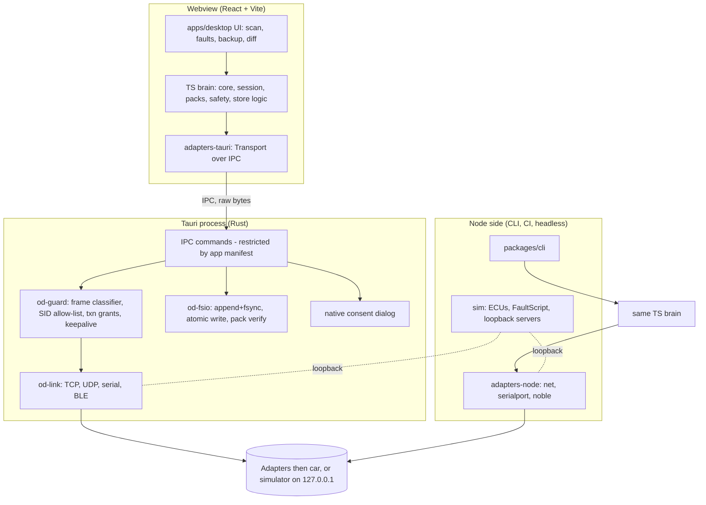

# Architecture proposal: Desktop-first, TypeScript brain with a Rust link host, Tauri 2 shell

Written 2026-11-20 for the 12-week window (Mon 2026-11-23 to Fri 2027-02-12). Proposal, not a decision. Not legal advice.
Author's stance: an independent architect arguing for one angle ("desktop first, ENET and serial native, mobile later") and then marking where it loses.

## Executive summary

1. **Thesis.** Keep the TypeScript protocol, session, safety and pack code (it exists, 27 tests pass). Add a small Rust "link host" inside a Tauri 2 desktop app that owns sockets, serial ports and BLE, and acts as a second, compiled-in write gate that web-layer code cannot bypass.
2. **Why desktop first.** The owner's gear (OBDLink CX over BLE, WiFi ENET, a bench module) and the best-behaved platforms line up on a Mac. The transport research ranks "macOS desktop with CX over BLE and ENET" as ship step 1 [adapter-and-transport-constraints].
3. **What it buys.** No local web server to defend; raw TCP for ENET and WiFi ELM without a helper; native BLE on three desktop OSes; a write gate that is a separate compiled layer, with writes physically absent from public builds.
4. **What it costs.** A Rust toolchain that is not installed today, a second transport implementation next to the Node one, Rust code duplicated at the gate, and a mobile story that is later and weaker.
5. **Reversal of a plan decision.** `docs/plan/architecture-12wk.md` ADR-004 rejected Tauri and chose daemon plus browser tab, then Electron. This proposal reverses ADR-004 only. ADR-001 (TypeScript core) stays; ADR-003 (daemon) is demoted to an optional headless tool.
6. **KPI fit.** M1 (Dec 18) does not wait for the shell: the existing Node CLI adapters measure G1 to G3 while the shell grows in parallel. The shell must be real by M2 (Jan 8).
7. **Biggest honest risks.** Tauri mobile is not proven; BLE on Tauri rests on one community plugin; the Rust gate doubles the safety code to keep in sync; and G12 (cash) gets tight once macOS notarisation is paid for.
8. **Where it loses.** To the daemon-plus-browser plan on contributor friction and G8-from-clone, and to a Capacitor-first plan on anything phone-shaped. Section 16 lists the measured triggers that should flip the choice.

---

## 1. How this relates to the existing plan

Read for this proposal: all 13 notes in `docs/research/deep2/`, `docs/plan/architecture-12wk.md`, `docs/plan/decisions.md`, `docs/plan/direction.md`, `docs/plan/kpis.md`, `docs/research/deep/EVIDENCE.md`, `docs/design/architecture.md`, `docs/design/failsafe-coding-spec.md`, `docs/plan/oss-leverage.md` (sections on D1), and the code in `packages/core` (2,008 lines of TypeScript in core and cli, read by file size and the transport and net files). I did not re-read every body paragraph of every deep2 note; I used each note's executive summary and the sections named in citations.

### 1.1 Decision deltas against `architecture-12wk.md`

| ADR | Existing plan | This proposal | Why |
|---|---|---|---|
| ADR-001 TS core, Rust only behind a trigger | TS core, Rust deferred | **Kept.** Rust is added only as I/O host and write gate, not as the protocol core | Its own reopen triggers include "latency on BLE traffic cannot be met in a WebView" [oss-leverage D1]; we pull the trigger early for I/O only, not for protocol logic |
| ADR-002 package layout | `adapters-node`, `adapters-web`, `daemon`, `apps/web`, `apps/desktop` (Electron) | Adds `adapters-tauri`, `apps/desktop` (Tauri), `crates/od-link`, `crates/od-guard`, `crates/od-fsio`; drops `adapters-web` and `daemon` from the 12-week critical path | One shell, not three |
| ADR-003 daemon is primary | WebSocket daemon on 127.0.0.1 | **Replaced in the app** by in-process IPC. `adapters-node` stays for CLI, CI and headless use | Removes threats T1 and T2 for the desktop app (section 12) |
| ADR-004 desktop shell | No shell until week 10, Electron spike, Tauri not chosen | **Tauri 2 from week 4** | Reverses ADR-004. See 16 for what we give up |
| ADR-005 mobile | Capacitor spike week 10 | Same spike, plus a time-boxed Tauri-mobile read-only test | Compare on the same test before committing |
| ADR-006 packs | Data only, signed `.odpack` | **Kept**, verified in Rust before the web layer sees a pack | One reader of pack files on disk |
| ADR-007 store | Files are truth, SQLite index | **Kept**; file primitives provided by Rust, logic in TS | |
| ADR-008 logging | Three streams, hash-chained audit | **Kept** | |
| ADR-009 journal engine | TS, fsync per record | **Kept** in TS; fsync call is done by Rust | See 6.5 |
| ADR-010 WriteToken and GuardedTransport | TS only, same-process bypass is a stated residual risk | **Strengthened**: second gate in Rust, writes behind a Cargo feature | Addresses the plan's own risk "TS single-process cannot isolate the write gate" [architecture-12wk section 9] |
| ADR-011, 012 tests, CI | As written | Extended with Rust jobs (6 more CI jobs, section 10) | |

---

## 2. Goals and non-goals

### 2.1 Goals (each traced to a KPI or decision)

| # | Goal | Anchor |
|---|---|---|
| A1 | One installable desktop app on macOS first, then Windows and Linux, that scans, reads faults in plain words and snapshots modules | G1, G6, G7, G8; direction.md option A |
| A2 | Reach every adapter the owner holds without a helper program: BLE (CX), WiFi ENET (TCP 6801 / DoIP 13400), WiFi ELM (TCP), USB or Bluetooth serial | adapter-and-transport-constraints sections 1 to 5 |
| A3 | Fast scans: sim under 2 s at week 4, real ENET under 6 s at week 8 and 4 s at week 12 | G2, G3 |
| A4 | A write gate that does not live only in the same JavaScript heap as the UI | G5, ADR-010 residual risk, failsafe-coding-spec section 3 |
| A5 | Writes compiled out of every public build | decisions.md #6; legal-safety-liability exec summary 8; kpis quality gates |
| A6 | Same TypeScript core runs in the app, the CLI, the simulator and (later) a phone web view | ADR-001 |
| A7 | Data packs are signed, provenance-checked and read by one trusted reader | ADR-006; data-strategy; dtc-crowd-curation-model |
| A8 | Adapter honesty: capability probing and a plain "what this adapter can and cannot do" screen | direction.md section 6; adapter-hardware-and-protocol-teardown (via EVIDENCE) |
| A9 | Zero telemetry, offline-first, no network sockets opened except to adapters | architecture.md section 10; ADR-008 T10 |

### 2.2 Non-goals for the 12 weeks

| Non-goal | Reason |
|---|---|
| Real-car writes of any kind | decisions.md #2; direction.md section 7 |
| iOS or Android release builds | Spike only, as in ADR-005; store policy work is separate [legal-safety-liability finding 7] |
| Flash, reprogramming, seed-key, SCN, unlocks | architecture.md section 2 non-goals; legal-safety-liability finding 4 |
| A public hosted web app or pack index | architecture-12wk 8.4 |
| Third-party code plugins | ADR-006 |
| Browser-only product | Cannot reach ENET or WiFi ELM at all [adapter-and-transport-constraints section 9.1] |
| Auto-update | "Nothing auto-updates the app" [architecture-12wk ADR-012] |
| Mercedes and Toyota writes | direction.md section 7; mercedes-and-toyota-reality exec summary 1 |
| Cross-brand coverage claims beyond what we test | direction.md option B rejected; dtc-mercedes-coverage and dtc-toyota-lexus-coverage say meaning coverage stays small |

---

## 3. Platform and transport matrix

Verdict key follows `adapter-and-transport-constraints.md` section 8: F fine, K flaky or conditional, I impossible, U unknown. The right-hand column is what this architecture actually ships and when.

### 3.1 Adapter by platform (what works)

| Adapter or link | macOS | Windows | Linux | iOS | Android | Browser demo | This proposal |
|---|---|---|---|---|---|---|---|
| OBDLink CX (BLE only) | F | F | K (BlueZ stuck-scan and cache issues) | F | F (Android 14 MTU rule) | Chrome and Edge only | Desktop week 4+ via Rust BLE; phones in the later spike |
| Other BLE ELM clone | F, UUIDs differ | F | K | F | F | Chromium only | Same driver, UUID list plus "one notify one write" fallback |
| Classic Bluetooth ELM327 | F | F | K | **I** | F | Paired only, Chrome | Desktop through the OS serial port (not tested by the research; U) |
| WiFi ELM327 clone (TCP, often 35000) | F | F | F | K (permission, "no internet" drift) | K (must bind to the dongle network) | **I** | Desktop week 4+ via Rust TCP |
| WiFi ENET adapter (HSFZ 6801, DoIP 13400) | F (signed bundle plus permission) | F | F | K | K | **I** | Desktop week 4+ via Rust TCP and UDP |
| Wired ENET (USB Ethernet plus cable) | F | F | F | K | **Risky** | **I** | Desktop; the owner's cable is unconfirmed [decisions.md] |
| USB serial (ELM USB, K+DCAN) | F | F | F | **I** (iPhone) | F | Chrome Web Serial | Desktop through a Rust serial crate; K+DCAN is E-series and out of scope |
| USB-CAN (gs_usb family) | K | F | F | **I** | K | K | Out of the 12 weeks |
| J2534 | U | F | U | **I** | U | **I** | Out of the 12 weeks |
| DoIP broadcast discovery | F | F | F | K (needs multicast entitlement) | U | **I** | Desktop; iOS uses unicast and manual IP |

Sources for every cell: `adapter-and-transport-constraints.md` section 8 and footnotes (a) to (q). Cells marked "U" were not established there.

### 3.2 What each platform needs from the app (OS-level rules we must meet)

| Platform | Rule | Source | Confidence |
|---|---|---|---|
| macOS | Bundled app must carry a Bluetooth usage string; a refused permission cannot be re-asked in code | adapter-and-transport-constraints 2.3 | medium |
| macOS 15+ | Local Network permission applies to bundled apps (blocks ENET and WiFi ELM until the user allows); command-line tools run from Terminal are allowed automatically | adapter-and-transport-constraints 4.2 (Apple TN3179) | high |
| macOS | Unbundled dev binaries inherit the parent app's Bluetooth permission; helpers may be killed otherwise | adapter-and-transport-constraints 2.3 | low-medium |
| macOS | BLE peripheral address is hidden; store a per-Mac UUID for "remember this adapter" | adapter-and-transport-constraints 2.3 | medium |
| macOS | First protected-characteristic touch shows a system pairing prompt that can block for long; use long timeouts | adapter-and-transport-constraints 2.3 | medium |
| Windows | BLE MTU is OS-controlled and readable only; threading apartment mistakes can stall BLE async calls | adapter-and-transport-constraints 2.4 | medium |
| Linux | BlueZ stuck scan and stale GATT cache; Wi-Fi and Bluetooth on one radio disconnects on small boards | adapter-and-transport-constraints 2.5 | medium |
| All | CX: max MTU 247, no queued writes, bonding open only 5 minutes after power-on, UUIDs FFF0/FFF1/FFF2, firmware readable from the Device Information service | adapter-and-transport-constraints 1.1 (vendor page) | high |
| All | WiFi ELM: set TCP_NODELAY, one client at a time, defaults vary per dongle (192.168.0.10:35000 and 192.168.4.1:23 both seen) | adapter-and-transport-constraints 3.2 | low-medium |
| All | Packaged webviews are system webviews: WebView2, WKWebView, WebKitGTK; so Web Bluetooth cannot be assumed | ui-library-landscape 7.4 | medium |

### 3.3 Mobile later: what we can honestly say now

| Question | Answer | Basis |
|---|---|---|
| Can the same web UI and TS core run on a phone? | Yes through a web view shell (Capacitor, or Tauri mobile) | ui-library-landscape 7.5; 7.4 |
| Is Tauri mobile ready? | Not proven. The 2.0 release post says mobile is still maturing and not all official plugins work there; no 2026 mobile feature matrix was found | Tauri 2.0 post (see Sources, S3); ui-library-landscape 7.4 |
| BLE crate on phones | btleplug lists iOS and Android as working (Android needs a hybrid Rust and Java build), its maintainers decline Tauri support questions; `tauri-plugin-blec` wraps it and has an Android backend | S6, S9; adapter-and-transport-constraints 2.6 |
| Phone field of use | Phones are the "primary for field use" in the transport research, desktop primary for coding and bench | adapter-and-transport-constraints 9.2 |
| Phone writes | None. Least reliable links (iOS WiFi dongle, Android unbound WiFi, browser BLE) stay read-only | adapter-and-transport-constraints 9.1 item 4 (design inference) |
| iOS limits that hold on any shell | No classic-BT ELM, no generic USB serial, Local Network prompt for any local TCP, multicast entitlement for broadcast discovery | adapter-and-transport-constraints 2.2, 4.2 |

Decision for the window: desktop ships; phone is a read-only spike judged on one shared test (section 13, week 10). If Tauri mobile and Capacitor tie, prefer Capacitor because its BLE plugin is verified for the CX case and the UI is the same React app [ui-library-landscape 7.5].

### 3.4 Browser demo tier

A hosted page is optional and last: Chrome or Edge desktop, BLE (CX) and USB serial only, read-only, no ENET [adapter-and-transport-constraints 9.2]. It reuses `@opendiag/core` and the web UI unchanged, so the cost is one `adapters-web` package (about 2 days, estimate). Not on the critical path; first thing cut if behind.

---

## 4. Architecture overview

### 4.1 Shape in one paragraph

Three layers. **The brain** is TypeScript: codecs, UDS client, scheduler, session, packs, safety state machine, backup and diff, UI. **The spine** is Rust inside the Tauri process: it owns every file descriptor that reaches a car (TCP, UDP, serial, BLE) and every durable write (journal, audit, backups), and it re-checks every outbound frame. **The shell** is Tauri 2 with a React UI in the system webview. The CLI, CI and the simulator use Node adapters behind the same `Transport` interface, so tests do not need Rust.

### 4.2 Module boundaries

Rule from ADR-002 is kept: dependency direction is one way, enforced by `scripts/check-boundaries.ts`. New rule: **no Rust crate depends on protocol meaning** (no DID tables, no pack semantics); Rust only classifies frames and moves bytes.

| Unit | Language | Contents | May depend on | Runs in |
|---|---|---|---|---|
| `@opendiag/core` | TS | util, `OdError`, isotp, uds, obd, dtc, hsfz, doip codecs, `Transport` interfaces, `DiagClient` | nothing | any |
| `@opendiag/session` | TS | Scheduler, keepalive policy, discovery logic, ELM tuning profiles (data) | core | any |
| `@opendiag/packs` | TS | schema, loader, verifier (also used by CLI), resolver, provenance lint | core | any |
| `@opendiag/safety` | TS | WritePlan, Journal logic, Gate, backup, diff | core, session, packs | any |
| `@opendiag/store` | TS | `Store` interface over a `FileOps` port; audit hash chain; export bundle | core | any |
| `@opendiag/sim` | TS | SimEcu, FaultScript, trace replay, loopback servers, ELM text sim | core, packs | node, any |
| `@opendiag/adapters-node` | TS | `net`, `serialport`, BLE for CLI and CI | core | node |
| `@opendiag/adapters-tauri` | TS | `Transport` and `FileOps` implemented over Tauri IPC | core | webview |
| `@opendiag/adapters-web` | TS | Web Serial, Web Bluetooth (demo tier, later) | core | browser |
| `apps/desktop` | TS + Rust | React UI, `src-tauri` (glue, capabilities, manifest) | all TS packages | Tauri |
| `crates/od-link` | Rust | Byte links: TCP (NODELAY), UDP, serial, BLE; connection state; no protocol meaning | std, OS crates | Tauri |
| `crates/od-guard` | Rust | Frame classifier per transport kind, read allow-list, txn grants, keepalive executor, refusal list loaded from JSON | od-link | Tauri |
| `crates/od-fsio` | Rust | `append_fsync`, `atomic_write`, directory listing, pack signature verify | std, ed25519 crate | Tauri |
| `packages/cli` | TS | Thin client, uses Node adapters directly | core, session, safety | node |
| `opendiag-packs` repo | data | Signed packs, CI | | |

Rust surface budget (estimate, low confidence): od-link 700 to 1,000 lines, od-guard 500 to 800, od-fsio 200 to 300, glue 300. About 1,700 to 2,400 lines against 2,008 lines of TypeScript today. That is the single biggest scope item this angle adds.

### 4.3 IPC contract (the only thing the web layer can ask of Rust)

All commands are listed in the app manifest so they are denied unless a capability grants them. Reason: the Tauri capabilities page states that custom app commands are allowed for all windows and webviews by default and can be restricted through the app manifest (S2).

| Command | Input | Output | Notes |
|---|---|---|---|
| `link_open` | kind (`tcp`, `udp`, `serial`, `ble`), params | `link_id` | Params validated in Rust; loopback and RFC1918 and link-local only for TCP, so a pack or bug cannot aim the app at the internet |
| `link_caps` | `link_id` | live write length, MTU, interval where readable, needs-permission flags | The "live write length, not a constant" rule [adapter-and-transport-constraints 1.2] |
| `link_send` | `link_id`, bytes, optional `grant_id` | ack or `Blocked{reason}` | Always passes through `od-guard`; fail closed on unparsable frames |
| `link_events` | `link_id` | stream channel of inbound bytes, link state | Raw payloads, no JSON wrapping (the 2.0 IPC rewrite added raw payload support, S3) |
| `link_close` | `link_id` | | |
| `keepalive_set` | `link_id`, request bytes, period | | Executed by a Rust timer; see 6.4 |
| `ble_scan` | filters (UUID list, name prefix) | devices | Includes Device Information read (model, firmware) |
| `fs_append`, `fs_write_atomic`, `fs_list`, `fs_read` | path under the data dir only | | Path confinement in Rust |
| `pack_load` | file path | verified pack JSON or error | Verification in Rust before JSON reaches the webview |
| `txn_request_grant` | plan JSON | `grant_id` or refusal | Only exists when the `writes` Cargo feature is compiled in |

### 4.4 Trust boundaries

| Boundary | What crosses | Control |
|---|---|---|
| Webview to Rust | The 10 commands above | App manifest allow-list; strict CSP; no remote content loaded; pack text rendered as text only |
| Rust to adapter or car | Bytes | `od-guard` classifier; address-range limits |
| Rust to disk | Journals, audit, backups, packs | Path confinement under the data dir; mode 600 files where OS supports it [architecture-12wk ADR-007] |
| Pack file to app | Signed `.odpack` | Ed25519 verify, expiry, rollback check in Rust [ADR-006] |
| Release to user | Installer | Platform signing plus checksums; see 11 |

---

## 5. Transport implementation notes

### 5.1 Common rules

- Rust provides byte links. Framing and diagnostics stay in TypeScript so the 27 existing tests and the golden vectors remain the single source for protocol behaviour [ADR-001 consequence 2]. The guard re-parses only the minimum needed to classify (section 6.2).
- Every link reports capabilities honestly: `maxInflight`, live write length, `needs_permission`, `needs_network_binding`, `unicast_only`. The transport research says the interface must carry these flags [adapter-and-transport-constraints 9.3].
- Adapter tier shown in the UI; the write gate requires tier 1 or 2 [architecture-12wk T6].
- Unsolicited frames are kept, not dropped: the current HSFZ and DoIP transports call `inbox.clear()` per request, which the plan already flags as a defect [architecture-12wk section 1]. The Rust link emits every inbound frame on the event channel with a monotonic timestamp, which is also what `.odtrace` needs.

### 5.2 BLE, OBDLink CX

| Item | Design | Source |
|---|---|---|
| Library | `btleplug` (BSD-3-Clause, central role only, desktop and mobile backends) behind a small trait so the plugin or the crate can be swapped | S6 |
| Plugin or direct | Spike week 2 on the crate directly; use `tauri-plugin-blec` (MIT or Apache-2.0) only if it saves time and exposes MTU and write length | S9; adapter-and-transport-constraints 2.6 |
| UUID match | UUID list first, else "one service with one notify and one write characteristic", else user pick | adapter-and-transport-constraints 1.2 |
| Chunking | Cap each write at negotiated value minus 3; verify with a loopback test | adapter-and-transport-constraints 11 (disagreement note) |
| Reassembly | By ELM prompt character, never by notification boundary | adapter-and-transport-constraints 1.2 |
| First-time flow | "Power the adapter, then pair within 5 minutes", with a power-cycle hint; macOS pairing prompt can block, so timeouts of tens of seconds | adapter-and-transport-constraints 1.2, 2.3 |
| Firmware gate | Read STN firmware from Device Information before sending ST commands | adapter-and-transport-constraints 1.4 |
| Not verified | Whether btleplug exposes the negotiated MTU or write length on each OS; whether bonding behaviour after the 5 minute window lets an already-bonded Mac reconnect | Gap G1, G2 |

### 5.3 WiFi ENET (HSFZ and DoIP) and WiFi ELM

| Item | Design | Source |
|---|---|---|
| Sockets | Rust `TcpStream` with `TCP_NODELAY`; UDP for DoIP vehicle identification and HSFZ discovery | adapter-and-transport-constraints 3.2, 4.1 |
| Tester address | Default 0xF4 on ENET; 0xF1 belongs to the CAN route; confirm from the owner's capture | EVIDENCE finding 4 |
| Unknown wire detail | HSFZ discovery bytes, length semantics, acknowledge, keepalive; the Rust classifier is **fail-closed** for any frame it cannot parse and is updated only with a capture-backed golden vector | EVIDENCE finding 3; adapter-and-transport-constraints 4.4 |
| macOS permission | A bundled app needs a signed bundle, a usage string and a first-run permission screen; CLI from Terminal does not. Test T6 early on the real bundle | adapter-and-transport-constraints 4.2, 10 (T6) |
| Dongle address | User-editable host and port; try known pairs; one client at a time | adapter-and-transport-constraints 3.2 |
| Several adapters | Link per adapter, user chooses; multiple network interfaces, do not assume `en0` | adapter-and-transport-constraints 4.2 |

### 5.4 Serial

`serialport` (Rust crate, MPL-2.0, supports Windows, macOS, Linux, iOS target listed, Android without enumeration; S7). MPL-2.0 is file-level copyleft: allowed as an unmodified dependency, tier B in `open-source-reuse-map.md`, flagged in the licence scan for review rather than auto-allowed (same treatment ADR-012 gives LGPL). Classic-Bluetooth ELM on desktop is reached through the OS serial port the pairing creates; the transport research did not test that path (U).

### 5.5 Where ELM state lives

The ELM driver (init, `ATSP`, `ATCRA`, `ATST`, prompt handling) stays in TypeScript (`@opendiag/session` tuning profiles are data). Rust sees ELM text only through the classifier in 6.2. This keeps one ELM implementation, tested against `SimElm`.

---

## 6. Safety pipeline placement

Source of the pipeline: `failsafe-coding-spec.md` sections 3, 5, 6; engine rules from `architecture-12wk.md` ADR-009 and ADR-010; decisions 2 and 6 in `decisions.md`.

### 6.1 Stage by stage

| Stage (failsafe spec) | Lives in | Why there |
|---|---|---|
| PLAN, gatekeeper (refusal list, tier, identity) | TS `safety` + Rust `od-guard` re-check | TS builds the plan and explains refusals; Rust refuses again from the same JSON refusal list |
| IDENTIFY (identity and software-level match) | TS | Needs packs and resolver |
| BACKUP (two reads, hash) | TS logic, Rust `fs_write_atomic` | Hash and verify in TS; durable write in Rust |
| DIFF and CONSENT | TS renders the diff; **Rust shows a native confirmation dialog built from the plan** and mints the grant | A webview script cannot click a native dialog; see 6.3 |
| PREFLIGHT (voltage, link, keepalive) | TS decides; Rust keepalive runs | Failsafe spec abort conditions need a keepalive that survives UI hiccups |
| DRYRUN | TS against sim or the dry-run mode of the pack steps | Pure logic |
| JOURNAL | TS record logic, Rust append plus fsync | Journal rules from ADR-009 (`STEP_SENT` before bytes leave the process) |
| APPLY | TS sends, Rust guard releases only requests matching the granted plan | Applier is the only emitter of 0x2E, 0x31 [failsafe spec section 3] |
| VERIFY (read-back after reset) | TS | |
| ROLLBACK, RECOVERY | TS state machine; Rust only provides durable files and a held link | Max 2 revert attempts, never on NRC 0x36 or 0x37 [ADR-009] |
| AUDIT | TS hash chain, Rust append | ADR-008 |

### 6.2 `od-guard`: the compiled-in last gate

**Classifier.** A pure function `classify(kind, bytes) -> Frame{sid, sub, target, class}` per transport kind: HSFZ, DoIP, ELM text line. `class` is `Read`, `Keepalive`, `AdapterConfig`, `Write`, `Refused`, `Unparsable`.

| Rule | Behaviour |
|---|---|
| Public build (no `writes` feature) | Only `Read` and `Keepalive` and `AdapterConfig` pass. `Write`, `Refused` and `Unparsable` return `Blocked`. The grant code is not compiled |
| Read allow-list | OBD modes 01, 02, 03, 07, 09, 0A; UDS 0x19, 0x22, 0x3E; session `10 01` only. This copies the list already in `readOnly()` in `packages/core/src/transport.ts` |
| ELM text | `AT` and `ST` commands pass only if they match a data-driven allow-list from the tuning profile; hex lines are classified by first payload byte after the current header; anything else is `Unparsable` |
| HSFZ and DoIP | Minimal header parse; length mismatch is `Unparsable`; address range checks on source and target |
| Refusal list | One JSON file in `opendiag-safety-data/refusal.json` consumed by TS (`@opendiag/safety`) and by Rust through `include_str!` at build time. One source, two readers, no duplicated list |
| Bench build (`writes` feature) | `Write` passes only with a `grant_id` and only if the request's hash is one of the steps in the granted plan |

**Golden vectors.** Both the TS decoders and the Rust classifier run the same JSON vector files in `packages/*/test/vectors/` [ADR-001 consequence 2]. A frame that classifies differently in the two languages fails CI.

**Honest limits.**
- The classifier duplicates a small amount of wire parsing. Wire details are still partly unknown [EVIDENCE finding 3], so the guard may block valid reads until captures arrive. Failing closed is the intended direction.
- Same OS user, same process: malicious native code still wins. Controls remain review, signed releases and no third-party code plugins [architecture-12wk ADR-010 item 6].
- The Rust gate is only worth its cost if writes exist in some build. In public builds the value is "the capability is absent", which is easy to test and to explain.

### 6.3 Consent that script cannot fake

The consent step in `failsafe-coding-spec.md` section 10 is a typed confirmation for rare, severe actions (the UX note supports that style only for rare actions) [ux-teardown-and-safety-ux exec summary 6]. In this design the final confirmation is a **native window created by Rust from the plan hash and a plain-language diff summary**; the webview cannot read or click it. The `grant_id` is bound to `txn_id`, the plan hash, an expiry and a single use per step. In the 12-week window this only runs against the simulator and the bench module [decisions.md #2].

### 6.4 Keepalive and watchdog

- `3E` tester-present is executed by a Rust timer from `keepalive_set`, not by a webview timer. Reason: failsafe spec section 3 requires the write engine to survive in a process with a watchdog, and ADR-009 aborts after 2 missed cycles; a keepalive that depends on a possibly busy or hidden web view is the weak link. (That webviews throttle hidden-window timers is general knowledge, not established in the research: low confidence, test it in week 4.)
- If the web layer disappears mid-transaction, Rust holds the link and keepalive for a fixed grace period, then stops sending, closes the link, and writes a `RECOVERY_REQUIRED` marker. It never replays a revert on its own; recovery is a user choice at next start [ADR-009 recovery rule].
- Abort points stay "between requests only" [ADR-009]. Rust never cuts a multi-frame request.

### 6.5 Journal and audit durability

- Rust `append_fsync` writes one JSONL record and syncs before returning. `STEP_SENT` is awaited before `link_send` is called, matching ADR-009.
- On macOS a plain `fsync` may not flush the drive's own cache; a full flush needs a special call. I believe Rust's `File::sync_all` does that on macOS and Node's `fs.fsync` does not. **Unverified in this run**: test with a power-pull-free proxy (kill -9 after write, compare) and read the std docs in week 5. Gap G5.
- Backups are written by atomic rename; hashes verified on every read [ADR-007, ADR-008].
- Kill-and-recover test: spawn the whole app, `SIGKILL` between write and read-back, restart, expect "open transaction" [architecture-12wk 8.1 week 8].

### 6.6 Capability tiers in this shell

| Build | Writes | Who gets it |
|---|---|---|
| `release` (default) | Not compiled in Rust; `features.writes=false` in TS; UI has no write controls | Everyone, including the week 12 beta |
| `bench` | Compiled; simulator and modules whose pack entry is `verified`; native consent | Owner and reviewers, labelled unsigned |
| `sim` | Compiled; simulator only | CI, contributors |

This matches ADR-010 item 5 and the "reader build with writes behind a compile flag" recommendation in `legal-safety-liability.md` exec summary 8.

---

## 7. Data and pack formats

Pack model comes from `data-schema.md` and `architecture-12wk.md` ADR-006; the content rules from `data-strategy.md`, `dtc-crowd-curation-model.md` and the DTC coverage notes.

### 7.1 File formats

| Artifact | Format | Where | Notes |
|---|---|---|---|
| Pack | `.odpack` zip: `manifest.json`, `entries/*.json`, `PROVENANCE.md`, `manifest.sig` (Ed25519) | Pack repo and local data dir | Verified in Rust; TS verifier shared with CLI and tests |
| Backup | JSON, existing `Backup` schema v1, SHA-256 of canonical bytes | `<data>/backups/<vin-hash>/<txn_id>.backup.json` | Already in `backup.ts` |
| Journal | JSONL, append-only, fsync per record | `<data>/journals/<txn_id>.jsonl` | ADR-009 record types |
| Audit | JSONL, hash-chained | `<data>/audit/<yyyy-mm>.jsonl` | ADR-008 |
| Trace | `.odtrace` JSONL `{t, dir, target, hex}` | `<data>/traces/` | Doubles as simulator replay input |
| Export bundle | `.odbundle` zip | User's choice | Raw blocks, hashes, journal, human report, tool version |
| Refusal list | `refusal.json` | Compiled into both languages | Single source |
| Index | SQLite, rebuildable | `<data>/index.sqlite` | Optional in 12 weeks; the in-memory index is enough for a few hundred modules (estimate) |
| Desktop settings | JSON | Platform dirs per ADR-007 | |

### 7.2 Entry shapes the research forces

| Constraint | Consequence in the schema | Source |
|---|---|---|
| BMW fault codes are 3-byte UDS codes plus a status byte, with four code shapes in the wild, and the first byte is not a module key | Key every code by (module identity, code bytes); never build a prefix-to-module table | dtc-bmw-coverage 1, 2 |
| Mercedes codes are a 5-character SAE base plus a failure-type suffix | Store base and failure-type byte separately; decode the shape even with no text | dtc-mercedes-coverage 1 |
| Toyota hybrid codes have a parent code plus information codes (INF) | Add a `sub_code` field to the DTC entry before any hybrid entry is written | dtc-toyota-lexus-coverage 7 |
| "Unknown code, here is what the module said" must be a normal state | First-class `unknown` render path; the app is useful at 0 percent text coverage | dtc-bmw-coverage recommendation |
| Generic codes are covered by OBDex (CC0) and a rewrite | Generic pack ships first; G6 week-4 target of 30 percent is reachable from generic coverage alone, if sessions mostly show generic codes (an assumption) | dtc-bmw-coverage 1; kpis.md G6 |
| OBDb is CC-BY-SA-4.0 and its BMW and Mercedes repos hold signals, not fault codes | OBDb-derived data is a separate pack, never merged into CC0 or CC-BY packs; it helps live data (G7-adjacent), not G6 | decisions.md #1; dtc-bmw-coverage 1; dtc-mercedes-coverage 1 |
| Share-alike direction: CC BY can flow into a CC BY-SA work, not the reverse | Pack linter checks direction at build time | dtc-crowd-curation-model 1 |
| Fix-reports: source tag, confidence tag, rights attestation, similarity gate, two-reviewer promotion | Schema fields and a quarantine state reserved now, UI later | dtc-crowd-curation-model 1 and section 9 |
| No properly licensed BMW or VAG coding database exists | Coding options are read-only labels built from owner captures in our own words | open-source-reuse-map exec summary |

### 7.3 Where Rust touches pack bytes

Only for signature, hash, expiry and rollback checks. Rust never interprets DIDs, PIDs or option text. This keeps A7 (one trusted reader) without growing Rust semantic code.

---

## 8. Plugin and brand-pack model

### 8.1 What an "extension" is in the 12 weeks

Data only. No third-party code, as in ADR-006. A "brand" is a bundle of packs plus a transport profile, selected by the resolver from module identity.

| Brand pack family | Contents in the window | Support tier | Source of limits |
|---|---|---|---|
| `obd-generic` | Standard PIDs, generic DTC meanings (rewritten, cross-checked against OBDex) | Full read | dtc-bmw-coverage 1 |
| `bmw-core` | Transport profile (ENET, tester 0xF4, scan candidate ranges), module identity DIDs, own-words fault text for bulletin-derived and induced-fault entries (100 to 250 entries is the planning estimate), read-only coding option labels | Read, snapshot, diff. No writes | dtc-bmw-coverage 1; bmw-g-series-coding-reality exec summary 9 |
| `bmw-g-series-notes` | Plain "this car does not allow it" explanations for 2023 plus platforms | Read only | bmw-g-series-coding-reality exec summary 2, 3, 8 |
| `mercedes-read` | Code shape decoder, control-unit designators, "locked, here is why" screen | Generic OBD-II plus decoding only | dtc-mercedes-coverage 7, 8; mercedes-and-toyota-reality exec summary 4, 8 |
| `toyota-hybrid` | Hybrid battery parent and information codes, small verified set (60 to 100 entries, estimate) | Read only | dtc-toyota-lexus-coverage 8 |
| `obdb-sa` (separate pack, CC-BY-SA) | Live-data signal definitions | Read only | decisions.md #1 |
| `sim-only` | Simulator vehicles, `simulator_only: true` | Test | ADR-006 |

### 8.2 Transport profile as data

The pack can name the transport kind, candidate address ranges, silence timeouts (150 ms Ethernet, 300 ms ELM defaults from architecture-12wk 6.2), ELM tuning commands (from an allow-list the Rust guard also holds), and keepalive profile. This is how a new brand is added without code. What data cannot do: change classifier rules. Classifier changes need a code release, by design.

### 8.3 Later: code plugins

If third-party logic is ever needed, the Rust host is where a WASM sandbox would live (ADR-001 trigger c). That is a possible advantage of this angle, but nothing in the research tests it, so it stays a future option and not a promise.

### 8.4 Contribution flow tied to the app

- "Export session report": `.odtrace` with VIN stripped by default, plus a human report. Counts as an outside report for G9 only when someone files it.
- "Suggest a fault meaning": opens a local form; the output is a file for the packs repo with source type, confidence and attestation. The app never uploads anything [architecture.md section 10].
- Pack linter in CI enforces provenance and licence direction (G11).

---

## 9. UI and shell notes

Component and chart choices are not re-argued here; they come from `ui-library-landscape.md` section 11 (Stack A: React 19, Vite, Tailwind v4, shadcn on Base UI, TanStack Table v9 and Virtual, uPlot, hand-built SVG gauges; Mantine 9 as documented fallback). Facts that change because the shell is Tauri:

| Topic | Effect | Source |
|---|---|---|
| Webviews differ by OS (WebView2, WKWebView, WebKitGTK) | Test the UI on all three; Web Bluetooth is not available, which is fine because BLE is in Rust | ui-library-landscape 7.4 |
| Old Linux distributions ship older WebKitGTK | Newer CSS used by Tailwind v4 may need a floor on distro version; **unverified**, test on one Ubuntu LTS image in week 9 | Inference; Gap G7 |
| `.tsx` is not run by Node | Keep UI logic in plain `.ts` hooks and reducers so `node --test` covers it; use Vite for the app | ui-library-landscape 8 |
| Same UI can later go in Capacitor | Keep the UI free of Tauri imports outside `adapters-tauri` and a thin `platform.ts` | ui-library-landscape U2 |
| Density, dark mode | Three density tokens; dark default, token-based, matches `web/index.html` | ui-library-landscape U3, U6 |
| Accessibility | WCAG 2.2 AA for safety flows; the native consent window needs its own accessible labels | ui-library-landscape U7 |
| Updater | Tauri's updater requires signatures that cannot be disabled and a private key owner-held (S5). Not enabled in 12 weeks; owner approves key creation first | S5; dev-box rules |

Screens needed by M2 (from `ux-teardown-and-safety-ux.md` and `user-jobs-and-demand.md`): connect and adapter health (voltage, link quality, honest capability report), whole-car scan with plain-word faults and an "unknown code" state, module snapshot with verified hash, snapshot diff, and a clear "this car does not allow it" message. Start-stop and battery registration are the top demand jobs but are writes; the app shows the current setting and says why it cannot change it [user-jobs-and-demand exec summary 1, 8].

---

## 10. Testing and simulator strategy

Extends ADR-011. Pyramid layers keep their names.

| Layer | TS side | Rust side | Shared |
|---|---|---|---|
| L1 unit, property, fuzz | `node --test`, `fast-check`, `jazzer.js` on decoders and pack loader | `cargo test`, `proptest` on the classifier, `cargo-fuzz` on the classifier and `od-fsio` | JSON golden vectors; any disagreement fails CI |
| L2 component | `SimEcu` plus `FaultScript` (drop link, silent, NRC 0x72, clamp write, corrupt read-back, power cut, delay) | Link tests against loopback servers | Same scripts |
| L3 integration | Brain over loopback HSFZ, DoIP and `SimElm`, Node adapters | **Same tests with the Tauri app** driven through IPC, sim servers on 127.0.0.1 | One conformance suite run against both transport implementations |
| L4 HIL | Self-hosted runner on trusted branches only, never fork PRs, separate OS user | Same | architecture-12wk T9 |
| L5 car | Manual, read-only, `.odtrace` plus audit | Same | decisions.md |
| UI e2e | Vitest for components; desktop e2e through WebdriverIO with the Tauri service | | See below |

Notes.
- **Two transport implementations is the cost.** The defence is one conformance suite (`transport-conformance.test.ts`) that both implementations must pass against the same loopback servers: request/response, concurrent requests, unsolicited frames kept, timeout, half-close, huge length field, slow-drip bytes, reconnect.
- Tauri desktop e2e: the Tauri docs describe WebDriver testing on Windows, Linux and macOS through WebdriverIO's Tauri service with an embedded server; plain `tauri-driver` does not support macOS (S4, medium). Plan a small smoke suite only; most coverage stays in L1 to L3.
- The simulator remains the safety evidence for weeks 1 to 10; the research warns that a too-forgiving simulator gives false confidence [architecture-12wk risk table]. Every real-car trace that disagrees with the simulator becomes a simulator bug first.
- A minimal ELM327 emulator is still needed and should be written in-house; no permissive one with BLE exists, and the best known is non-commercial [open-source-reuse-map exec summary].
- Cross-implementation oracles (python-udsoncan, iso14229) run nightly as dev tools, never bundled [ADR-011].
- Network-deny test: the app fails CI if it opens any socket other than to a user-selected adapter or a test loopback [ADR-008 T10].
- Rust CI adds: `cargo fmt`, `clippy`, `cargo test`, `cargo deny` (licences and advisories), `cargo audit` or equivalent, and a feature matrix build that proves the `release` build contains no write code (a test greps the binary symbols for the grant functions: simple, crude, effective; estimate 0.5 day).
- Rust crates worth reading as references (not copying) for the Rust side: `oxibus/automotive_diag` (Apache-2.0) and `I-CAN-hack/automotive` (MIT) [oss-leverage rows 14 and 15; open-source-reuse-map exec summary].

---

## 11. Release and licensing plan

### 11.1 Licensing

| Item | Licence | Note |
|---|---|---|
| OpenDiag code (TS and Rust) | Apache-2.0 | Existing |
| Tauri | Apache-2.0 or MIT | ui-library-landscape 7.1 |
| `btleplug` | BSD-3-Clause (README also notes parts derived from MIT/Apache and BSD-3 code) | S6 |
| `tauri-plugin-blec` | MIT or Apache-2.0 | S9 |
| `serialport` (Rust) | MPL-2.0 | S7; depend unmodified, review, do not vendor-edit |
| Fonts | OFL-1.1 | ui-library-landscape 9 |
| Packs | CC0 or CC-BY; OBDb-derived pack CC-BY-SA-4.0, separate repo path | decisions.md #1 |
| Excluded | PrimeReact 11, `flutter_blue_plus` | ui-library-landscape 9 |
| Rule | No GPL, AGPL, or non-commercial in shipped code; `cargo deny` plus the npm scan | kpis.md quality gates; architecture-12wk ADR-012 |

`python-can` (LGPL-3.0) and the GPL tools (EdiabasLib, python-OBD, OpenVehicleDiag and others) are learn-from-docs-only [open-source-reuse-map]. Nothing in this proposal links them.

### 11.2 Build and channels

| Channel | Content | Writes | Signing |
|---|---|---|---|
| nightly | CI build of `main`, macOS first | sim feature only | unsigned |
| beta | `v0.2.0-beta.N`, GitHub Release, checksums | none (release feature set) | macOS signed and notarised if the Apple programme is bought; Windows and Linux with checksums |
| stable | After gates of the relevant phase | none until a reviewer signs off | as above |
| bench | Owner and reviewers only | bench feature | unsigned, local |

Facts about distribution from the Tauri docs: macOS needs code signing and notarisation outside the App Store; Windows installers are signed; Linux formats include deb, AppImage, Flatpak, RPM, Snap (S8, medium). Installer sizes are not measured (U).

### 11.3 Money (G12)

| Item | Estimate | When | Source |
|---|---|---|---|
| Bench module and wiring | 100 to 150 USD | Week 7 | decisions.md |
| Apple Developer Program (signing and notarisation) | 99 USD per year (price from the plan, not re-fetched) | Week 11, not earlier | architecture-12wk 2.3 |
| Windows code-signing certificate | Not researched (U) | Skip; ship checksums | Gap G8 |
| Everything else | Free tier | | decisions.md |

Totals: about 100 to 150 at week 8 (inside the under-150 target), 199 to 249 by week 12 against a target of under 200. **The G12 week-12 target is at risk by up to about 50 USD if both purchases happen**; see risk R9 and section 16.

### 11.4 Compliance posture

Reader build only for the public window; no seed-key or lock-breaking material anywhere; "unaffiliated" wording and no OEM marks; counsel consult scheduled before stable; EU and US notes in `legal-safety-liability.md` apply. App-store policies (Apple 1.4, 2.3, 2.5.2, 5.1) matter only when a phone build is published and are out of window.

---

## 12. Security: threat-model deltas

Baseline is `architecture-12wk.md` section 7 (T1 to T13). Only changes are listed.

| ID | Change in this architecture | Result |
|---|---|---|
| T1 hostile web page drives the local daemon | No listening socket in the app; IPC reachable only from the app's own webview | Removed for the app. Stays for the optional headless daemon |
| T2 other local process uses the daemon | Same | Removed for the app |
| T3 malicious pack | Rust verifies signature, expiry, rollback before the webview sees data | Reduced |
| T5 hostile ECU or adapter bytes | Parsing split across TS decoders and the Rust classifier; fuzz both | Surface grows slightly; fuzzing covers it |
| T7 supply chain | Adds crates.io to npm; `cargo deny`, lockfiles, pinned versions, `cargo vet` or equivalent considered | Wider; more tooling |
| T8 confused deputy | Rust guard, Cargo feature, native consent | Reduced for public builds |
| T14 (new) XSS in the webview calling IPC | Strict CSP, no remote content, manifest-restricted commands, pack text escaped, a lint banning `dangerouslySetInnerHTML` | New control |
| T15 (new) Tauri and plugin updates | Plugin APIs can break in minor versions (release post), so pin and review; monthly dependency window | New cost |
| T16 (new) Unsigned beta builds trigger OS warnings | Checksums plus clear install notes; do not train users to bypass warnings for other software | Documented |

The Tauri 2.0 release included an external security audit by Radically Open Security (S3, medium; the scope of that audit was not read).

---

## 13. Week-by-week plan (12 weeks) against `kpis.md`

Capacity assumption from the existing plan: the owner about 15 hours per week, Claude doing most implementation. Dates follow decisions.md: research sprint Nov 23 to 25, coding from Thu Nov 26, G-A moves to Tue Dec 1, milestones M1 Dec 18, M2 Jan 8, M3 Jan 15, M4 Feb 12.

**Principle: the shell is never on the critical path to a milestone until M2.** M1 is met with the CLI and Node adapters that exist; the Tauri shell must be demonstrably alive by M2.

| Wk | Mon | Core track (TS, same as existing plan) | Shell and Rust track (this angle) | Exit check |
|---|---|---|---|---|
| 1 | Nov 23 | Research sprint Nov 23 to 25 (first ENET and CX timings, `research-sprint.md`). From Nov 26: commit in-flight tree, `OdError`, package split step 1, boundary script, licence scan | Install Rust with rustup after owner approval; `cargo new`, hello-world Tauri window; confirm Xcode command-line tools are enough (found at `/Library/Developer/CommandLineTools`) | Tests still 27 plus new; Rust builds on the owner's Mac |
| 2 | Nov 30 | Transport v2 caps; multi-in-flight HSFZ and DoIP; Scheduler; Session keepalive | `od-link` TCP with NODELAY and event channel; `adapters-tauri` Transport; conformance suite written first against Node; BLE spike with `btleplug` against the CX: log services, MTU and write length (test T1, T2) | **G-A Tue Dec 1.** Conformance suite green on Node adapters |
| 3 | Dec 7 | Discovery, parallel scan, scan cache, ELM probe and tuning, `packages/bench`. First real captures if the ENET cable is present | `od-link` UDP and serial; conformance green on Rust adapters over loopback; **IPC overhead benchmark** (budget: 1 ms p50 and 5 ms p95 per request, the daemon row of architecture-12wk 6.1); `od-guard` read allow-list with golden vectors | G-B: sim 40-ECU scan under 2 s p50 with 20 ms latency; CLI real timings logged |
| 4 | Dec 14 | CLI `scan --timing` and `quick` on real CX and ENET; sim write-then-restore harness reaching 50 round trips (G4 week-4 target) without the full gate | App v0: connect, scan, faults in plain words, VIN, 10 live PIDs; macOS bundle built; run test T6 (bundle versus Terminal on the real ENET) | **M1 Fri Dec 18:** G1 at least 3 traced sessions, G2 sim under 2 s, G3 under 6 s, G6 at least 30 percent, G4 sim 50, G8 at 15 minutes |
| 5 | Dec 21 | Store (files, audit chain, export bundle), backup and diff moved to `safety` (holiday week, small scope) | `od-fsio` append and atomic write; fsync behaviour test (Gap G5); backups from the app | G7 at 3 modules in the store |
| 6 | Dec 28 | Pack v1 schema, loader, verifier, signing CLI (keys need owner approval and a CREDENTIALS.md row), provenance and refusal linter, resolver; generic pack with own wording | Pack verify in Rust; refusal.json shared between TS and Rust; UI for snapshot and diff | G-C: tampered, expired, unsigned, rolled-back, refusal-list packs rejected in both verifiers |
| 7 | Jan 4 | WritePlan, Journal, Gate, WriteToken, `GuardedTransport`; sim write services | Rust `writes` feature: grant, plan-hash check, native consent window; classifier tests for write class; release-build symbol check | **M2 Fri Jan 8:** G7 at least 3 decoded, G5 holds, G6 at least 30 percent. Bench module bought this week (G12) |
| 8 | Jan 11 | FaultScript and 8 scenarios, kill-and-recover, property tests, safety package for the reviewer | Rust keepalive under UI stall; webview-crash scenario; kill the whole app and recover | **M3 Fri Jan 15 (G-D):** G4 100 of 100 on sim, G5 holds (100 bypass attempts, both layers) |
| 9 | Jan 18 | Live data from pack entries, CSV logging, voltage gate, step language dry-run | Live-data charts (uPlot); WebKitGTK and WebView2 UI test pass; Windows and Linux builds from CI | G2 real under 6 s on ENET; G10 at 95 percent |
| 10 | Jan 25 | Platform spikes memo | Capacitor read-only BLE spike plus time-boxed Tauri-mobile test, one shared test; optional `adapters-web` demo | G-E: go or no-go memo with measured scan time per platform |
| 11 | Feb 1 | Adapter qualification (CX, WiFi ENET, vLinker, clone), measured benchmarks replace estimates | Bench module trials (G4 on hardware); buy Apple programme and notarise; Windows and Linux smoke on hardware if available | G4 bench round trips toward 20 of 20; G3 under 3 s on real adapters |
| 12 | Feb 8 | Hardening: fuzz 1M per decoder, licence review, threat-model walkthrough, docs | Beta `v0.2.0-beta.1` with checksums; G8 timed by a non-author | **M4 Fri Feb 12:** week-12 column met or explained |

### 13.1 KPI trace

| KPI | Week-12 target | How this architecture serves it | Risk to it |
|---|---|---|---|
| G1 real-car sessions, 25 | Traced sessions from the CLI count too; app sessions add volume | If macOS permission or BLE trouble blocks the app, CLI still counts |
| G2 scan time, ENET | Rust sockets with NODELAY and an event stream; fan-out stays in TS first, move a declarative probe plan into Rust only if IPC is measured as the bottleneck | Unmeasured; no public baselines exist [kpis.md evidence update] |
| G3 quick read over ELM | Needs a BLE run on the CX or a WiFi ELM dongle; the owner's WiFi ENET adapter is not an ELM device | Same as every angle |
| G4 round trips | Journal fsync and kill tests; bench from week 11 | Bench module arrives late |
| G5 no unsafe write | Two gates plus absent code in public builds | Gate duplication drifts (R5) |
| G6 plain-English faults | Packs and "unknown" state | Data work, not shell work |
| G7 modules decoded | Snapshot UI by week 5 | Needs real cars |
| G8 clone to first read, 5 minutes | Notarised download path: install, open sim demo, connect; a clone-and-build path needs Rust and is slower | See 16 |
| G9 outside users, 10 | Signed macOS build helps; Windows and Linux builds unsigned | |
| G10 reliability | Rust link events plus honest capabilities | |
| G11 clean contributions | Pack linter in CI | |
| G12 cash under 200 | Section 11.3 | Over by up to about 50 USD in the worst case |

### 13.2 Cut order if a Friday scoreboard says behind

The existing plan cuts: web UI polish, step language, Electron spike, mobile spike; the safety engine and fault-injection suite are never cut [architecture-12wk 8.1]. This proposal's order:

1. Browser demo tier and `adapters-web`.
2. Tauri-mobile test (keep Capacitor).
3. Windows and Linux CI builds (macOS only for the beta).
4. UI polish and live-data charts.
5. Rust-side pack verification (fall back to TS verification inside the webview; lose A7 but keep G5).
6. Only then the Rust write gate and native consent (G5 is then carried by the TS gate alone, which is the existing plan's position).

Never cut: simulator safety suite, backup verification, the kill-and-recover test.

---

## 14. Performance notes

| Budget row (architecture-12wk 6.1) | Effect of this angle | Confidence |
|---|---|---|
| Daemon overhead 1 ms p50 and 5 ms p95 | Replaced by IPC overhead; Tauri IPC takes raw payloads (S3). Real cost not measured. Benchmark in week 3 | low |
| Gateway discovery 400 ms | Rust UDP receive loop with a 1.5 s listen window | medium |
| Full ENET scan 2 s p50 and 4 s p95 | Parallel fan-out in TS through IPC; 16 requests in flight is a hypothesis that needs the owner's car (no public data on BMW gateway concurrency) | low |
| ELM scan, WiFi 12 s p50 | Same as the existing plan | low |
| Tester-present jitter within 250 ms | Better than a web-view timer in principle; unmeasured | low |
| Web UI first load 150 KB gzip | Applies to the web bundle only; the desktop app has no network cost, so the budget becomes a memory and start-time budget (to be set in week 4) | medium |
| App start to ready | Not defined in the plan; add: under 2 s on the owner's Mac (target, estimate) | low |

Do not pre-optimise (existing rule). The ability to push a declarative probe plan into Rust is a reserve lever, not a design commitment.

---

## 15. Top 10 risks

| # | Risk | Likelihood | Impact | Mitigation | Evidence |
|---|---|---|---|---|---|
| R1 | Rust toolchain and Tauri build slow the first weeks; Rust not installed; a solo owner has 15 hours a week | High | High | CLI carries M1; shell starts week 2 after the conformance suite exists; cut order 13.2; installing needs owner approval | architecture-12wk 2.2; oss-leverage D1 |
| R2 | BLE on desktop through `btleplug` or `tauri-plugin-blec` is flaky or lacks MTU control; btleplug maintainers decline Tauri issues | Medium | High | Week 2 spike on the crate directly; fall back to Node `noble` in a sidecar (cost: bundle Node) or to the WiFi ENET route for the owner; keep the BLE trait small | S6; S9; adapter-and-transport-constraints 2.6 |
| R3 | macOS Local Network permission makes the bundled app look broken for ENET and WiFi ELM while the CLI works | Medium | Medium | Permission-state screen; test T6 in week 4; document `ENET works from Terminal` as a fallback | adapter-and-transport-constraints 4.2, 12 |
| R4 | Tauri mobile is not ready, so "mobile later" becomes a third transport implementation | High | Medium | Capacitor is the default; shared UI free of Tauri imports; mobile remains read-only | S3; ui-library-landscape 7.4, 7.5 |
| R5 | TS and Rust gates drift apart, producing false blocks or, worse, a gap | Medium | Very high | One refusal JSON; shared golden vectors; classifier is fail-closed; both gates tested by the same 100 bypass tests (G5); release-build symbol check | architecture-12wk risk table (single-process gate) |
| R6 | Wire details for HSFZ and DoIP are partly unknown, so the Rust classifier blocks valid frames or mis-parses | Medium | Medium | Fail-closed with a visible "blocked: unparsable frame" counter; capture-backed vectors in week 3 and 4 | EVIDENCE finding 3 |
| R7 | Webview differences, especially WebKitGTK on older Linux, break the UI | Medium | Low-Medium | macOS is the supported reference; Windows and Linux flagged "community tested" in the beta | ui-library-landscape 7.4; Gap G7 |
| R8 | A web UI or pack text injection reaches IPC commands | Low | High | Manifest-restricted commands, strict CSP, text-only rendering, lint | S2 |
| R9 | Cash overrun: Apple programme plus bench exceeds the week-12 target of 200 USD | Medium | Low | Buy the Apple programme in week 11 only; keep the bench module at the low end; distribute unsigned macOS builds to the owner only if the budget bites; ask the owner to rule on a G12 exception | kpis.md G12; architecture-12wk 2.3 |
| R10 | Simulator too forgiving, so the two gates pass tests that a real module would fail | Medium | Very high | Trace replay, cross-implementation oracles, bench module in week 11, no real-car writes in the window (owner decision) | architecture-12wk risk table; decisions.md #2 |

---

## 16. Where this angle loses (honest section)

### 16.1 Compared with the daemon plus browser tab plan

| Dimension | Existing plan | This proposal | Who wins |
|---|---|---|---|
| Time to first usable tool for contributors | `npx opendiag serve`, Node only | Needs Rust to build the app; contributors can still use the CLI and the sim without Rust | Existing plan |
| G8 (clone to first read) | Node and a browser | Download path is fine; clone path needs Rust unless the contributor uses the CLI demo. G8 must say which path it times | Existing plan on the clone path |
| Number of transport implementations | One (Node) plus browser ones | Two (Node and Rust) plus later mobile | Existing plan |
| One-person maintenance | One language to debug | Two languages and two gates | Existing plan |
| Debugging a field bug | Trace plus Node REPL | Trace; Rust side debugging is harder for a non-Rust owner | Existing plan |
| Attack surface of a local server | A listening port with token, Origin and Host checks | None in the app | This proposal |
| Write gate isolation | Same heap | Separate compiled layer, absent in public builds | This proposal |
| Native BLE and serial on all desktops | Node libraries (`serialport`, `noble` forks of unknown maturity) | Rust crates (btleplug, serialport-rs) | Tie; both unproven on this machine |

### 16.2 Compared with a Capacitor-first or native mobile plan

- iPhone and Android are where field use happens and where the least reliable links live [adapter-and-transport-constraints 9.2]. This proposal gets to a phone last.
- Tauri mobile is not proven (S3). If the owner's real use is "in the garage with a phone", this angle delays that by months.
- The Rust gate does not exist on a Capacitor phone, so mobile has only the TS gate and stays read-only. Honest, but it breaks the "same safety everywhere" story.

### 16.3 Compared with Electron

Electron runs the TypeScript core and Node adapters unchanged and supports Web Bluetooth, Web Serial and Node TCP in one process [ui-library-landscape 7.3]. It is the lower-risk shell for a solo owner and would deliver the same desktop app with less new code. Tauri wins on installer size, on the native-gate story and on not shipping a Node runtime; those are real but secondary to the KPIs. If the Rust gate is cut (13.2 item 6) and BLE through Rust proves hard, Electron becomes the better choice, and the TS packages move over untouched.

### 16.4 Things this proposal does not improve

- Data coverage (G6) and real-car volume (G1, G7) are not helped by the shell. The direction note says the moat is data [direction.md section 4].
- It does not make any adapter faster than its radio and chip allow; the research found limits are adapter waiting and ISO-TP pacing, not host language [adapter-and-transport-constraints 1.3].
- It adds nothing for the owner's top-demand jobs (start-stop, battery registration, coding), which stay out of the window by decision.

### 16.5 Measured triggers to switch

| Trigger | Measured when | Switch to |
|---|---|---|
| BLE through Rust cannot keep a CX session stable for 30 minutes on the owner's Mac | Week 2 spike | Electron with Node BLE, or ENET-only desktop first |
| Rust code is more than about 3,000 lines by week 6 (estimate) | Week 6 | Cut Rust gate per 13.2, keep Rust for I/O only |
| IPC overhead p95 above 5 ms or clearly worse than loopback WebSocket | Week 3 | Move the probe fan-out into Rust, or fall back to the daemon |
| The owner's priority shifts to phone-in-hand use | Any Friday | Capacitor-first plan, desktop via the same web UI in Electron |
| Weeks 1 to 4 slip more than a week because of Rust setup | Week 4 | Daemon plus browser tab as in the existing plan |
| macOS Local Network permission cannot be made understandable in the bundled app | Week 4 | Ship the CLI and a Terminal-launched local server for ENET |

---

## 17. Open questions for the owner (need a yes before the work)

1. Approve installing the Rust toolchain on the dev box (user-level install, not global packages). Confirm Xcode command-line tools are enough.
2. Which exact adapters are the three, and is one an ENET cable? This decides the week 2 BLE spike and the week 4 permission test [decisions.md].
3. Approve creating the pack signing keys (and, later, the Tauri updater key if the updater is ever enabled), with Keychain storage and registry rows.
4. Is a G12 exception acceptable if Apple notarisation pushes cash to about 250 USD?
5. Is Tauri-first acceptable even though it reverses ADR-004? If not, the Electron variant in 16.3 reuses everything but the Rust crates.

---

## Sources

Tool note: pages were fetched on 2026-11-20 through a summarising fetch tool, so wording is second-hand. No new web search was run; most facts come from local research files, cited by filename.

### Local files (read in full or by named section)

- `docs/plan/decisions.md`, `docs/plan/direction.md` (sections 1 to 7), `docs/plan/kpis.md`, `docs/plan/architecture-12wk.md`, `docs/plan/oss-leverage.md` (D1 and rows 14, 15)
- `docs/design/architecture.md` (sections 1 to 4, headings), `docs/design/failsafe-coding-spec.md` (sections 3 to 5 and headings)
- `docs/research/deep/EVIDENCE.md` (summary and index)
- `docs/research/deep2/adapter-and-transport-constraints.md` (sections 1 to 4, 7 to 12)
- `docs/research/deep2/ui-library-landscape.md` (summary, sections 7 to 11)
- `docs/research/deep2/open-source-reuse-map.md`, `legal-safety-liability.md`, `ux-teardown-and-safety-ux.md`, `competitor-feature-inventory.md`, `user-jobs-and-demand.md`, `bmw-g-series-coding-reality.md`, `mercedes-and-toyota-reality.md`, `dtc-bmw-coverage.md`, `dtc-mercedes-coverage.md`, `dtc-toyota-lexus-coverage.md`, `dtc-crowd-curation-model.md` (executive summaries and cited sections)
- Code: `packages/core/src/transport.ts`, `packages/core/src/net.ts` (first 60 lines), file inventory of `packages/`

### External pages fetched in this run

| Tag | URL | Used for | Confidence |
|---|---|---|---|
| S1 | https://v2.tauri.app/develop/sidecar/ | Sidecar config via `externalBin`, per-target-triple naming, shell permissions; no Node setup or mobile statement on that page | medium |
| S2 | https://v2.tauri.app/security/capabilities/ | Capabilities scope permissions per window; custom commands allowed for all windows by default, restrictable via app manifest | medium |
| S3 | https://v2.tauri.app/blog/tauri-20/ | Tauri 2.0 stable dated 2024-10-02; mobile still maturing, not all official plugins on mobile; plugin APIs may break in minor versions; IPC raw payloads; external security audit | medium |
| S4 | https://v2.tauri.app/develop/tests/webdriver/ | WebDriver testing on Windows, Linux, macOS via WebdriverIO Tauri service; `tauri-driver` alone not on macOS | medium |
| S5 | https://v2.tauri.app/plugin/updater/ | Updater needs signatures that cannot be disabled; private key via environment variable; losing it blocks updates | medium |
| S6 | https://github.com/deviceplug/btleplug | BSD-3-Clause; Linux, Windows, macOS, iOS, Android; central role only; no Classic; maintainers do not support Tauri; Android hybrid build, API 24 | medium |
| S7 | https://github.com/serialport/serialport-rs | MPL-2.0; Windows, macOS and iOS, Linux, Android without enumeration | medium |
| S8 | https://v2.tauri.app/distribute/ | macOS signing and notarisation, Windows installer signing, Linux formats | medium |
| S9 | https://github.com/MnlPhlp/tauri-plugin-blec | MIT or Apache-2.0; btleplug on desktop and iOS, own Android backend; no maturity statement | medium |

---

## Gaps (what could not be established)

| # | Gap | Effect | How to close |
|---|---|---|---|
| G1 | Whether `btleplug` exposes the negotiated MTU and write length on macOS, Windows, Linux | Chunking rule may need native glue | Week 2 spike (tests T1, T2 of the transport note) |
| G2 | What happens when an already-bonded Mac reconnects to the CX after the 5-minute bonding window | First-run and re-run UX | Week 2 on the owner's CX |
| G3 | Real IPC overhead of Tauri 2 for small raw payloads at scan rates | G2 target and the "move fan-out to Rust" decision | Week 3 benchmark |
| G4 | Whether webview timers are throttled when the window is hidden, and how much | Justification of Rust keepalive is partly assumed | Week 4 test |
| G5 | Whether `File::sync_all` does a full flush on macOS and Node's `fsync` does not (my belief, not read this run) | Journal durability claim | Read std docs, week 5 test |
| G6 | Whether Tauri's Node sidecar is viable as a BLE fallback (the Node sidecar guide was not read; the sidecar page says nothing about mobile) | Fallback in R2 | Read the Node sidecar guide before week 2 if R2 triggers |
| G7 | WebKitGTK versions on supported Linux distributions versus what Tailwind v4 and the chosen components need | Linux UI support level | Test on one Ubuntu LTS image in week 9 |
| G8 | Windows code-signing cost and SmartScreen behaviour for unsigned installers | G12 and G9 on Windows | Research before week 9; for now ship checksums |
| G9 | Installer sizes, memory use and start time of a Tauri build of this app | No numbers for the claimed "small" advantage | Measure on the week 4 build |
| G10 | Whether `tauri-plugin-blec` is maintained and what its last release date is (page did not show it) | R2 | Check crates.io before the week 2 spike |
| G11 | Rust line-count and effort figures in 4.2 and 13 are my estimates; nothing in the research sizes them | Schedule risk R1 | Re-estimate after the week 2 spike |
| G12 | No public scan-time baselines for ISTA, BimmerCode, Carly or OBDeleven | "Faster than incumbents" cannot be claimed | Owner times them [kpis.md evidence update] |
| G13 | HSFZ discovery bytes, length semantics, acknowledge and keepalive; BMW gateway concurrency behaviour | Rust classifier and 16-way parallel scan | Owner capture, weeks 3 and 4 |
| G14 | Android local-network behaviour for ordinary sockets and USB Ethernet drivers | Mobile later | Mobile spike |
| G15 | Whether a signed macOS bundle is needed for BLE during development (research says unbundled helpers may be killed) | Dev workflow in week 2 | Test with `cargo tauri dev` on the owner's Mac |
| G16 | App-store compliance of a phone build (Apple 2.5.2, 5.1 and others) | Mobile release, out of window | Separate research |
