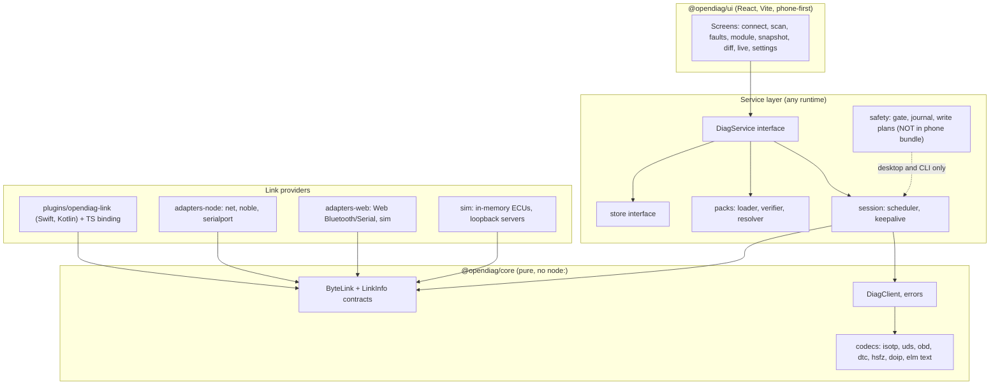
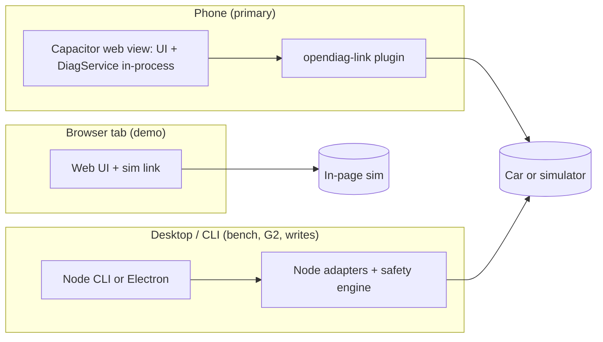

# Architecture proposal: mobile-first, shared TypeScript core, native link bridge

Angle argued: **mobile-first. One TypeScript core, a Capacitor shell on iOS and Android, a small native "link" plugin we own, and the desktop product later from the same codebase.**
Author role: independent software architect, arguing this angle on purpose. Written 2026-11-20. Not legal advice.
Status: PROPOSAL. Nothing here overrides `docs/plan/decisions.md`. Where it differs from `docs/plan/architecture-12wk.md` the difference is named.

## Executive summary

1. **Thesis.** Build the phone app first, because the owner's first job (plug in, scan, get every fault in words) is a job done at the car, and BimmerCode and BimmerLink (the apps we sit beside) are phone-first on four platforms [competitor-feature-inventory.md, ux-teardown-and-safety-ux.md]. Whether the owner actually works from a phone is **unmeasured** (assumption A9 in direction.md); this proposal makes that the week-1 gate.
2. **Shape.** Same TypeScript core and same web UI everywhere. The phone runs the core inside a Capacitor web view. Adapters reach the core through one narrow byte-stream contract (`ByteLink`) implemented by a native plugin we write (BLE, TCP, WiFi join/bind, permissions). Desktop and CLI use Node implementations of the same contract.
3. **Why a plugin we own.** Generic plugins cannot do the two things the platform research says are mandatory: bind to a no-internet WiFi dongle on Android and handle iOS Local Network permission and join flow [adapter-and-transport-constraints.md §3.3, §4.2]. So "native bridge" means about 600 to 1,000 lines of Swift and Kotlin (my estimate), wrapped by the community BLE plugin where it is good enough.
4. **Read-only on phones, writes on desktop and bench.** Matches owner decision 2 and the read-only-first legal advice [decisions.md, legal-safety-liability.md]. The write engine is not in any phone bundle. A CI check proves it.
5. **KPI fit.** G1, G3, G6, G10 get easier (phone in the car, BLE and WiFi ELM paths native). G2 (ENET scan speed) is still measured on a Mac with the Node adapters, because iPhone ENET is "flaky" in the research. G8 (clone to first read in 5 minutes) gets **harder** for contributors unless a browser sim mode exists; it is in the plan (week 2). G12 (cash under $200 at week 12) is **at risk** if iOS TestFlight is bought: $99 + bench module $100 to $150 can exceed $200.
6. **Where it loses (section 13).** It is slower to iterate than daemon-plus-browser, the strongest transport (BMW ENET) is weakest on iPhone, device-only test loops tax a one-person plan, and if the owner turns out to be a laptop user the first month is partly wasted. The design degrades: the shared core means about 70 percent of the work (my estimate) is reusable either way.
7. **Decision gates.** D0 Nov 25 (phone or laptop), D1 Fri Dec 4 (Capacitor plus own plugin proven on a real BLE adapter, bridge round trip measured), D2 Fri Dec 18 (M1), D3 Fri Jan 22 (iOS store path, cost). Each has a stated fall-back.
8. **Not verified.** I fetched no new web pages for this proposal. Every external fact is relayed from the repo's research docs with their own confidence tags. Nothing was run on a phone. All timings, line counts and effort numbers in this file are my estimates and are labelled.

---

## 0. How this was produced, and limits

- Read in full: `docs/plan/decisions.md`, `kpis.md`, `direction.md`, `architecture-12wk.md`; `docs/research/deep2/adapter-and-transport-constraints.md`, `ui-library-landscape.md`; executive summaries of the other eleven deep2 docs; `docs/design/architecture.md` section 4.3 and the section headings of `failsafe-coding-spec.md`; `docs/research/deep/EVIDENCE.md` (first 40 lines) and the CX/BLE part of `speed-and-latency-engineering.md`.
- Code read: `packages/core/src/transport.ts`, `elm327.ts` (ByteStream), `net.ts` (HsfzTransport), `index.ts`. Layout of `packages/core` (18 files, 2,008 lines including `packages/cli`) and `packages/cli` (1 file).
- **Not done:** no web search, no fetch, no device run, no build of Capacitor or any plugin. `web/index.html` is the only UI file in the repo; `docs/design/ui/` is empty.
- Confidence tags are inherited from the cited doc unless I say "(mine)" which means my own judgement, low to medium.
- Clean-room: nothing here needs, and nothing here proposes, OEM files, leaked keys or databases.

### 0.1 One correction to carry forward

`docs/research/deep/speed-and-latency-engineering.md` says iOS "will not go below 15 ms" connection interval. The later `adapter-and-transport-constraints.md` records that this was unsupported and corrected it: iOS decides the interval, the app cannot influence it, and the one thread read shows 15 ms for one peripheral only [adapter-and-transport-constraints.md §1.3 and Gaps item 15, medium]. This proposal uses the corrected version.

---

## 1. Goals and non-goals

### 1.1 Goals (mapped to the KPI table)

| # | Goal | KPI it serves | Mobile-first angle adds |
|---|---|---|---|
| P1 | One scan-and-read flow that works from an Android phone and an iPhone with the OBDLink CX (BLE) and with a WiFi ELM or WiFi ENET adapter | G1, G3, G10, N1 | In-car use without a laptop; BLE is native, not Chromium-only |
| P2 | The same core, same packs, same UI on phone, CLI and later desktop | G8, G11 | Single runtime (TypeScript) stays [architecture-12wk.md ADR-001] |
| P3 | Measured adapter truth per phone model: negotiated MTU, write length, round trip, drops | N2, G10 | The phone is where these numbers differ most [adapter-and-transport-constraints.md §1, §2] |
| P4 | Plain-English fault list with honest "no description yet" | G6, N1 | Phone-width layout first, desktop table second |
| P5 | Read-only verified snapshots and diffs stored on device and exportable | G7, N3 | Phone storage plus export bundle (iOS deletes app data with the app) [ux-teardown-and-safety-ux.md] |
| P6 | Live logging with named channels, exported as open CSV | N5 | Phone mounted in the car is the natural logger; foreground only in this window |
| P7 | Write engine proven on simulator and bench through Node, with **zero** write capability reachable from any phone build | G4, G5 | Read-only store build by construction |
| P8 | A browser sim mode so a stranger can see a scan in minutes without a phone or adapter | G8, G9 | Keeps clone-to-first-read near 5 minutes |
| P9 | Desktop (Electron around the same web bundle) after the phone path works | M4 | Same UI package, Node adapters |

### 1.2 Non-goals (this window)

| Non-goal | Why | Source |
|---|---|---|
| Any write on a phone | Owner decision 2; flaky links; unmeasured background behaviour | decisions.md, adapter-and-transport-constraints.md §9.1 point 4 |
| Real-car writes anywhere | Dropped, not deferred | decisions.md #2 |
| iPhone support for classic Bluetooth ELM clones, generic USB serial, USB-CAN, J2534 | Impossible on iOS | adapter-and-transport-constraints.md §8 |
| Wired ENET on Android as a promise | Depends on phone kernel driver | adapter-and-transport-constraints.md §4.3 |
| App-store public release in the 12 weeks | Gated on D3 and legal check | kpis.md M4, legal-safety-liability.md |
| Mercedes or Toyota features beyond a read-only "not yet" | Evidence thin | mercedes-and-toyota-reality.md, direction.md §7 |
| Rust core, Tauri | Not triggered | architecture-12wk.md ADR-001, ADR-004 |
| Third-party code plugins; downloaded code | Store rules and safety | legal-safety-liability.md (Apple 2.5.2), architecture-12wk.md ADR-006 |
| Cloud accounts, telemetry | Trust is the pitch | direction.md §7 |
| Flashing, emissions, immobiliser, odometer, SRS | Refusal list | direction.md §7, architecture-12wk.md ADR-010 |

---

## 2. Constraints this design rests on (ledger)

Every later section refers to these IDs. Source file names are in `docs/research/deep2/` unless a path is shown. Confidence is the source doc's own tag.

| ID | Constraint | Source | Conf. | Design consequence |
|---|---|---|---|---|
| C1 | CX is BLE 5.1 only; service 0xFFF0, notify 0xFFF1, write 0xFFF2; MTU max 247; no queued writes; bonding open only 5 min after power-on | adapter-and-transport-constraints.md §1.1 | high | BLE link must read live MTU and write length, write one chunk then wait; first-pair UX has a 5-minute rule |
| C2 | Android 14 sends 517 as first MTU request and ignores later ones; use the negotiated value | adapter-and-transport-constraints.md §2.1 | high | Plugin reports negotiated MTU after connect; core caps writes to it |
| C3 | Android 12+ needs BLUETOOTH_SCAN and BLUETOOTH_CONNECT runtime permission; 11 and lower need location | adapter-and-transport-constraints.md §2.1 | high | Permission state is part of the link contract |
| C4 | iOS connection interval is chosen by iOS; the app cannot influence it | adapter-and-transport-constraints.md §1.3 | medium-high | Do not promise throughput; measure per device |
| C5 | iOS example throughput 400 to 600 kbit/s vs 1000 to 1200 on Android in one developer's thread | adapter-and-transport-constraints.md §1.3 | low-medium | BLE radio is not the bottleneck for ELM text; round trips are |
| C6 | iOS has no classic-Bluetooth SPP without licensing; generic USB serial impossible on iPhone | adapter-and-transport-constraints.md §3.1, §5 | medium | iPhone adapter set is BLE plus WiFi only |
| C7 | iOS needs Local Network permission for any local TCP or UDP; multicast/broadcast needs a restricted entitlement; simulator does not implement it | adapter-and-transport-constraints.md §4.2 | high | Default to unicast to a known IP; manual IP entry; real-device tests only |
| C8 | iOS automatic joining of a no-internet dongle WiFi is unproven; reports conflict | adapter-and-transport-constraints.md §3.3 | low-medium | Manual join instructions are the baseline; auto-join is an experiment |
| C9 | Android 10+ network-specifier request shows a system dialog once, then silent; connection has no internet; the app must bind its socket to it or traffic goes to cellular | adapter-and-transport-constraints.md §3.2, §3.3 | high / medium | Plugin owns network binding on Android |
| C10 | WiFi ELM defaults vary (192.168.0.10:35000, 192.168.4.1:23); one client at a time; use TCP_NODELAY | adapter-and-transport-constraints.md §3.2 | low-medium | User-editable host and port; try known pairs; no-delay on sockets |
| C11 | Browsers have no raw TCP; Safari and every iOS browser lack Web Bluetooth and Web Serial | adapter-and-transport-constraints.md §4.2, §7 | high / medium | iPhone needs a native shell for BLE; browser build is a demo tier |
| C12 | macOS 15+ bundled apps need Local Network permission; Terminal-launched tools are exempt | adapter-and-transport-constraints.md §4.2 | high | Mac ENET from the CLI is the clean path for G2; desktop shell later needs a permission screen |
| C13 | Node strips only erasable TS, refuses `.ts` under `node_modules`, does not run `.tsx` | ui-library-landscape.md §8 | high | UI built by Vite; core stays plain erasable `.ts`; publish compiled JS |
| C14 | Capacitor BLE plugin `@capacitor-community/bluetooth-le` 8.4.0 (MIT): central only, MTU read, not usable in the iOS Simulator, Android `connect()` quirk | ui-library-landscape.md §7.5 | medium | Device tests mandatory; plugin kept behind our contract |
| C15 | `capacitor-tcp-socket` 8.0.0 exists; behaviour, maintainer, iOS Local Network handling untested | ui-library-landscape.md §7.5, Gap 10 | low | Treat as untrusted; plan an own TCP implementation |
| C16 | React Native route needs a second UI and a Hermes-compatible core; `react-native-ble-plx` 3.5.1 had 1 release in 12 months | ui-library-landscape.md §7.6 | medium | RN is the documented alternative, not the choice |
| C17 | Flutter BLE plugin `flutter_blue_plus` is commercial for for-profit use; PrimeReact 11 licence gate | ui-library-landscape.md §7.7, §2.1 | high | Excluded |
| C18 | Apple 2.5.2: no downloaded code that adds or changes features; packs must be data, not scripts. Apple 2.3: no "BMW" in name or keywords; compatibility claims must be backed by tests. Apple 1.4 physical harm; 5.1 privacy | legal-safety-liability.md (summary 7, table rows) | medium-high | Data-only packs; read-only build; no telemetry; nominative naming only |
| C19 | Google Play: no downloaded executable code outside Play (interpreted code in a VM exempt) | legal-safety-liability.md | medium | Same data-only rule |
| C20 | Reading is the safest legal ground; ship a reader build with no write code, writes behind a compile flag | legal-safety-liability.md (summary 1, 8) | high | Mobile bundle has no write engine |
| C21 | Newer G-series: reads work almost everywhere, writes hit a signing cliff | bmw-g-series-coding-reality.md (summary 1, 2) | medium / high | Phone product is a reader and snapshotter by nature |
| C22 | BimmerCode backs up each unit and stores in app; deleting the app deletes iOS backups | ux-teardown-and-safety-ux.md (BimmerCode rows) | high | Export bundle and Files/share-sheet export are v1 features |
| C23 | No source gives scan times for incumbents; G2 and G3 need own timing first | kpis.md evidence update, speed-and-latency-engineering.md | high | Week-1 measurement is a task, not an assumption |
| C24 | Fault-text sources are thin; description share unknown until owner's codes are collected | direction.md A4, dtc-bmw-coverage.md, dtc-crowd-curation-model.md | medium | G6 is data-bound, not shell-bound |
| C25 | Owner has three adapters (WiFi and Bluetooth), cables, bench PSU; models unconfirmed; one real purchase: bench module around week 7 | decisions.md | high | Plan uses what exists; confirms models in sprint |
| C26 | Existing core: `HsfzTransport` and `DoipTransport` import `node:net` directly; `ByteStream` is a string (latin1) stream used by ELM only | packages/core/src/net.ts, elm327.ts (read 2026-11-20) | high (code) | Needs a binary `ByteLink` and a move of `node:net` code out of core |
| C27 | The plan already runs one request at a time on HSFZ/DoIP (`inbox.clear()`) and no capabilities, cancellation or event stream | architecture-12wk.md §1 | high | Transport v2 (caps) is required by both mobile and desktop |
| C28 | Android and iOS background BLE and foreground-service rules for long sessions were **not researched** | adapter-and-transport-constraints.md Gaps 3 and 4 | n/a | Long drive logging is a risk and a week-9 measurement |
| C29 | Wired ENET on iOS: works only with a supported Ethernet adapter, a vendor page says a non-licensed adapter can drop mid-flash | adapter-and-transport-constraints.md §4.3 (k) | low | Wired phone ENET is a stretch test T8, not a feature |
| C30 | Owner decisions: share-alike OBDb data in a separate pack; bench modules only for writes; weekly KPI scoreboard decides cuts | decisions.md #1, #2, #3 | high | Pack separation applies inside the app binary too (section 7.4) |

---

## 3. Platform and transport matrix

### 3.1 What works where (ship status in this proposal)

Legend: **S** ships in 12 weeks and is tested. **E** experiment, may not ship. **N** not planned. **X** impossible (platform rule). All platform verdicts come from `adapter-and-transport-constraints.md` §8 (high where the cell says so there; flaky cells are medium or low).

| Transport / adapter | iPhone | Android | macOS | Windows | Linux | Provided by |
|---|---|---|---|---|---|---|
| OBDLink CX (BLE, STN) | **S** | **S** (Android 12+ permissions, MTU read) | **S** (CLI via noble; bundle needs Bluetooth usage string) | N (works per research, untested here) | N (BlueZ flaky) | Native plugin on phones; `adapters-node` (noble) on Mac/CLI |
| Other BLE ELM clones | **E** (UUIDs vary) | **E** | **E** | N | N | Same, generic UUID match with user pick |
| WiFi ELM327 clone (TCP 35000 / 23) | **E** (Local Network prompt, "no internet" drift) | **S** (with network binding) | **S** | N | N | Plugin TCP + join helper on phones; Node TCP on desktop |
| WiFi ENET adapter (HSFZ 6801 / DoIP 13400) | **E** (flaky per research) | **S** (binding) | **S** (Terminal-launched CLI exempt from permission) | N | N | Same as above |
| Wired ENET (USB Ethernet + cable) | **E** test T8 only | N (kernel driver dependent) | **S** (CLI, the G2 reference) | N | N | Node adapters |
| Classic BT ELM327 | **X** | **E** (Android RFCOMM, optional) | N | N | N | Out of scope; documented "not on iPhone" |
| USB-serial, K+DCAN, ELM USB | **X** | N | N | N | N | Out of 12 weeks |
| USB-CAN (gs_usb), J2534 | **X** | N | N | N | N | Out of 12 weeks (architecture-12wk.md §8.4) |
| DoIP/HSFZ UDP discovery (broadcast) | **N** on iPhone (multicast entitlement) | **E** | **S** (CLI) | N | N | Unicast to known IP is the phone default (C7) |
| Browser tab (Chrome/Edge desktop) | **X** (no Web Bluetooth on iOS browsers) | N | **E** sim mode, Web Bluetooth to CX | N | N | `apps/web` with `adapters-web`; sim mode is the contributor demo |

### 3.2 Reading the matrix honestly

- The strongest, fastest, best-evidenced BMW path (ENET, HSFZ framing agreed by four sources [EVIDENCE.md index, bmw-enet-hsfz-wire-protocol.md]) is "flaky" on iPhone and "fine with network binding" on Android. So **the best mobile BMW story is Android**. iPhone is BLE-first (CX) and ENET only after the C8 experiment.
- The owner's gear is an OBDLink CX (BLE) and a WiFi ENET adapter (owner brief, kpis.md evidence update). That pair maps to: phone + CX over BLE, phone + ENET over WiFi, Mac + ENET over WiFi or cable. Model names are unconfirmed [decisions.md].
- Whether the CX can reach body modules at all is assumption A2 and is unmeasured [direction.md]. If it only reaches the engine module, the phone-BLE value drops and the phone path becomes WiFi ENET, where iPhone is weakest. This is the largest single dependency of the angle (risk R1).

### 3.3 Permission and first-run state (belongs in the product, not in a help page)

| Platform | State the app must show | Source |
|---|---|---|
| iOS | Bluetooth permission; Local Network permission (granted, denied, undetermined); "joined adapter WiFi, but no internet" notice; real-device only | C7, C8 |
| Android 12+ | Nearby devices permission; WiFi network request approved or not; "bound to adapter network" yes/no | C2, C3, C9 |
| macOS app (later) | Local Network permission screen; Bluetooth usage string | C12 |
| All | CX 5-minute bonding rule; "close other OBD apps, one client only" | C1, C10 |

These come from `link.info()` (section 5.2) so the same screen renders on every platform.

---

## 4. Architecture overview

### 4.1 Layers



### 4.2 Deployment shapes (same code, different host)



### 4.3 The one structural idea: one service interface, two hosts

`architecture-12wk.md` ADR-003 puts a localhost daemon between the UI and the adapters. A phone cannot (and should not) run a daemon. So the UI talks to a `DiagService` **interface** with two implementations:

| Host | Implementation | Used by |
|---|---|---|
| In-process | `DiagService` built directly on session + core + link provider | Phone (Capacitor), browser sim mode, tests |
| Remote | JSON-RPC client to `opendiagd` (ADR-003 unchanged) | Desktop and CLI, and a browser tab pointed at a Mac |

The method set is the daemon's method set from ADR-003 (`scan`, `readDtcs`, `readDid`, `snapshot`, `diff`, events `link.state`, `scan.progress`, `session.lost`). This keeps ADR-003 and ADR-005 compatible and avoids a second UI. Cost: the service interface must be designed in week 2, before the daemon (week 4), not after.

---

## 5. Module boundaries

### 5.1 Packages (extends ADR-002; new or changed rows marked)

One-way dependencies, checked by the planned `scripts/check-boundaries.ts` [architecture-12wk.md ADR-002].

| Package | Contents | May import | Runtime | Change vs ADR-002 |
|---|---|---|---|---|
| `@opendiag/core` | util, errors, isotp, uds, obd, dtc, hsfz and doip **codecs**, elm text protocol, `DiagClient`, `ByteLink`, `LinkInfo`, `Transport` v2 | nothing | any | **Moves `net.ts` out** (C26); HSFZ/DOIP transports rebuilt on `ByteLink` |
| `@opendiag/session` | scheduler, keepalive, discovery logic, ELM tuning profiles | core | any | unchanged |
| `@opendiag/packs` | schema, loader, verifier, resolver, refusal list | core | any | unchanged; verifier uses `@noble/ed25519` (runs in web view) |
| `@opendiag/safety` | WritePlan, journal, gate, guarded transport, backup, diff | core, session, packs | any | **Excluded from phone bundles**; `GuardedTransport` default-deny (read allow-list) is split into a tiny `@opendiag/guard` that **is** in phone bundles |
| `@opendiag/guard` | read-only allow-list wrapper (successor of `readOnly()` in `transport.ts`) | core | any | **New** (about 50 lines, mine) |
| `@opendiag/store` | `Store` interface, memory impl, file impl (Node) | core | any | adds `store-capacitor` impl |
| `@opendiag/store-capacitor` | Store on app sandbox via the Filesystem plugin plus export/import bundle | store | phone | **New** |
| `@opendiag/sim` | SimEcu, SimVehicle, fault scripts, loopback servers, SimElm | core, packs | node + any | unchanged; add `SimLink` (in-memory `ByteLink`) |
| `@opendiag/adapters-node` | TCP, serial, noble BLE | core | node | unchanged |
| `@opendiag/adapters-native` | **TS binding of the native plugin**, implements `ByteLink` from plugin events | core | phone web view | **New** |
| `plugins/opendiag-link` | **Swift and Kotlin** plugin: BLE (wrapping `@capacitor-community/bluetooth-le` where it suffices), TCP, WiFi join/bind, permission state | native SDKs | iOS, Android | **New**, ours |
| `@opendiag/adapters-web` | Web Bluetooth/Serial, sim link | core | browser | lowered priority |
| `@opendiag/api` | `DiagService` interface, zod types, JSON-RPC client | core | any | adds the in-process host |
| `@opendiag/daemon` | `opendiagd` | all node-side | node | week 4 as planned; not on the phone path |
| `@opendiag/ui` | React components, tokens, screens (shared) | api | web view, browser | **New** (was inside `apps/web`) |
| `apps/mobile` | Capacitor shell and native projects | ui, adapters-native, store-capacitor, packs, session, guard | iOS, Android | promoted from "spike" |
| `apps/web` | Vite app: sim mode and daemon client | ui, adapters-web | browser | unchanged role |
| `apps/desktop` | Electron around the same web bundle and daemon | | desktop | week 10 spike as planned |
| `packages/cli` | thin client; also hosts the write/bench commands | node-side | node | unchanged |

Enforcement additions (extend the boundary script): (a) `apps/mobile` must not depend on `@opendiag/safety` (CI fails on import or on a `safety` entry in the mobile lockfile graph); (b) the mobile production bundle must not contain the strings `mintWriteToken`, `WriteStep`, `JournalRecord` (a bundle grep in CI); (c) `@opendiag/core` has no `node:` imports (already ADR-002).

### 5.2 The link contract (the heart of the native bridge)

Sketch only; names are mine and would be tightened in week 1. Binary in, binary out; **no text, no framing knowledge** in the plugin.

```ts
// @opendiag/core/link.ts (sketch)
export type LinkKind = "ble" | "tcp" | "sim";

export interface LinkOpenArgs {
  kind: LinkKind;
  ble?: { deviceId: string; serviceHint?: string[]; notifyHint?: string; writeHint?: string };
  tcp?: { host: string; port: number; noDelay: true; bindToAdapterNetwork?: boolean };
}

export interface LinkInfo {
  kind: LinkKind;
  /** BLE: usable bytes per write, read after connect (C1, C2). TCP: undefined. */
  writeLength?: number;
  mtu?: number;
  permissions: { bluetooth: "granted" | "denied" | "undetermined" | "n/a";
                 localNetwork: "granted" | "denied" | "undetermined" | "n/a" };
  /** Android: socket is bound to the adapter network. iOS: always false (cannot be forced). */
  boundToAdapterNetwork: boolean;
  /** Device Information service strings when the link is BLE (CX reports STN firmware here). */
  deviceInfo?: Record<string, string>;
  /** Adapter hints for the capability prober; never trusted for safety. */
  warnings: string[];
}

export interface ByteLink {
  open(a: LinkOpenArgs): Promise<LinkInfo>;
  write(data: Uint8Array): Promise<void>;     // resolves when the OS accepted the write; chunking is inside
  onData(cb: (chunk: Uint8Array) => void): () => void;
  onClose(cb: (why: string) => void): () => void;
  close(): Promise<void>;
  info(): LinkInfo;
}
```

Rules:

1. **Chunking and write pacing live in the plugin**, using the live write length (C1, C2): one chunk, wait for the write response, next chunk. The TS side never hard-codes 20 or 244.
2. **Receive is a notification stream.** Reassembly by prompt (ELM) or by length (HSFZ, DoIP) is in `core`, not native, so the same codecs and the same fuzz corpus run everywhere [architecture-12wk.md ADR-001 pure seams].
3. **Join and bind helpers are separate methods** (`joinAdapterNetwork(ssid)`, Android only; iOS returns "manual join" instructions). They exist in the plugin, not in core, because they are platform APIs (C8, C9).
4. **Permissions are queried and requested through the plugin**, and a denied state is data the UI renders (section 3.3).
5. **No SID, address or UDS knowledge in the plugin**, except the optional read-only filter (section 9.3).
6. `Elm327Transport` keeps its text logic and sits on a latin1 adapter over `ByteLink`; `HsfzTransport` and `DoipTransport` are rewritten to take a `ByteLink` (C26). Existing 27 tests keep running through an in-memory `ByteLink` (the sim servers are already loopback streams).

### 5.3 Transport v2 capability flags (mobile additions)

`TransportCaps` from `architecture-12wk.md` §5.1 gets four mobile fields: `needsPermission` (bluetooth, localNetwork), `needsNetworkBinding`, `unicastOnly` (iOS without the multicast entitlement), `foregroundOnly` (true on phones until C28 is measured). `maxPayload` is fed from `LinkInfo.writeLength`. The adapter tier (T1 to T3) from the plan decides read-only versus write-capable, and **every phone link is capped to read-only regardless of tier**.

---

## 6. Data and pack formats

### 6.1 Pack file (unchanged) and what mobile adds

The `.odpack` format is exactly ADR-006: zip with `manifest.json` (id, version, schema, licence, min_app, file hashes, `created`, `expires`), `entries/*.json`, `PROVENANCE.md`, `manifest.sig` (Ed25519, `@noble/ed25519`) [architecture-12wk.md ADR-006, data-schema.md]. Mobile-specific rules:

| Rule | Reason | Source |
|---|---|---|
| Packs are **data only**: JSON entries interpreted by shipped code; the step language is declarative with bounded retries and no loops | Apple 2.5.2 and Google Play executable-code rules; also ADR-006 | C18, C19 |
| Packs ship **inside the app binary** (a baseline signed set) and update only on **user action** (import file or pull from a user-chosen URL) | Offline-first rule; no silent downloads | architecture-12wk.md ADR-012, direction.md §7 |
| No OTA live-update service for JS bundles (Capacitor "live update" style) | It would download code that changes features | C18 |
| Phone verifies signature, expiry and rollback with the same loader as desktop | One verification path | ADR-006 |
| Phone caps tier at T0 for every entry (read-only) even if the pack says T1 or T2 | Read-only phone | P7 |

### 6.2 Brand packs and the share-alike pack

| Pack | Licence | Contents | In the app binary? |
|---|---|---|---|
| `generic` | CC-BY or CC0 (own words) | OBD-II PIDs, standard UDS DIDs, ISO 15031 DTC text | Yes |
| `bmw-core` | CC-BY | module address hints, identity DIDs, owner-captured module list with provenance and `tested_on`; DTC text where a clean source exists | Yes |
| `obdb-signals` | **CC-BY-SA-4.0** | OBDb-derived live-data signal definitions | **Not bundled by default** (see 6.3) |
| `toyota-ro`, `mercedes-ro` | CC-BY | "not yet" read-only stubs, standard OBD-II only | Yes, tiny |

Decision 1 says share-alike data stays in a separate pack and is never mixed into CC-BY/CC0 packs [decisions.md #1, open-source-reuse-map.md].

### 6.3 Open question that mobile makes sharper (low confidence, mine)

Bundling CC-BY-SA data **inside an App Store binary** raises a question that desktop and CLI do not: whether store terms are compatible with share-alike obligations for the bundled data. I found no source that answers it; the plan already calls for a short legal check before the first public release of that pack [decisions.md #1, direction.md A10]. Until then the proposal ships `obdb-signals` as a **separate file the user imports**, not as part of the binary. That costs a setup step for live data on a phone (hurts N5 first-run). It is cheap to reverse.

### 6.4 Backup, snapshot and journal files

Same formats as ADR-007 (`Backup` schema v1, `.odbundle` zip, JSONL audit and trace). Storage on the phone is the app sandbox via `store-capacitor`; export uses the OS share sheet and Files app. Journals matter only for writes, which are not on phones, so the phone store needs **no fsync-per-record journal** in this window (the plan's journal engine lives in Node) [architecture-12wk.md ADR-009]. Reason to keep export first-class: iOS removes app data when the app is deleted [C22].

Volatile-field masking (assumption A8, counters and timestamps changing between identical reads) is a pack-level `mask` list, applied in the diff before hashing, so two snapshots can hash-compare on phone and desktop identically [direction.md A8, N3].

---

## 7. Safety pipeline placement

### 7.1 Where each control lives

| Control | Placement | In phone bundle? | Source |
|---|---|---|---|
| Read-only allow-list (SIDs 01 02 03 07 09 0A 19 22 3E and `10 01`) | `@opendiag/guard`, wraps every `Transport` the UI can reach | **Yes** | transport.ts (`readOnly`), ADR-010 |
| Refusal list (SRS, immobiliser, odometer, emissions, key learning) | `@opendiag/safety/refusal.ts` mirrored in pack linter and **loader** | Loader copy yes; engine no | ADR-010, direction.md §7 |
| Unknown identity means read-only | resolver in `@opendiag/packs` | Yes | ADR-006, ADR-010 |
| Voltage read and display | `ATRV` through the ELM/STN profile; shown on every connect | Yes (display) | direction.md §8 item 2 |
| Write plan, journal, gate, tokens, revert | `@opendiag/safety` | **No** | ADR-009, ADR-010 |
| Verified backup before any write (read twice, hashed) | `@opendiag/safety/backup` (also used for read-only snapshots) | Snapshot code yes; write coupling no | decisions.md #2, G5 |
| Typed confirmation, diff preview | UI package, driven by the gate | Components exist; no wired writes | ux-teardown-and-safety-ux.md |

### 7.2 Why writes are off the phone (and stay off until C28 is measured)

1. Owner decision 2: bench modules only, and in this window not on a car at all [decisions.md].
2. The phone is the least predictable client for a mid-write abort: app backgrounding, screen lock, an incoming call, OS BLE connection drops. Background behaviour was never researched [C28]. An abort between requests is the design rule [architecture-12wk.md ADR-009]; the OS can break that rule for us.
3. The research marks iOS WiFi, Android WiFi without binding, Linux BlueZ and browser BLE as the least reliable links and says they "should stay read-only" (a design inference, not a sourced fact) [adapter-and-transport-constraints.md §9.1].
4. Store review: Apple 1.4 and Google "interfere with devices" lines are cited as possible reviewer concerns for write features [legal-safety-liability.md]. A reader build avoids the question.

### 7.3 In-process isolation limits (honest)

In a Capacitor web view the UI, `DiagService` and `guard` share one JS context. ADR-010 already admits that same-process malicious code can bypass all of it and relies on review, signed releases and no code plugins [architecture-12wk.md ADR-010 item 6]. Mobile adds nothing worse, but does not add isolation either. Two controls make the phone build stronger than "trust the JS":

1. **Absence beats prohibition.** The mobile bundle does not contain the write engine (CI grep, section 5.1). There is nothing to mint a token.
2. **Optional native read-only filter (stretch, week 10 or later).** The plugin inspects the first UDS service byte after parsing HSFZ, DoIP or an ELM hex command and refuses anything outside the allow-list. This is about 150 to 300 lines per platform (mine) and **duplicates logic** outside the TS fuzz suite. It is only worth building if the shared golden vectors (JSON) are also run against it. I rate it as nice to have, not required for the window.

### 7.4 Pack and data safety on the phone

Signature, expiry, rollback and refusal checks are in the shared loader, so a malformed pack on a phone is rejected the same way as on a Mac. Fuzz targets are the same decoders; pack loader fuzz runs in Node only, since the loader code is identical [architecture-12wk.md ADR-011].

---

## 8. Plugin and brand-pack model

### 8.1 Two kinds of extension (kept from the design docs, tightened for stores)

| Kind | What | Who can add | Phone |
|---|---|---|---|
| **Data packs** | JSON entries (modules, DIDs, DTC text, signal maps, coding blocks, ELM profiles, procedures in the declarative step language) | Anyone, via PR to `opendiag-packs`; signed in CI | Yes, signed |
| **Link providers** | New `ByteLink` implementations (another adapter family) | Maintainers in the repo | Built in; no runtime loading |
| **Code plugins** (third-party executable code) | none | nobody in 12 weeks | **Forbidden** (C18, C19, ADR-006) |

### 8.2 Brand model

- **Brand code** is small and in the repo: framing and addressing conventions that are protocol facts, e.g. HSFZ port 6801, tester address 0xF4 on the ENET route versus 0xF1 on the CAN route [EVIDENCE.md index, bmw-enet-hsfz-wire-protocol.md], DoIP routing activation for non-BMW. No per-car tables in code (existing rule) [architecture-12wk.md ADR-002 note, §6.2].
- **Brand packs** hold everything car-specific: reach hints, identity DIDs, DTC text, coding blocks, live signal sets, ELM tuning per adapter family.
- Resolver outcome `exact | family | unknown` decides what the UI offers; on the phone every outcome is read-only [architecture-12wk.md §5.3].
- **BMW first** (G-series reads work "almost everywhere", writes hit a cliff [C21]), **Toyota/Lexus** via standard OBD-II plus OBDb signals in the separate pack, with the A90 Supra as the only BMW-platform bridge [toyota-lexus-protocols-and-open-data.md via direction.md], **Mercedes** a documented "locked, here is why" screen [mercedes-and-toyota-reality.md].

### 8.3 Naming and store posture

"BMW" does not appear in the app name, keywords or screenshots' headlines (Apple 2.3, nominative use in body text only with a disclaimer) [C18, direction.md §7]. Compatibility claims must come from measured sessions with saved traces, never from a vendor table [direction.md §7, C23].

---

## 9. Testing and simulator strategy

### 9.1 Pyramid (ADR-011 kept; mobile layers added)

| Layer | What | Where it runs | Mobile addition |
|---|---|---|---|
| L1 unit, property, fuzz | codecs, state machines, pack loader | Node (`node --test`), Jazzer for decoders | Golden vectors are JSON, shared with the native filter (if built) |
| L2 component | `SimEcu` with timing and `FaultScript` | Node | `SimLink` makes the same sim reachable in-process on a phone and in a browser |
| L3 integration | loopback HSFZ/DoIP servers and SimElm; `.odtrace` record and replay | Node | **Phone-to-Mac TCP**: phone app connects over LAN to the Mac's loopback sim servers, exercising the real plugin TCP path, the Local Network prompt (C7) and ELM-over-TCP |
| L3b BLE | CX emulation | Mac peripheral tool plus real phone | **A small Mac tool (Swift, CoreBluetooth peripheral role) that exposes service 0xFFF0 with notify/write characteristics and bridges to SimElm** (my estimate: 200 to 300 lines, own code). No permissive BLE ELM emulator exists, and the best known one is non-commercial [open-source-reuse-map.md]; this reads only its public behaviour list |
| L4 HIL | real adapters, real phones | Owner's desk; self-hosted runner for Mac side only | Phone runs a **self-test screen** (link conformance suite) and exports a JSON result file the owner attaches to the Friday scoreboard |
| L5 car | manual, tagged, saved `.odtrace` | Owner's car, read-only | Phone sessions export traces for replay as regression tests |

### 9.2 Constraints that shape this (cited)

- The Capacitor BLE plugin **cannot run in the iOS Simulator**, and the iOS Simulator does not implement the Local Network permission, so BLE and Local Network behaviour are real-device only [C14, C7]. Whether the Android emulator can do BLE was **not researched** (Gap).
- iPhone-simulator tests therefore cover UI and `SimLink` only. This is the biggest reason the angle costs iteration speed (section 13).
- The sim must not lie on timing. Latency model comes from measured numbers, not defaults: bridge round trip (week 2), BLE per-command cost (week 3), ENET from the Mac (Nov 25 sprint) [kpis.md, research-sprint.md].

### 9.3 Link conformance suite (new, small)

One TS suite, about 25 cases (mine), run against four providers: `SimLink`, Node TCP, Node noble, native plugin. Cases: open/close, write chunking at MTU 20 and 244, reassembly of a 4095-byte ISO-TP response via ELM text and via HSFZ, backpressure, close during write, permission denied surfaces as data not a crash, reconnect after remote close, "one request in flight" for ELM, 1000-message echo for round-trip percentiles. It is the thing that makes "a native plugin we own" testable instead of folklore.

### 9.4 UI tests

Component tests with Vitest or Playwright component mode (Node cannot run `.tsx`) [C13, ui-library-landscape.md §8]; logic (reducers, hooks, formatters) kept in plain `.ts` so the existing `node --test` runner covers it. Playwright against `apps/web` sim mode at phone width (375 by 812) and desktop width. Storybook is optional and cheap.

---

## 10. UI constraints this architecture imposes (the visual design is a separate doc)

From `ui-library-landscape.md` (recommendation: React 19, Vite, Tailwind v4, shadcn on Base UI, TanStack Table v9 and Virtual, uPlot, own SVG gauges; Mantine 9 as fallback) with phone-first adjustments:

| Concern | Rule |
|---|---|
| Layout | Single column at under 640 px: fault list as expandable rows (same data model as the desktop table), module list as a stack, detail as a full-screen sheet. Two-pane from 1024 px |
| Touch | Targets at least 44 px (platform convention; not sourced in the research, mine) |
| Density | Three density tokens decided once (comfortable, compact, dense) [ui-library-landscape.md §10 U3]; phone defaults to comfortable |
| Dark mode | Dark default, token based [ui-library-landscape.md §10 U6] |
| Live data | Per-channel store, ring buffer 10 to 50 thousand points per channel, uPlot or lightweight-charts; update rate is tens of samples per second at most [ui-library-landscape.md §1] |
| Accessibility | Never colour-only state; numeric text inside every gauge; `role="meter"` [ui-library-landscape.md §5.3] |
| Web view risk | Dense tables and long logs in a web view may scroll poorly on mid-range Android; virtualise only the frame log, measure in week 4 [ui-library-landscape.md §7.5, mine] |
| Bundle | First-load budget from the plan (150 KB gzip desktop JS) is a **web** budget; a phone app ships assets locally, so the budget that matters is cold start on a mid-range Android, measured not assumed |
| Safety flows | Preflight, snapshot, diff, typed confirm are built as components now and wired to the gate on desktop only [ux-teardown-and-safety-ux.md summary 8] |

---

## 11. Release and licensing plan

### 11.1 Licence

- Code Apache-2.0 (existing). Docs and non-share-alike packs CC-BY (existing plan). `obdb-signals` CC-BY-SA-4.0 in a separate pack file [decisions.md #1].
- Dependencies: MIT or Apache-2.0 only in shipped code; PrimeReact 11 and `flutter_blue_plus` excluded [C17]. LGPL is flagged and avoided for iOS static linking [open-source-reuse-map.md rule B].
- **Gap in the plan's licence gate:** the planned scan reads `pnpm licenses list`, which does **not** see CocoaPods, Swift packages or Gradle dependencies pulled in by native plugins. The mobile track needs a second scan over the native dependency lists, tool not chosen (Gap).

### 11.2 Channels

| Channel | Phone artefact | Who | Gate |
|---|---|---|---|
| nightly | Debug APK from CI (unsigned or debug-signed) | contributors, owner | simulator and sim mode only |
| beta | Android release APK (sideload, checksums) from tag; iOS TestFlight **if D3 passes** | owner, G9 volunteers | week-12 column met or explained |
| stable | Store release | public | after counsel check, name check, review notes written; **not in 12 weeks** |

### 11.3 Cost (feeds G12, "under $200 at week 12")

| Item | Price | Source | Status |
|---|---|---|---|
| Apple Developer Program | 99 USD per year | architecture-12wk.md §2.3 (not re-fetched there) | needed for TestFlight and device builds beyond local signing |
| Google Play developer | 25 USD once | architecture-12wk.md §2.3 | optional; sideload first |
| Bench module and wiring | about 100 to 150 USD | decisions.md | the plan's one purchase |
| Windows/macOS signing | deferred | architecture-12wk.md §2.3 | out of window |

Arithmetic: 99 + 100 to 150 = **199 to 249 USD**, so G12 passes only at the low end if iOS TestFlight is bought. Options: (a) Android sideload only in the window, iOS for the owner's own phone through local development signing (I believe local signing needs no paid programme but did not verify this; low), (b) accept a G12 exception at the Friday scoreboard per decision 3. This is a D3 decision; I flag it rather than hide it.

### 11.4 Store compliance checklist (from legal-safety-liability.md)

Privacy policy and usage strings (Bluetooth, Local Network); no account; no telemetry by default; "Notes for review" describing read-only scope and safeguards; no "BMW" in name or keywords; data-only packs; no downloaded code; compatibility claims backed by saved traces. Apple 5.2.5 and later parts were not fully read in the legal research [legal-safety-liability.md Gap 8].

### 11.5 Signing keys (dev-box rules)

Apple certificates, provisioning, Android upload keystore and pack signing keys are keys. Creation or rotation needs owner approval, a row in `~/.claude/CREDENTIALS.md` in the same step, storage in Keychain, no key in the repo [DEVBOX rules; architecture-12wk.md §7.3]. CI signing from a protected environment, not the dev Mac.

---

## 12. Twelve-week build path

Calendar and gates follow `architecture-12wk.md` §8 and `kpis.md` milestones: research sprint Nov 23 to 25, coding from Thu Nov 26, G-A Tue Dec 1, M1 Fri Dec 18, M2 Fri Jan 8, M3 Fri Jan 15, M4 Fri Feb 12 [decisions.md #5, #7]. Capacity: owner about 12 to 15 h per week plus Claude sessions [architecture-12wk.md header, direction.md §10]. Effort numbers are mine.

### 12.1 Week by week

| Wk (Mon) | Mobile-first deliverables | Shared deliverables (same as plan) | Exit check / KPI move |
|---|---|---|---|
| 1 (Nov 23) | **D0 gate (Nov 25):** owner answers phone vs laptop, which phones, which adapter models; capture first ENET and CX reads (read-only, saved trace). Thu Nov 26: Capacitor 8 skeleton in `apps/mobile` (hello screen), "scan BLE, connect to CX, read Device Information" on the owner's phone | Error model; split `core` pure vs `adapters-node`; `ByteLink` contract; boundary script and licence scan; `.odtrace` recorder | G-A Dec 1. First real timing for G2/G3 recorded (sprint) |
| 2 (Nov 30) | `opendiag-link` v0 BLE path on **Android first** (permissions, negotiated MTU, chunked write); TS binding; **bridge round-trip benchmark** (1000 echoes, p50 and p95); `DiagService` interface in `@opendiag/api`; `SimLink`; browser sim mode starts | Transport v2 caps; scheduler; session keepalive | **D1 gate Fri Dec 4:** BLE round trip measured on a real CX; continue only if the added bridge cost is small against a BLE round trip (stated rule below) |
| 3 (Dec 7) | iOS BLE; plugin TCP (own implementation if the community plugin fails the conformance suite); Android network join and bind; iOS Local Network flow; first **phone quick read** (VIN, faults, voltage) from the owner's car via CX; link conformance suite v1 | Discovery, parallel scan, scan cache, ELM probe, bench package | G1 session 1 on phone with trace. G-B Dec 11 (sim) |
| 4 (Dec 14) | Phone UI skeleton: connect, scan, faults, voltage, 10 live PIDs; first Android debug APK and iOS device build for the owner; Mac CLI ENET scan timing | `opendiagd` v0 (desktop, CLI), daemon security tests | **M1 Dec 18:** G1 at least 3, G2 sim under 2 s, G3 under 6 s on ELM path |
| 5 (Dec 21) | `store-capacitor`, export bundle, share sheet, import; diff view on phone (holiday week, small scope) | `@opendiag/store`, hash-chained audit, backup flow | G7 progress; export round trip on a real phone |
| 6 (Dec 28) | Bundled signed `generic` and `bmw-core` packs; pack import UI; `obdb-signals` as import-only; G6 measured per source | Pack loader, verifier, signing CLI, linter, resolver | G6 first real number; legal question list updated |
| 7 (Jan 4) | Snapshot and diff on phone for real modules (read twice, hash); volatile-field masking; adapter report screen (N2) | WritePlan, journal, gate, tokens in Node (desktop only) | **M2 Fri Jan 8:** G7 at least 3, G5 holds, G6 at least 30%, N3 first half |
| 8 (Jan 11) | **CI bundle check:** mobile bundle has no write engine; read-only conformance on phone; web-view table performance pass | Fault injection, kill-and-recover, property tests, safety review package | **M3 Fri Jan 15** (simulator) G4 100 of 100, G5 holds |
| 9 (Jan 18) | Live data on phone: 10+ named channels, ring buffer, CSV export, keep-awake, foreground-only banner; **C28 background measurement** (screen lock, app switch) on both phones | Step language dry-run (if not cut), voltage gate | N5 first drive log (30 min target) |
| 10 (Jan 25) | **D3 gate Fri Jan 22 (end of wk 9):** iOS TestFlight yes or no, decided before this week; Android release APK; Electron shell around the same web bundle (desktop later) | Platform go/no-go memos | G-E: per-platform scan timings |
| 11 (Feb 1) | Adapter qualification on **each phone model and each of the owner's 3 adapters** (MTU, write length, RTT, drops); native filter only if time | Bench module read-only then write/restore from Node CLI (G4 on bench) | G2, G3, G10 measured; bench 20 of 20 targeted |
| 12 (Feb 8) | Beta tag, checksums, install guide, store-review notes drafted (not submitted), retrospective | Fuzz 1M per decoder, licence review (JS and native), threat-model walkthrough | **M4 Fri Feb 12:** week-12 column met or explained |

**D1 rule (mine, stated now so it cannot drift):** if the bridge adds more than about one fifth of a typical BLE command round trip, or if the plugin cannot pass the conformance suite on Android by Fri Dec 4, switch to the fall-back: phone becomes a **Mac-hosted web UI over a LAN daemon** (ADR-003 unchanged, mobile spike per ADR-005) and the week-3 to week-9 phone items move to the plan's original week 10. The numeric threshold is a judgement, not a sourced figure.

### 12.2 KPI trajectory under this path

| KPI | Wk 4 target | Mobile-first path | Risk note |
|---|---|---|---|
| G1 real sessions | 3 | Phone CX or ENET sessions from week 3; Mac CLI ENET sessions also count | Needs the owner at the car; shared with every angle |
| G2 ENET scan, median s | sim under 2 | Measured **on the Mac** (CLI, wired or WiFi ENET) | Phone ENET timing reported separately, not claimed against G2 |
| G3 ELM quick read, s | under 6 | Phone over BLE CX and over a WiFi ELM clone | Needs a WiFi ELM device or a BLE run (kpis.md evidence update b) |
| G4 round trips | sim 50 | Node sim; unaffected | None from mobile |
| G5 | 0 | Strengthened: no write engine in phone bundles | Needs the bundle CI check (week 8) |
| G6 description share | 30% | Data-bound; phone shows "no description yet" | A4 unknown |
| G7 modules backed up | 3 by M2 | Phone snapshots count if hashes verify twice | BLE reach to body modules is A2 |
| G8 clone to first read, min | 15 (wk 4) then 10, 5 | Browser sim mode gives the clone path (target 5 min, no phone, no Xcode); **phone path is longer** (Xcode or Android Studio) and is not what G8 times | Must be agreed with the owner: G8 measured on sim mode, or on a prebuilt APK/TestFlight link |
| G9 outsiders | 1, 4, 10 | Android APK sideload is the easy route for outsiders; iOS depends on D3 | iOS outsiders blocked without TestFlight |
| G10 finish without retry | 90% | Phone logs per adapter and phone model | Phone-specific failures can lower it; honest reporting required |
| G11 | 100% | Same linter | Native dependency scan gap |
| G12 cash | under 50 / 150 / 200 | See 11.3 | Likely exception if TestFlight is bought |

### 12.3 What gets cut first (per decision 3, the Friday scoreboard decides)

Order for this angle (differs from architecture-12wk.md, whose cut order starts with the mobile spike): (1) step-language engine, (2) Electron shell, (3) native read-only filter, (4) web-view table polish and Storybook, (5) iOS TestFlight, (6) write-engine breadth beyond what the bench trial needs [direction.md §9.1]. **Not cut:** the read-only guard, the bundle check, the link conformance suite, the pack verifier, the verified-backup rule.

---

## 13. Top 10 risks and mitigations

Likelihood and impact are my judgements (medium unless stated), each tied to a source.

| # | Risk | L / I | Evidence | Mitigation | Early signal |
|---|---|---|---|---|---|
| R1 | The CX over BLE reaches only the engine module, so the phone-BLE story collapses | Medium / High | A2: CX is HS-CAN and ISO/KWP only, nothing measured on BMW over it [direction.md A2, adapter-and-transport-constraints.md §1] | Week-1 scan over CX; if engine-only, make WiFi ENET the phone path and say so; keep Mac+ENET as the reference | Sprint scan result |
| R2 | The owner uses a laptop, not a phone, so phone-first is the wrong order | Unknown / High | A9: audience phone vs laptop unmeasured [direction.md A9] | D0 gate Nov 25; the core, packs, sim, conformance suite and UI package are shared, so a pivot to daemon-first loses the plugin work only (about 25 to 35% of weeks 2 to 4, mine) | Owner's answer |
| R3 | Community TCP plugin is unfit; we must write our own | High / Medium | `capacitor-tcp-socket` untested [ui-library-landscape.md Gap 10, C15] | Own TCP in the plugin from week 3; conformance suite decides; the contract hides the choice | Suite failures wk 3 |
| R4 | iOS WiFi dongle join and "no internet" drift make ENET on iPhone unreliable | Medium-high / Medium | Reports conflict, no Apple statement [adapter-and-transport-constraints.md §3.3, C8] | Manual join as baseline; Android first for ENET; iPhone BLE primary; test T4 early | T4 in week 3 |
| R5 | Plugin bridge latency or serialization makes G3 and G2-on-phone miss | Medium / High | Unmeasured (mine); bytes cross a JSON bridge | Week-2 echo benchmark; batch commands; move chunking and ELM prompt waiting native if needed; D1 rule | Echo p95 |
| R6 | Web-view scroll and touch performance on dense tables | Medium / Medium | Named risk for Capacitor [ui-library-landscape.md §7.5] | Virtualise frame log only; measure week 4 on a mid-range Android; fall back to simpler lists on phone | Week-4 trace |
| R7 | Store rejection, trademark or legal friction | Medium / Medium | Apple 1.4, 2.3, 2.5.2, 5.1; no OBD-specific rule found [legal-safety-liability.md] | Read-only build, data-only packs, review notes, name check in week 1, sideload and TestFlight external group only after D3 | Counsel call |
| R8 | Cash: iOS programme fee plus bench module breaks G12 | High / Low | 99 + 100 to 150 > 200 at the high end [11.3] | Android sideload first; decide D3 on money; accept an exception on the scoreboard | Week-9 spend |
| R9 | Background and screen-lock behaviour breaks 30-minute drive logs (N5) | Medium-high / Medium | Not researched [C28] | Foreground only, keep-awake, banner "keep the app open"; measure week 9; log gaps explicitly | Week-9 test |
| R10 | Safety drift: a write path leaks into a phone bundle, or a native filter diverges from the TS allow-list | Low-medium / Very high | ADR-010 admits same-process limits [architecture-12wk.md ADR-010] | Absence by CI (bundle grep, dependency check); shared JSON vectors; native filter optional and only with vector parity | CI red |

Also real but lower: slow device test loops (section 14), native skills pool (14.5), and the unresearched Android emulator BLE question.

---

## 14. Where this angle loses (honest)

1. **Slower iteration for a one-person plan.** BLE and Local Network cannot be exercised in the iOS Simulator [C14, C7]; every transport change needs a device, a cable and a build. Daemon-plus-browser tests on one Mac with loopback servers in seconds. I estimate the mobile track adds 20 to 35 percent to the transport and UI weeks (mine, not measured).
2. **The best BMW transport is weakest where this angle is strongest.** ENET (fast, four-source framing, the plan's G2 path) is "flaky" on iPhone and conditional on Android [adapter-and-transport-constraints.md §8]. Desktop gets it for free and with no permission fight on a Terminal-launched CLI [C12].
3. **Owner risk is concentrated in A9 and A2.** If the owner is a laptop user (A9) or the CX is engine-only (A2), the central premise weakens. Daemon-first is robust to both.
4. **G8 gets worse for contributors.** A phone build needs Xcode or Android Studio plus device signing. Only the browser sim mode rescues "5 minutes from clone" and sim mode is not the product [kpis.md G8].
5. **We take on native code in two languages.** About 600 to 1,000 lines of Swift and Kotlin (mine) outside the TypeScript fuzz and test culture, where the project's stated advantage is one runtime and a large contributor pool [architecture-12wk.md ADR-001 consequences]. The Rust trigger (b) in ADR-001 (iOS native BLE needing a shared core Capacitor cannot give) has **not** fired, but this angle walks close to it.
6. **No writes on the platform where this angle lives.** The write engine, bench trial, G4 and G5 (the project's trust claim) are all desktop work. The phone team can look busy while the highest-value safety work happens elsewhere. If the owner values the safety story over the in-car convenience story, this angle spends the first four weeks on the wrong thing.
7. **Money and store timing.** G12 is likely breached if iOS ships beta (11.3). App review lead times were not researched.
8. **Unmeasured platform behaviour.** Background BLE, foreground services, Android emulator BLE, Capacitor plugin access from a Worker (so the core stays on the UI thread) are all **unknown**; the phone is where unknowns pile up.
9. **Phone ecosystem gaps.** No USB, no classic Bluetooth, no J2534 on iPhone [C6]. A K+DCAN or older-car story (E-series) is zero on iPhone and unplanned on Android in this window.
10. **Where it genuinely wins:** in-car use, BLE natively on iPhone (no Chromium-only API), Android network binding done properly, the same product shape as BimmerCode and BimmerLink users already know, and a pivot path that keeps most work. If A9 and A2 both come back favourable, this is the best audience-fit option I can find in the evidence. If either fails, switch at D0 or D1 and lose little.

---

## 15. Relationship to existing decisions (ADR map)

| ADR in architecture-12wk.md | This proposal |
|---|---|
| 001 TypeScript core | Kept. Trigger (b) watched, not fired |
| 002 Package layout | Extended (section 5.1): `guard`, `adapters-native`, `plugins/opendiag-link`, `store-capacitor`, `ui` |
| 003 Browser reaches TCP via daemon | Kept for desktop and CLI. Phone uses the in-process host of the same `DiagService` interface (new ADR-M1) |
| 004 Desktop shell | Kept; Electron wraps the same web bundle at week 10 |
| 005 Mobile spike only | **Replaced:** mobile is the primary track; spike risks become D0, D1, D3 gates |
| 006 Pack format and signing | Kept; data-only rule gets store citations |
| 007 Storage | Kept; phone store plus export |
| 008 Logging and errors | Kept; plugin errors map to `OdError` codes (`LINK_PERMISSION`, `LINK_MTU`, `LINK_NETWORK_UNBOUND` suggested) |
| 009 Write engine | Kept; Node only in this window |
| 010 Write capability and token | Kept; add mobile bundle absence check |
| 011 Simulator and HIL | Kept; add Mac peripheral tool and link conformance suite |
| 012 CI and releases | Kept; add native dependency licence scan and mobile channels |

New ADRs proposed: **M1** one `DiagService`, two hosts; **M2** Capacitor over React Native and Flutter (reasons C14 to C17); **M3** own native link plugin behind `ByteLink`; **M4** phone builds are read-only by absence; **M5** `ByteLink` binary contract replaces the string `ByteStream` for network transports (C26).

### Why Capacitor and not React Native or Expo

Both are viable for BLE. Capacitor keeps one UI and the shadcn/TanStack stack, and runs the TypeScript core in a normal web view with `crypto.subtle`, `Uint8Array` and the DOM [ui-library-landscape.md §7.5, §7.9]. React Native needs a second UI (DOM components do not carry), a Hermes-compatible core without Node APIs, and `react-native-ble-plx` showed one release in 12 months with its New Architecture status not found [ui-library-landscape.md §7.6]. The contract in 5.2 is shell-neutral, so switching would mean rewriting only `plugins/opendiag-link` as a native module and the UI layer. That is real work, not free. I rate the choice medium confidence.

---

## 16. Open questions for the owner

1. Phone or laptop at the car, today (A9)? Which phones (iPhone model and iOS version, Android model and version)? Is Xcode installed and an Android device available? (Unknown to me.)
2. Exact model names of the three adapters; is one cable an ENET cable? [decisions.md]
3. Is a TestFlight programme worth about 99 USD to you if it likely breaks G12, or should iOS stay "own phone only" in this window?
4. Is the G8 definition "clone to first fault read in browser sim mode" acceptable, or must it include a phone build?
5. Approve a Mac-side BLE peripheral test tool (own code) and a phone self-test screen as part of week 3?
6. OK to defer bundling the share-alike OBDb pack into any store binary until the legal check?

---

## Sources

All external sources are **relayed from the repo's research docs, not re-fetched in this run**. Tags are the original docs' tags. Local files are cited by path. A claim marked "(mine)" has no source.

### Local (read 2026-11-20)

- `docs/plan/decisions.md`, `docs/plan/kpis.md`, `docs/plan/direction.md`, `docs/plan/architecture-12wk.md`
- `docs/research/deep2/adapter-and-transport-constraints.md`, `ui-library-landscape.md`, `user-jobs-and-demand.md` (summary), `competitor-feature-inventory.md` (summary and platform rows), `legal-safety-liability.md` (summary and store-policy rows), `open-source-reuse-map.md` (summary and mobile rows), `ux-teardown-and-safety-ux.md` (summary and BimmerCode rows), `bmw-g-series-coding-reality.md` (summary), `mercedes-and-toyota-reality.md` (summary)
- `docs/research/deep/EVIDENCE.md` (index), `docs/research/deep/speed-and-latency-engineering.md` (BLE section, with the correction in 0.1)
- `docs/design/architecture.md` §4.3 (superseded Rust platform table, kept for the transport tiers only), `docs/design/failsafe-coding-spec.md` (headings)
- Code: `packages/core/src/transport.ts`, `elm327.ts`, `net.ts`, `index.ts`; root `package.json`

### External pages cited by those docs (not re-fetched here)

| Used for | URL | Tag in source doc |
|---|---|---|
| CX service UUIDs, MTU 247, bonding window | https://support.obdlink.com/support/solutions/articles/43000746707-obdlink-cx-adapter-notes | high |
| iOS Local Network rules | https://developer.apple.com/documentation/technotes/tn3179-understanding-local-network-privacy | high |
| Android Bluetooth permissions | https://developer.android.com/develop/connectivity/bluetooth/bt-permissions | high |
| Android 14 MTU 517 | https://developer.android.com/about/versions/14/behavior-changes-all | high |
| Android network specifier, no-internet WiFi | https://developer.android.com/develop/connectivity/wifi/wifi-bootstrap | high |
| Core Bluetooth throughput thread | https://developer.apple.com/forums/thread/770717 | medium |
| Apple review guidelines (1.4, 2.3, 2.5.2, 5.1) | https://developer.apple.com/app-store/review/guidelines/ | high (read up to 5.6 per the legal doc) |
| Google Play device and network abuse | https://support.google.com/googleplay/android-developer/answer/9888379 | high (as to page) |
| Capacitor BLE plugin | https://github.com/capacitor-community/bluetooth-le | medium |
| Node TypeScript limits | https://nodejs.org/api/typescript.html | medium |
| react-native-ble-plx | https://github.com/dotintent/react-native-ble-plx | medium |
| Flutter BLE licence | https://pub.dev/packages/flutter_blue_plus | medium |
| Electron device APIs | https://www.electronjs.org/docs/latest/tutorial/devices | medium |
| npm registry data (versions, dates, licences) | https://registry.npmjs.org/ (per package) | high |

---

## Gaps (what could not be established)

1. **No new research this run.** Search and fetch were not used. Every external claim inherits the confidence and weaknesses of `deep2/` docs, which themselves flag partial coverage. Section status: **PARTIAL** for anything external.
2. **No device test.** Nothing was run on a phone, with the CX, or with Capacitor. Bridge latency, plugin behaviour, web-view performance, cold start and scroll performance are all unmeasured; every number with "(mine)" is an estimate.
3. **Owner facts unknown:** phone models and OS versions, whether Xcode and an Android device are available, exact adapter models, phone-versus-laptop habit (A9), which cars [decisions.md, direction.md].
4. **iOS and Android background behaviour** (screen lock, app switching, foreground services) was not researched anywhere [adapter-and-transport-constraints.md Gaps 3 and 4]; the 12-week plan has no measurement for it before week 9.
5. **Android emulator BLE capability** not researched.
6. **Capacitor plugin access from a Web Worker** not verified; the core is assumed to run on the UI thread.
7. **`capacitor-tcp-socket`** behaviour and maintainer unverified [ui-library-landscape.md Gap 10].
8. **TestFlight and Play internal testing rules and lead times**, and whether local development signing is free for the owner's own phone, were not researched. App review time unknown.
9. **Store compatibility of bundling CC-BY-SA data in a binary** unresolved; the plan already calls for a legal check.
10. **Native dependency licence scanning** tool not chosen; the plan's JS licence scan does not cover it.
11. **BLE reach to non-engine BMW modules over the CX** (A2) and **ENET behaviour on newer gateways** (A1) are unmeasured and decide the value of this angle.
12. **Wired ENET on phones** has only a low-confidence, one-vendor-page source [C29].
13. **I did not read** the full text of `bmw-g-series-coding-reality.md`, `dtc-*.md`, `dtc-crowd-curation-model.md`, `user-jobs-and-demand.md`, `competitor-feature-inventory.md`, `open-source-reuse-map.md`, `legal-safety-liability.md`, `ux-teardown-and-safety-ux.md` or `mercedes-and-toyota-reality.md` beyond their summaries and the rows cited. A detail lower down could change a statement here.
14. **UI visual design** (tokens, density values, motion) is deliberately not decided here; it is the next doc [ui-library-landscape.md §12].
