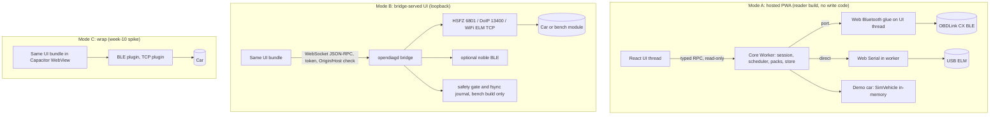

# Architecture proposal: Web-first (TypeScript core, React PWA, Web Bluetooth/Serial, optional local bridge, wrap later)

Written 2026-11-20 for the 12-week window (Mon 2026-11-23 to Fri 2027-02-12). Not legal advice. Status: **proposal, argued from one angle on purpose**. Author role: independent software architect told to argue "web-first". Nothing here was run on a car. No code or other file was changed.

Confidence tags: **high** = primary page or repo file read; **medium** = secondary page, summariser-read page, or two agreeing docs; **low** = inference, my own arithmetic, or general knowledge not re-checked. Doc names in square brackets are files in `docs/research/deep/`, `docs/research/deep2/`, `docs/plan/` or `docs/design/`. "New fetch" sources are listed in the Sources section as N1 to N12 and were read on 2026-11-20 through a summarising fetch tool, so wording is second-hand.

Clean-room: no leaked or pirated OEM file, key or database was requested or used. Nothing here needs one.

---

## Executive summary

1. **Pitch:** ship the product as a static, installable PWA with the whole TypeScript core running in a Web Worker. Zero install for the owner's OBDLink CX (BLE) on Chrome or Edge, plus a browser demo with the simulator, so a stranger reaches a first fault read in minutes (KPI G8) and the project can collect outside reports (G9) at $0 (G12).
2. **ENET is not a browser feature.** Browsers have no raw TCP, so HSFZ (6801) and DoIP (13400) need a local bridge [adapter-and-transport-constraints.md §4.2]. The bridge serves the same built UI same-origin from loopback. This is the existing plan's daemon, promoted from "primary" to "second delivery mode" [architecture-12wk.md ADR-003].
3. **Writes never run in a browser tab.** Public hosted build compiles the write engine out. Bench writes (owner decision 2) run only in a bridge-served bench build, with a journal that can really fsync [decisions.md; failsafe-coding-spec.md]. This makes the quality gate "no write capability reachable from a public build" cheaper to prove than in any native-first design.
4. **Honest overlap:** about 70% of this proposal is the current plan's ADR-002/003/006 reordered. The real differences are (a) Web Bluetooth CX path in weeks 2 to 4 instead of a week-10 spike, (b) a hosted demo mode, (c) core runs in a Worker with a typed read-only RPC, (d) wrapping (Capacitor, Electron) is demoted to a week-10 spike that is allowed to fail.
5. **Where it loses:** iPhone (Safari has no Web Bluetooth or Serial), anything that needs a long unattended phone session, a Chromium-only audience, and the CX reach question (A2) that could make the zero-install path shallow. Section 15 is blunt about this.
6. **Meets the KPI table?** G1, G3, G5, G8, G9, G12 get easier. G2 (ENET) needs the bridge. G10 (reliability) is the largest unknown. Section 12 maps every week to `kpis.md` and names the cut order.
7. **Needs from the owner:** phone or laptop in the car (A9), CX model confirmation, a decision on the public hosting rule versus the dev-box "unguessable link or login" rule (section 11.4).

---

## 1. What this proposal is and is not

### 1.1 Position in one paragraph

OpenDiag is a read-first tool for BMW owners who already code and tune [direction.md §6]. Reading is where the evidence, the law and the 12-week owner decisions all point [legal-safety-liability.md; decisions.md]. A read-first tool has no need for a native install to deliver value, as long as the link to the car can be opened from a page. For the owner's two adapters, one can (CX over BLE, Chrome family) and one cannot (WiFi ENET, needs TCP). So: browser for BLE, serial and demo; bridge for TCP and, later, for bench writes; native wrap only for iPhone and only if the spike passes.

### 1.2 How it differs from `architecture-12wk.md`

| Topic | Current plan | This proposal |
|---|---|---|
| Primary path | Daemon plus browser tab (ADR-003 tier 1) | Two equal first-class modes: hosted PWA (BLE, Serial, demo) and bridge-served UI (TCP, bench). Same bundle |
| Browser direct transports | Tier 2, read-only, "until week 12" | Tier 1 for CX and Chrome; built in weeks 2 to 4 |
| Hosted PWA to daemon | Tier 3, last | Not built in the window. Same-origin only, avoids Chrome Local Network Access risk (section 3) |
| Core placement | In page or daemon | Worker in the browser; same code in Node in the bridge |
| Desktop shell | Electron spike week 10 | Optional wrap, week 10, cut early (it is the lowest-value spike for this angle) |
| Mobile | Capacitor spike week 10 | Same spike, but promoted in importance: it is the only iPhone story, and it is decided by week 10 go/no-go |
| Node BLE (`@stoprocent/noble`) | Needed for desktop BLE in daemon | Not on the critical path: desktop Chrome does BLE itself. Noble only for Safari/Firefox desktop users via bridge, later |
| Demo | Simulator in tests and CLI | Simulator ships inside the hosted app as "Demo car" |

### 1.3 What I kept unchanged

ADR-001 (TypeScript core, Rust behind a trigger), ADR-002 package split and boundary script, ADR-006 data-only packs signed with Ed25519, ADR-008 error model, ADR-009 journal engine, ADR-010 WriteToken and refusal list, ADR-011 test pyramid, ADR-012 CI. I add rules to them; I do not replace them [architecture-12wk.md].

---

## 2. Goals and non-goals

### 2.1 Goals (each tied to `kpis.md`)

| # | Goal | KPI | How web-first serves it |
|---|---|---|---|
| W1 | Open a URL, pick the CX, read all faults on Chrome desktop or Android, no install | G1, G3, G8 | Web Bluetooth path; demo mode for people without a car |
| W2 | Full module scan over ENET in the KPI time | G2 | Bridge serves UI same-origin; one loopback hop (budget 1 ms p50, 5 ms p95 [architecture-12wk.md §6.1]) |
| W3 | Read-only snapshot and diff that survives a closed tab | G7, N3 [direction.md §9.2] | OPFS or IndexedDB store plus mandatory export bundle |
| W4 | No write code reachable from any hosted build | G5, quality gate | Build target split plus bundle audit in CI (section 7) |
| W5 | Plain-English faults with an honest "no description yet" | G6 | Packs lazy-loaded per brand, resolver in the worker |
| W6 | Outsiders can try it and report back | G9, G8 | Shareable URL, offline demo, "export trace for bug report" button |
| W7 | Free to run | G12 | Static hosting on free tiers [architecture-12wk.md §2.3] |
| W8 | Clean licences | G11, quality gate | MIT/Apache UI stack only [ui-library-landscape.md §9]; pack linter in CI |

### 2.2 Non-goals (in the 12 weeks)

- Real-car writes of any kind [decisions.md decision 2].
- Flashing, key work, emissions, odometer, SRS [direction.md §7; legal-safety-liability.md §12].
- Safari or iPhone-in-browser hardware access. It does not exist [adapter-and-transport-constraints.md §7].
- WiFi ENET from a bare browser. Impossible [adapter-and-transport-constraints.md §4.2].
- Hosted page talking to a local bridge (the "tier 3" pairing). Deferred past week 12.
- Third-party code plugins. Data only [architecture-12wk.md ADR-006; legal-safety-liability.md Apple 2.5.2 row].
- Accounts, cloud sync, default telemetry [direction.md §7].
- Mercedes or Toyota features beyond read-only "not yet" screens, except what the same read path gives for free [mercedes-and-toyota-reality.md].
- Store releases (App Store, Play) inside the window [architecture-12wk.md §8.4].

---

## 3. Constraints this design rests on

Every row is a fact I rely on, with where it came from. If a row is wrong, the section named in the last column is what breaks.

| # | Constraint | Source | Conf. | Breaks if wrong |
|---|---|---|---|---|
| C1 | No browser API opens raw TCP or UDP to a car. Direct Sockets is Isolated Web Apps only; end-user availability unverified | adapter-and-transport-constraints.md §4.2 | high | Bridge becomes optional (good for us) |
| C2 | OBDLink CX: BLE 5.1 only, service 0xFFF0 with notify 0xFFF1 and write 0xFFF2, max MTU 247, no queued writes, bonding only 5 min after power-on | adapter-and-transport-constraints.md §1.1 | high (vendor) | §4, §9 |
| C3 | The GATT blocklist does not list 0xFFF0, 0xFFF1, 0xFFF2 or 0x180A. Blocklist has exclude-writes only on some descriptors | N6 (WebBluetoothCG registry) | medium (summariser-read) | The CX path in a browser. Closes Gap 8 of the transport doc partly; real device test still needed |
| C4 | Web Bluetooth: HTTPS, user gesture, chooser, GATT objects die on disconnect, queue GATT operations, no MTU API, not in Workers | adapter-and-transport-constraints.md §7; ui-library-landscape.md §7.2 | high/medium | Threading model (§5.4) |
| C5 | Web Serial: Chrome 89+, available in dedicated workers; serial over classic Bluetooth RFCOMM in Chrome 117 desktop for paired devices | adapter-and-transport-constraints.md §3.1, §5; ui-library-landscape.md §7.2 | high | USB ELM and classic BT clones |
| C6 | Safari and every iOS browser: no Web Bluetooth, no Web Serial, no WebUSB. One niche third-party browser (Bluefy) ships Web Bluetooth | adapter-and-transport-constraints.md §7; ui-library-landscape.md exec summary 7 | high/medium | iPhone story = wrap or nothing |
| C7 | Chrome 142 prompts for public pages calling local-network or loopback addresses (fetch-like requests). At 138, WebSocket was "not yet gated". Plans to gate more | adapter-and-transport-constraints.md §4.2; N5 | high | Hosted-to-bridge (kept out of the window) |
| C8 | Same-origin UI served from the bridge is outside Chrome's current LNA first milestone | N5 (inferred by the summariser, not stated) | low | If wrong, same-origin may also prompt; test in week 10 |
| C9 | iOS Local Network permission applies to native TCP/UDP; "web content in Safari or the system web view" is exempt, but that exemption is useless since web content has no raw TCP | adapter-and-transport-constraints.md §4.2 | high | Capacitor TCP plugin on iPhone needs the native prompt |
| C10 | macOS 15: command-line tools run from Terminal or ssh are allowed automatically; bundled apps are blocked until the user allows | adapter-and-transport-constraints.md §4.2 (TN3179) | high | `npx opendiag serve` is the lowest-friction ENET path on a Mac; an Electron bundle needs a permission screen |
| C11 | Android 14: first MTU request is sent as 517, later ignored; CX max 247; always read the negotiated value | adapter-and-transport-constraints.md §2.1 | high | Capacitor/Android native BLE chunking |
| C12 | Quality gates: no GPL, AGPL or non-commercial dependency in shipped code; no write capability reachable from a public build; tests green on Node 24 and 26 | kpis.md | high | Dependency choices |
| C13 | Apple 2.5.2: apps may not download or execute code that adds or changes features. Packs must be data. Apple 4.2: an app must offer more than a repackaged website | legal-safety-liability.md (App stores row); N11 | medium-high | Pack format (§6); wrap viability (§13) |
| C14 | Owner decisions: bench-only writes, mandatory verified backup, writes compiled out of public builds until a reviewer signs off, no real-car writes in the window | decisions.md | high | §7 |
| C15 | Node strips types but refuses `.tsx` and TypeScript under `node_modules`; UI needs Vite; shared `core` stays erasable `.ts` with explicit `.ts` imports | ui-library-landscape.md §8 | high (Node doc) | Build layout (§5.2) |
| C16 | Web UI initial load budget: under 150 KB gzip JS (p50), under 250 KB (p95) | architecture-12wk.md §6.1, gate G-E | medium (plan target, an estimate) | UI stack (§9) |
| C17 | No measured BLE or ENET BMW timing exists yet; first real timings come on Nov 25 | kpis.md baseline; research-sprint.md | high | G2, G3 |
| C18 | No public scan-time baseline for ISTA, BimmerCode, Carly or OBDeleven | speed-and-latency-engineering.md; kpis.md evidence update | high | "Faster than incumbents" claims |
| C19 | iOS BLE connection interval is chosen by iOS, not the app; one developer measured about 400 to 600 kbit/s on iPhones | adapter-and-transport-constraints.md §1.3 | low-medium | BLE rate expectations on wrapped iOS |
| C20 | Whether the CX reaches non-engine BMW modules over BLE is unknown (A2) | direction.md §10 A2; adapter-hardware-and-protocol-teardown.md | none yet | Value of the zero-install path |

New browser facts used (all from fetches on 2026-11-20):

| # | Fact | Source | Conf. |
|---|---|---|---|
| B1 | `Bluetooth.getDevices()` returns devices this origin may access, including ones out of range. Experimental, limited availability (not Baseline). Secure context. Page gives no browser versions and does not say whether a user gesture is needed | N1 | medium |
| B2 | Screen Wake Lock: Chrome 84, Edge 84, Firefox 126, Safari 16.4 (page badges). Released automatically when the tab is hidden; browser may refuse | N2 | medium |
| B3 | Storage: default best-effort, `navigator.storage.persist()` for persistent. Safari deletes script-created data after 7 days without interaction when tracking prevention is on. Page does not say home-screen apps are exempt. Eviction deletes the whole origin's data together | N3 | medium |
| B4 | `FileSystemSyncAccessHandle.flush()` is Baseline widely available since March 2023, dedicated workers only, secure context. Page promises persistence to disk, no stronger crash semantics | N4 | medium |
| B5 | Chrome intensive timer throttling hits chained timers on pages hidden over 5 minutes. Page does not mention Web Bluetooth or WebSocket | N10 | medium |
| B6 | `showDirectoryPicker()` needs a secure context and a user gesture. MDN marks it limited availability (not Baseline). Chromium-only is general knowledge, not on the page | N8 | medium/low |
| B7 | Chrome DevTools Protocol has a `BluetoothEmulation` domain for testing Web Bluetooth with virtual devices; Puppeteer exposes it as experimental. Playwright support not confirmed. Whether virtual GATT services and notifications are simulated was not confirmed | N7 | low-medium |
| B8 | npm registry (2026-11-20): `fflate` 0.8.3 MIT, `vite-plugin-pwa` 2.0.0 MIT, `workbox-build` 7.4.1 MIT, `@noble/ed25519` 3.2.0 MIT, `comlink` 4.4.2 Apache-2.0, `idb` 8.0.4 ISC | N12 | high |

---

## 4. Platform and transport matrix

Legend as in `adapter-and-transport-constraints.md` §8: **F** fine, **K** flaky or conditional (footnote), **I** impossible, **U** unknown. "PWA" means the hosted build in a browser. "Bridge" means the local bridge serving the same UI to any browser on the same machine. "Wrap" means a Capacitor shell (later, week-10 spike).

### 4.1 Delivery mode by platform (what you can run where)

| Platform | Hosted PWA (Chrome/Edge) | Hosted PWA (Safari/Firefox) | Bridge-served UI | Wrap |
|---|---|---|---|---|
| macOS | F (BLE, Serial, demo) | demo only | F (ENET, WiFi ELM, bench). From Terminal: no Local Network prompt (C10) | Electron optional. Needs signed bundle plus permission screen (C10) |
| Windows | F (BLE, Serial, demo) | demo only | F | Electron optional |
| Linux | K (Web Bluetooth flag-gated in an old guide; BlueZ quirks) | demo only | F (BLE through noble is untested) | not planned |
| Android | K (Chrome Android Web Bluetooth per Chrome guide; caniuse lists only v157, older unconfirmed) | demo only | not applicable (no Node on the phone) | Capacitor: K (BLE plugin, network binding, TCP plugin unverified) |
| iPhone/iPad | **I** (Safari). Bluefy is a niche exception | demo only | not applicable | Capacitor: K (real device only; Local Network prompt; auto-join WiFi unproven) |

Sources: adapter-and-transport-constraints.md §7, §8, §9; ui-library-landscape.md §7.

### 4.2 Adapter by platform for the web-first design

| Adapter | Mac / Win Chrome PWA | Linux Chrome PWA | Android Chrome PWA | iPhone Safari PWA | Bridge (Mac, Win, Linux) | Wrap Android | Wrap iPhone |
|---|---|---|---|---|---|---|---|
| **OBDLink CX (BLE)** | F (d) | K (c, d) | K (d, e) | **I** | F via noble (untested, U) | F (a) | F (b) |
| Other BLE ELM clone | F, UUIDs vary (f) | K | K | **I** | F | F | F |
| **WiFi ENET adapter (HSFZ/DoIP)** | **I** | **I** | **I** | **I** | F (Mac: Terminal exempt, bundle needs permission) | K (g) | K (h) |
| Wired ENET (USB Ethernet) | **I** | **I** | **I** | **I** | F | K, driver-dependent | K, adapter-dependent |
| WiFi ELM327 clone | **I** | **I** | **I** | **I** | F | K (g) | K (h) |
| Classic BT ELM327 | F, paired only (Chrome 117 Serial over RFCOMM) | K | K (targeted 137) | **I** | F | U (the Capacitor BLE plugin is BLE only) | **I** |
| USB serial (ELM USB, K+DCAN) | F (Web Serial) | F | K (WebUSB plus polyfill) | **I** | F | F (not sourced) | **I** (iPhone), K (iPad) |
| USB-CAN (gs_usb) | K (WebUSB unverified) | K | K | **I** | Linux F (SocketCAN) but out of window | U | **I** |

Footnotes:
- (a) Android 12+ needs Nearby devices permission; read negotiated MTU (C11).
- (b) Real device only; the BLE plugin does not run in the iOS Simulator [ui-library-landscape.md §7.5].
- (c) BlueZ stuck-scan and GATT cache issues [adapter-and-transport-constraints.md §2.5].
- (d) Chooser plus user gesture each session by default; `getDevices()` may reduce this (B1, unverified on target browsers). No MTU control, so use small writes.
- (e) Chrome guide says Android 6.0+; caniuse reading lists only 157. Unsettled.
- (f) FFF0 is a common convention, not universal; match by UUID list then by "one notify plus one write characteristic" [adapter-and-transport-constraints.md §1.2].
- (g) Needs network binding for WiFi without internet; capacitor-tcp-socket behaviour untested [adapter-and-transport-constraints.md §3.2; ui-library-landscape.md §7.5].
- (h) Local Network permission prompt; auto-join of dongle WiFi unproven [adapter-and-transport-constraints.md §3.3].

### 4.3 What the owner's gear gets

| Owner adapter | Zero-install browser path | Bridge path | Expected first KPI use |
|---|---|---|---|
| OBDLink CX | Chrome on Mac, Windows, Android | Optional | G3 (quick read), G1 sessions |
| WiFi ENET adapter | None | `npx opendiag serve` then open `http://127.0.0.1:PORT` | G2 (scan), G1 sessions |
| Third adapter (model unconfirmed, [decisions.md]) | Depends on model | Depends | G10 across adapters |

### 4.4 Capability screen (a product requirement, not a nicety)

The UI must ask `Transport.caps` (architecture-12wk.md §5.1) plus a new `environment` probe and show a plain table: "Here, in this browser, you can use: X. You cannot use Y because Z. Run the bridge to unlock Y." Fields: `hasWebBluetooth`, `hasWebSerial`, `isSecureContext`, `servedBy` (`hosted` or `bridge`), `writesCompiledIn`. The reason strings come from the constraints table above. This is how the product stays honest about the matrix (a "browser says no" is not an "adapter is broken").

---

## 5. Architecture

### 5.1 Delivery modes and topology



Rules:

1. One UI bundle. The bridge serves it from its own origin, the CDN serves it from another. Capabilities differ by environment probe, not by forked code.
2. The browser never talks to a bridge it was not served by (C7, C8).
3. The Worker is the only place that holds a `Transport`. The UI thread holds an RPC proxy with typed read methods. There is no `sendRaw` on the proxy.
4. The same `@opendiag/core`, `session`, `packs` run in the Worker and in Node. Only `adapters-web`, `adapters-node`, `store` implementations differ.

### 5.2 Module boundaries

Extends ADR-002's table [architecture-12wk.md]. New or changed rows in bold.

| Package | Contents | May import | Runs in | Change |
|---|---|---|---|---|
| `@opendiag/core` | codecs, UDS client, errors, Transport interfaces | none | any | as ADR-002 |
| `@opendiag/session` | Scheduler, Session, keepalive, discovery logic, ELM profiles | core | any | as ADR-002 |
| `@opendiag/packs` | schema, loader, verifier, resolver, refusal data | core | any | verifier uses `@noble/ed25519` (B8), no WebCrypto Ed25519 dependency |
| `@opendiag/safety` | WritePlan, Journal, Gate, WriteToken, GuardedTransport, backup, diff | core, session, packs | any | **split into `safety/read` (GuardedTransport read allow-list, backup read, diff) and `safety/write` (plan, journal, gate, token). Public builds import only `safety/read`** |
| `@opendiag/store` | Store interface, audit log | core | node, browser | **adds `OpfsStore` (worker, sync access handle, `flush()` per B4) and `IdbStore` fallback; `FsStore` for bridge** |
| `@opendiag/sim` | SimEcu/Vehicle, fault injection, replay | core, packs | any (in-memory) | **in-memory build is shipped in the hosted app as Demo car; loopback servers stay Node-only** |
| `@opendiag/adapters-node` | TCP, serial, noble BLE | core | node | as ADR-002 |
| `@opendiag/adapters-web` | WebBluetooth, WebSerial, WS-to-bridge transports | core | browser | **primary for this angle, built weeks 2 to 4** |
| **`@opendiag/runtime-web`** | Worker host, RPC (own ~200 lines, or `comlink` 4.4.2 Apache-2.0), BLE port bridge between Worker and UI thread | core, session, api | browser | new |
| `@opendiag/api` | RPC and bridge protocol types (zod) | core | any | one schema serves Worker RPC and bridge WebSocket |
| `@opendiag/daemon` (the bridge) | `opendiagd`, HTTP static and WS server, auth | all node-side | node | also serves `apps/web/dist` |
| **`@opendiag/ui`** | tokens, density modes, components built on shadcn/Base UI, SVG gauges | none (React) | browser | new, section 9 |
| `apps/web` | PWA shell, routes, service worker | api, adapters-web, runtime-web, ui | browser | builds targets `reader`, `demo`, `bench` |
| `apps/desktop`, `apps/mobile` | Electron, Capacitor wrap | | | spikes only |
| repo `opendiag-packs` | data packs | | | unchanged |

Enforcement additions to `scripts/check-boundaries.ts` (ADR-002):

- (d) `apps/web` target `reader` may not import `safety/write` anywhere in its module graph.
- (e) `adapters-web` may not import `node:*`.
- (f) The UI package may not import `session`, `adapters-*` or any transport; it speaks only to `api` types.

Build layout note: `core` stays erasable `.ts` with explicit `.ts` imports so Node tests keep working with no build step, and Vite consumes the same files; UI `.tsx` is Vite only; publish compiled JS to npm at release time because Node refuses TypeScript under `node_modules` [ui-library-landscape.md §8].

### 5.3 Build targets

| Target | Where it is served | Contains | Does not contain | Purpose |
|---|---|---|---|---|
| `reader` | Hosted static origin and bridge | UI, core, session, packs, `safety/read`, adapters-web, store, sim (demo) | `safety/write`, WriteToken minting, write UI | the public product |
| `demo` | same artifact as `reader` with `?demo` route | as above plus demo car selected | nothing extra | try without a car |
| `bench` | Bridge only, behind token, loopback | `reader` plus write UI, `safety/write` routes in the **bridge** (the page holds no gate) | n/a | owner bench trials, weeks 8 to 11 |

Vite `define` constant `__WRITES__` is false in `reader`. A CI step walks the build manifest and fails if any chunk from `safety/write` is present, and also greps built JS for the token-minting export name and write service IDs table. Both checks are cheap and are the evidence behind G5 and the quality gate (low confidence on the exact mechanism; I did not prototype it).

### 5.4 Threading model (forced by the browser rules)

- Web Bluetooth is not available in Workers (C4). So BLE I/O runs on the UI thread behind a tiny `BlePort` that posts `Uint8Array` chunks to the Worker. The Worker owns the ELM text protocol, the scheduler and keepalive. Risk: a busy UI thread delays BLE callbacks. Mitigation: BLE glue does nothing but queue and post; use virtualised tables so renders stay small; measure p95 callback delay in week 3.
- Web Serial works in dedicated Workers (C5), so serial runs fully in the Worker.
- GATT operations are serialised in one queue in `adapters-web` (C4). Writes are chunked at 20 bytes until a probe proves more is safe, because a page cannot read the negotiated MTU [adapter-and-transport-constraints.md §7]. For read flows this barely matters: an ELM or STN command line is short, and ISO-TP segmentation is handled inside the adapter chip [adapter-and-transport-constraints.md §1.2]. It matters for long hex write payloads, which are bench-only and go through the bridge anyway.
- Timers: the Worker uses an injectable clock (as the plan's `Scheduler` does) so tests run in virtual time. Keepalive in a hidden tab can be throttled (B5, partial evidence). Policy: no long unattended sessions in a hidden tab. Show a "keep this tab visible" banner, hold a Screen Wake Lock (B2), and treat hidden-tab keepalive loss as `session.lost`, same as the gate's abort rule [architecture-12wk.md §5.2].

### 5.5 Transport v2 additions for the web

Additions to `TransportCaps` (architecture-12wk.md §5.1) so the matrix is machine-readable:

```ts
interface TransportEnv {
  surface: "browser-ble" | "browser-serial" | "bridge-ws" | "native-plugin" | "sim";
  mtuKnown: boolean;          // false for Web Bluetooth
  needsGesture: boolean;      // chooser per session
  needsNetworkBinding?: boolean;   // Android WiFi without internet
  needsLocalNetworkPermission?: boolean; // iOS, macOS bundles
  unicastOnly?: boolean;      // iOS without multicast entitlement
  readOnlyBuild: boolean;     // true in reader builds
}
```

The capability screen (section 4.4) and the "adapter report" (direction.md section 8, item 5) both read this.

---

## 6. Data and pack formats

### 6.1 Summary table

| Artifact | Format | Where it lives in the web build | Source of truth rule |
|---|---|---|---|
| Pack | `.odpack` zip: `manifest.json`, `entries/*.json`, `PROVENANCE.md`, `manifest.sig` (Ed25519 over canonical manifest) | Fetched from static host or loaded from a user file; cached in Cache Storage or IndexedDB | Signed manifest [architecture-12wk.md ADR-006] |
| Backup/snapshot | `Backup` schema v1 JSON (exists in `backup.ts`) | OPFS file per snapshot, index in IndexedDB | File first, index rebuildable [ADR-007] |
| Audit log | hash-chained JSONL | OPFS | Tamper test [ADR-008] |
| Trace | `.odtrace` JSONL `{t, dir, target, hex}` | OPFS ring (size cap), export on demand | Bug-report and replay |
| Export bundle | `.odbundle` zip: raw blocks, hashes, report, tool version | Download, or File System Access folder on Chromium | The only backup that survives browser data loss |
| Session log | JSONL with outcome, adapter id, timings | OPFS | Feeds G1, G10 counts |
| Live log | CSV (open, documented) | Download | N5 [direction.md §9.2] |

### 6.2 Pack details that matter in a browser

- **Data only.** No scripts, no executable logic in packs, so Apple 2.5.2 and Google's loaded-code rule are not triggered [legal-safety-liability.md App stores rows; legal-regulatory-landscape-deep.md §2.8]. The step language (week 9) is declarative and interpreted by shipped code.
- **Verification in the Worker** with `@noble/ed25519` 3.2.0 (MIT, B8). I do not rely on WebCrypto Ed25519 because I did not verify cross-browser support (not researched).
- **Canonical form.** Sign over a canonical JSON encoding. I suggest RFC 8785 style canonicalisation (general knowledge, low confidence; confirm in week 6).
- **Per-brand chunking.** One pack file per brand family plus `generic-obd`. A first load pulls only `generic-obd` (small). BMW pack loads when a BMW identity is read. This keeps the first-load budget (C16) independent of data growth.
- **Offline.** Packs cached by version; update only on user action ("offline-first, nothing auto-updates" [architecture-12wk.md ADR-012]). The service worker pre-caches the shell only, never packs without consent.
- **Share-alike separation.** The OBDb-derived pack is its own `.odpack` with its own manifest licence field (CC-BY-SA-4.0), its own repo path, loaded only if the user enables "community signal data". UI shows a "Data sources and licences" screen. Never merged into CC0/CC-BY packs or Apache source [decisions.md decision 1; open-source-reuse-map.md tier C; dtc-crowd-curation-model.md]. A short legal check stays before first public release of that pack [decisions.md].
- **Rollback and expiry.** Manifest `version` monotonic, `expires` checked, last-seen version stored locally; a cleared browser store resets the rollback floor, a known weakness (low impact: the floor protects against a stale pack, not a malicious key).
- **Provenance and refusal list in the loader**, not just CI (ADR-006). The linter that runs in CI (G11) also ships in the loader's report.
- **Unknown identity means read-only raw view**, enforced in the resolver [architecture-12wk.md §5.3].
- **DTC record shape** follows the research: key by (module identity, code bytes), carry status byte, optional own-words text, evidence list, and add a sub-code field before Toyota hybrid entries [dtc-bmw-coverage.md §1; dtc-toyota-lexus-coverage.md §1 item 7]. "Unknown code, here is what the module reported" is a first-class state so the app is useful at 0% text coverage.
- **Zip tooling:** `fflate` 0.8.3 (MIT, B8) is a candidate for `.odpack` and `.odbundle`; I only checked version and licence, not size, API fit or maintenance. Verify in week 5.

### 6.3 Storage in a browser (and its honest limits)

| Concern | Design | Evidence and caveat |
|---|---|---|
| Durable writes | `OpfsStore` runs in a dedicated Worker, uses sync access handles, calls `flush()` after each journal-like append | `flush()` persists to disk, no stronger crash semantics promised (B4). Good enough for read snapshots and audit; not for write journals |
| Eviction | Call `navigator.storage.persist()` after the first successful snapshot; show state in the UI | Default is best-effort and eviction deletes the whole origin together (B3). Chromium and Safari decide automatically without a prompt (B3) |
| Safari | Treat 7-day rule as real: after 7 days without interaction, script-created data may be deleted; do not assume home-screen apps are exempt | Page does not state the exemption (B3). Safari has no BLE anyway, so only demo and bridge-served use matter there |
| Backup survival | After every snapshot the UI offers "Save a copy" (download `.odbundle`); on Chromium also "Pick a backup folder" via `showDirectoryPicker` | Needs a user gesture and secure context (B6); Chromium-only is unverified |
| Privacy | VIN hashed in file names; VIN redacted in logs to last 4; no network egress other than the pack host | Matches ADR-007/008; enforce with CSP `connect-src` and a Playwright network-deny test (T10) |

---

## 7. Safety pipeline placement

Principle: **reading is cheap, writes are expensive, so the web build gets the cheap half and the bridge gets the expensive half.** This is how I read decision 2, decision 6 and `failsafe-coding-spec.md` together.

### 7.1 Where each stage lives

| Stage (failsafe-coding-spec.md) | Hosted reader build | Bridge `bench` build |
|---|---|---|
| Gatekeeper, refusal list | Refusal data present (loader rejects refused entries); no write path to gate | Full gate server-side in bridge |
| Identity match | Yes (read) | Yes |
| Full read backup, read twice, hash | **Yes**. This is the "snapshot" feature (direction.md §8 item 3) | Yes, mandatory before any plan |
| Diff preview and consent | Diff of two snapshots (no consent step, nothing to apply) | Full diff plus typed confirm (bench only) [ux-teardown-and-safety-ux.md §6.3, §8] |
| Preflight (voltage, link, ignition) | Shown as read-time health display (job 9) | Gate precondition, unreadable voltage blocks |
| Dry run | n/a | Simulator first |
| Journal with fsync | n/a (no writes) | Node `fs` fsync in bridge (ADR-009) |
| Apply, verify, auto-rollback | **Absent from bundle** | Present, bench module only |
| Recovery mode | Read-only "unfinished transaction" detector can still warn | Full |
| Audit log | Hash-chained in OPFS for reads and snapshots | Hash-chained on disk |

### 7.2 Defence layers (in order)

1. **Build target.** `reader` has no `safety/write` module (section 5.3). Not "disabled", absent.
2. **GuardedTransport at the adapter boundary.** Every `Transport` is wrapped before anything else sees it, using the existing allow-list (`READ_SIDS` plus `10 01` in `transport.ts`). Default-deny.
3. **Worker proxy.** UI thread can call `scan()`, `readFaults()`, `snapshot()`, `liveStart()`. No method forwards arbitrary bytes.
4. **Hosted origin hygiene.** Strict CSP (no third-party scripts, `connect-src` limited to self and the pack host), Subresource Integrity on the shell, `Permissions-Policy` limiting `bluetooth` and `serial` to self (MDN names a `bluetooth` policy directive in N1; serial policy exists per the transport doc), service worker that pins the version for a session and never swaps mid-session. Header mechanism on Cloudflare Pages is general knowledge, not re-checked (low).
5. **Bench build is bridge-only.** Loopback bind, per-launch token, Origin and Host checks against DNS rebinding (T1 in architecture-12wk.md §7), writes need a fresh consent event from the bridge-served UI. The page does not hold the gate or the journal.
6. **Residual risk, stated:** same-origin script can bypass layers 2 and 3 in a hosted page. The controls are layer 1 (nothing to call), supply-chain rules (ADR-012, T7), and no third-party scripts. This is the same honesty as ADR-010 item 6.

### 7.3 Why not write from the browser even on a bench

- A tab can be closed, reloaded, throttled or killed mid-transaction. The journal's `STEP_SENT` before `STEP_ACK` guarantee [architecture-12wk.md ADR-009] needs durable ordering; browser storage gives `flush()` with no stronger promise (B4).
- Hidden-tab timers can be throttled (B5, partial), and keepalive jitter must stay within ±250 ms [architecture-12wk.md §6.1].
- Web Bluetooth has no MTU knowledge, and `adapter-and-transport-constraints.md` §9.1 item 4 already says flaky links should stay read-only.
- G5 ("0 writes without verified backup", tested with 100 bypasses) is easier to argue when the only write-capable process is one Node program, not every browser profile.

### 7.4 Test hooks for G5

The 100-bypass test runs against (i) the Node bridge gate and (ii) the built `reader` artifact: load the real bundle in Chromium, drive the Worker RPC with every method and malformed payload, and assert that no write SID reaches the fake transport. Assertion (ii) is new and is the web-first contribution to G5.

---

## 8. Plugin and brand-pack model

| Layer | What it is | Who writes it | Loaded how | Licence |
|---|---|---|---|---|
| Standards code | ISO-TP, UDS, OBD, HSFZ, DoIP codecs | First-party TS | Bundled | Apache-2.0 |
| Brand profile | tester address (BMW 0xF4 on ENET [bmw-enet-hsfz-wire-protocol.md]), session timings, transport preference, identity DIDs to read | Pack data (JSON) | `.odpack` | CC0 or CC-BY, own wording |
| Module profile | DID decode, DTC text, coding blocks | Pack data | `.odpack`, lazy per brand | CC0 or CC-BY |
| Community signals | OBDb-derived live-data signals | Importer output | Separate `.odpack`, opt-in | CC-BY-SA-4.0 |
| User overlay | Owner's own files (for example their own ODX via `odxtools`, run locally outside the browser) | User | File picker; kept local; tier capped at T0 | user's own |
| Code plugins | none in the window | n/a | n/a | n/a |

Rules:

- **Brand = data.** Adding Toyota hybrid support means a pack, a sub-code field and a view, not new transport code. Mercedes and Toyota ship as read-only "not yet" plus standard OBD [direction.md §7; mercedes-and-toyota-reality.md].
- **Brand code chunks** (for example BMW-specific decode helpers that cannot be data) are first-party ES modules loaded by dynamic import from the same signed release, never from a pack. Anything that adds behaviour ships in a release, which satisfies Apple 2.5.2 [legal-safety-liability.md].
- **Contribution flow** is a pull request to `opendiag-packs` with provenance and a contributor attestation, checked by the linter and a similarity gate [dtc-crowd-curation-model.md §9; data-schema.md §5, §6]. The web app adds an in-app "Report a code" form that produces a draft file the user downloads and submits; it does not post to a server (no accounts, no telemetry).
- **Future plugin path:** WASM-sandboxed code plugins only if ADR-001's trigger (c) fires. Web-first makes that path natural (browser sandbox), which is a real long-term advantage but not a 12-week item.
- **Refusal list** applies to packs and UI alike: no SRS, immobiliser, key learning, emissions defeat, odometer, speed limiter, no seed-key material [architecture-12wk.md ADR-010; direction.md §7].

---

## 9. UI stack and the constraints web-first adds

Component and library research is in `ui-library-landscape.md`. I do not repeat it. What this angle adds:

### 9.1 Stack (adopting the doc's Stack A, with the Mantine fallback)

React 19 + Vite + Tailwind v4, shadcn on Base UI, TanStack Table v9 + TanStack Virtual, uPlot for live traces, hand-built SVG gauges with `role="meter"`, ECharts lazy-loaded for post-session analysis. Fallback: Mantine 9 if component assembly slows KPIs by week 2 [ui-library-landscape.md §11]. All MIT or Apache-2.0; PrimeReact 11 and flutter_blue_plus excluded by licence [ui-library-landscape.md §9].

Two cautions that bear on this angle:

- **Bundle budget (C16).** A React stack plus table plus tokens may not fit 150 KB gzip for the first route. I have no measured number; ui-library-landscape.md says its React size figure looks unreliable and its sizes are whole-package upper bounds. Plan: measure the real shell in week 4, split table, charts, packs and each brand into lazy chunks, and if still over, ask the owner for an explicit exception (as G-F allows for budget misses).
- **TanStack Table v9** was declared stable 2026-08-04, and most examples online are v8 [ui-library-landscape.md §6]. Pin versions; read the v9 migration notes.

### 9.2 Constraints web-first puts on design (feeds the later "how it should look and act" work)

| Constraint | UI consequence | Source |
|---|---|---|
| Chooser and gesture per session | Connect screen is a deliberate one-tap flow with a fixed "Pair adapter" button, not an auto-connect | adapter-and-transport-constraints.md §7; B1 |
| CX bonding window 5 min after power-on | First-run copy: "Plug in the adapter, then pair within 5 minutes; if it fails, unplug and replug" | adapter-and-transport-constraints.md §1.2 |
| Phone in the car | Large touch targets, one-hand layouts, no hover-only affordances, dark default (garage and night) | direction.md A9; ui-library-landscape.md R5, R6 |
| Screen lock and hidden tab | "Keep screen on" via Wake Lock; banner when the tab is hidden; logging pauses visibly rather than failing silently | B2, B5 |
| Hosted vs bridge differences | Persistent environment chip: "Hosted, reader" or "Bridge, bench"; capability screen (section 4.4) | this doc |
| Safety UX | Plan, snapshot, diff, typed confirm only in bench; never colour-only state; WCAG 2.2 AA for safety flows | ux-teardown-and-safety-ux.md §6, §7; ui-library-landscape.md U7 |
| Honest data | "No description yet" with module and status instead of a guess | dtc-bmw-coverage.md §1 |

---

## 10. Testing and simulator strategy

Keeps ADR-011's pyramid. Web-first adds browser layers and uses the browser as a free test host for no-network and no-write claims.

| Layer | What | Tooling | KPI link |
|---|---|---|---|
| L1 unit, property, fuzz | Codecs, ISO-TP reassembly, packs loader, journal parser | `node --test`, `fast-check`, `@jazzer.js/core` (per ADR-011) | G11, quality gates |
| L1b UI logic | Reducers, hooks, formatters kept in plain `.ts` so the existing runner covers them | `node --test` | test count only goes up |
| L2 component | `SimEcu` with fault scripts, virtual-time scheduler | Node | G4, G5 |
| L2b browser transport | `BleTransport` driven by a **fake GATT peripheral** that implements the same interface, delivering notifications in 20-byte slices and enforcing "one write at a time" | Node and Chromium | G3, G10 |
| L3 integration | Worker + UI in Chromium against (i) in-memory sim, (ii) bridge with loopback HSFZ/DoIP sim | Playwright (Apache-2.0 per ui-library-landscape.md §3) | G1, G2 |
| L3b browser safety | Load the built `reader` artifact, drive every RPC method, assert no write SID leaves; assert zero unexpected network requests; assert no `safety/write` chunk | Playwright plus bundle audit | G5, T10 |
| L3c Web Bluetooth realism | Chrome `BluetoothEmulation` CDP domain (B7) for chooser and advertisement behaviour; fall back to an init-script stub of `navigator.bluetooth` | Puppeteer experimental API or stub | G10 |
| L4 HIL | Real CX in Chrome on the owner's Mac and an Android phone; ENET through the bridge | manual plus self-hosted runner only for the bridge path, never fork PRs (T9) | G1, G2, G3 |
| L5 car | Manual, tagged, saved as `.odtrace` plus audit | owner | G1 counts |

Simulator facts and rules:

- `SimElm` (text stream) and the HSFZ/DoIP loopback servers exist [architecture-12wk.md §1]. The browser ships the in-memory `SimVehicle` only. Servers stay in Node.
- Every behaviour a real trace contradicts becomes a sim bug first [architecture-12wk.md ADR-011]. The first real timing arrives Nov 25 [kpis.md; research-sprint.md].
- Cross-implementation oracles (python-udsoncan, iso14229 server) stay as nightly Node-side dev tools, never bundled [open-source-reuse-map.md; architecture-12wk.md §2.4]. python-can is LGPL-3.0; do not copy it [open-source-reuse-map.md].
- Do not use ELM327-emulator (non-commercial) [architecture-12wk.md §2.4; open-source-reuse-map.md].
- Chromium-only CI browser for hardware-ish tests; Firefox and WebKit only for demo and bridge-served UI smoke tests (they cannot run the BLE path).
- Weak point: the BluetoothEmulation domain status for GATT services and notifications is unconfirmed (B7). If it cannot emulate the CX's 0xFFF0 service, L3c shrinks to the stub, and real-device BLE regressions are only caught by the manual T7 checklist [adapter-and-transport-constraints.md §10].

Manual hardware checklist for the web path (extends T1 to T8 of the transport doc):

1. Scan and subscribe to FFF1 from Chrome on Mac; record bonding prompt behaviour and the 5-minute window.
2. Probe the largest safe write size with a harmless command; record the number per OS.
3. Time 100 short commands (T3) in Chrome, in the bridge with noble (if used), and in the CLI.
4. Does `getDevices()` give a no-chooser reconnect on Chrome desktop and Chrome Android? (B1)
5. 30-minute logging soak in a foreground tab with Wake Lock on Android (N5); note throttling (B5) and disconnects.
6. Page reload mid-session: does the CX need a power-cycle to reconnect?

---

## 11. Release and licensing plan

### 11.1 Code licence and dependencies

- Repo Apache-2.0 [decisions.md; open-source-reuse-map.md tier A]. UI stack MIT/Apache; fonts OFL-1.1 with licence file shipped [ui-library-landscape.md §3, §9].
- CI licence scan fails on GPL, AGPL, SSPL, CC-BY-NC, unknown licence in the shipped tree; LGPL needs manual review (ADR-012). Browser builds ship dependency licences in a generated `THIRD_PARTY` page inside the app.
- Candidate small dependencies checked on the registry (B8): `@noble/ed25519` 3.2.0 MIT, `fflate` 0.8.3 MIT, `comlink` 4.4.2 Apache-2.0, `idb` 8.0.4 ISC, `vite-plugin-pwa` 2.0.0 MIT, `workbox-build` 7.4.1 MIT. Maintenance and size not checked.
- Name and logo: nominative use only, disclaimer, no implication of an OEM link [direction.md §7; legal-regulatory-landscape-deep.md].

### 11.2 Channels

| Channel | Artifact | Gate |
|---|---|---|
| nightly | Preview deployment of `main` at an unguessable preview URL; unsigned | Tests green on Node 24 and 26 |
| beta | Tagged `v0.x.0-beta.N`, versioned immutable deploy URL, GitHub Release with checksums and the bridge package | Gates of the relevant phase; counsel scoping call scheduled [direction.md §9.1] |
| stable | Stable URL plus bridge | After write-engine reviewer sign-off or explicit "not yet"; **public build never includes writes in this window** |

Update behaviour: the service worker downloads the new version in the background and asks the user to reload; it never swaps mid-session; the app shows its version and build hash on the capability screen so bug reports are exact. Packs update only on user action.

### 11.3 Bridge distribution

- Weeks 4 to 9: `npx opendiag serve` (needs Node, acceptable for contributors) [architecture-12wk.md ADR-004]. On macOS this is also the path with no Local Network permission screen (C10).
- Week 10: decide between a single-file Node executable (unverified for Node 24 [architecture-12wk.md ADR-004]) and an Electron wrap. Electron means a signed, notarised macOS bundle with a usage string and permission screen (C10) and costs the Apple Developer fee [architecture-12wk.md §2.3].

### 11.4 Hosting and the dev-box rules (needs the owner)

- Hosting plan: Cloudflare Pages static site, free tier [architecture-12wk.md §2.3]. A static PWA has no server logic to cap.
- Owner rules say each public service gets its own endyland.com subdomain, an unguessable link or a login, a cap on what it can do and a log, and that DNS or Pages domain changes need approval and a recorded current state first (dev-box rules, `~/.claude/DEVBOX_SECURITY.md`).
- **Conflict to resolve:** an open-source tool wants a discoverable URL; the dev-box rule says unguessable or login. Proposal: during the 12 weeks, share only unguessable preview URLs with named testers (this also gives G9 its first outside people), and ask the owner explicitly before any public subdomain or announcement. The "cap on what it can do" is satisfied by the reader build (it cannot write by construction); "a log" means the host's access log, with the app itself sending no telemetry.
- Nothing in this proposal touches DNS, tunnels, keys or Pages domains without approval. Pack signing keys follow the key-custody rules in architecture-12wk.md §7.3 (owner approval, Keychain, registry row, CI-only signing).

### 11.5 Wrapping later (what must stay true to keep it cheap)

- No Node-only API in UI or Worker code (boundary rule e).
- Transport selection through a single factory that can return `browser-ble`, `bridge-ws` or `native-plugin`.
- Same bundle served inside Capacitor. Apple 4.2 says an app must offer more than a repackaged website (N11), so the wrapped iPhone app must carry real native value: the BLE and TCP plugins, offline packs, local storage, share-sheet export. Rejection risk is unquantified (no research on review outcomes; gap in business-models-and-sustainability.md).
- Store releases remain out of scope until after the week-10 spike [architecture-12wk.md ADR-005].

---

## 12. Week-by-week 12-week build path and KPI fit

Calendar from `architecture-12wk.md` §8.1 and `decisions.md` decision 7: research sprint Nov 23 to 25, coding from Thu Nov 26, G-A on Tue Dec 1. Capacity: about 12 to 15 owner hours per week plus Claude sessions per package. Hour targets are goals, not promises [decisions.md decision 3].

| Wk | Mon | Deliverables (web-first emphasis in bold) | Exit check and KPI |
|---|---|---|---|
| 1 | Nov 23 | Research sprint (Nov 23 to 25) with first real timing. From Nov 26: commit or fix in-flight tree; `OdError`; package split steps; boundary script incl. rules (d) to (f); licence scan in CI. **`apps/web` skeleton on Vite with Demo car (in-memory sim in a Worker). Chrome-by-hand BLE probe against the CX: services, bonding window, chunk probe, `getDevices()` test (answers A2 first half, C3, B1).** | G-A Tue Dec 1. Baseline for G2/G3 |
| 2 | Nov 30 | Transport v2 caps; correlated multi-in-flight for HSFZ and DoIP; scheduler; session keepalive. **`adapters-web` Web Bluetooth ELM/STN transport with one-op GATT queue and 20-byte writes; `runtime-web` Worker host and typed read RPC; connect screen and capability screen.** First real CX session in Chrome | First G1 sessions with saved `.odtrace`. Keepalive and parallel tests green on sim |
| 3 | Dec 7 | Discovery (HSFZ UDP, DoIP identification), parallel scan, scan cache, ELM profiles, `packages/bench`. **Bridge v0 (`opendiagd`): WS JSON-RPC, serves `apps/web/dist`, token and Origin/Host checks; HSFZ real capture via bridge.** Scan and DTC list UI (TanStack v9) | G-B. A2 answered (does CX reach non-engine modules?). G2 and G3 sim numbers in CI |
| 4 | Dec 14 | **UI: scan, DTCs, VIN, 10 live PIDs; phone-width layout; PWA install and offline demo; first Cloudflare Pages preview at an unguessable URL.** Daemon security tests T1, T2. Measure real bundle size against C16 | **M1 Fri Dec 18:** G1 at least 3 with traces, G2 sim under 2 s, G3 under 6 s (real, on CX or ELM). First outside tester if possible (G9 target 1, G8 15 min) |
| 5 | Dec 21 | Holiday week, small scope. **`OpfsStore`, audit log chain, `.odbundle` export and import, "Save a copy" and folder picker; request persistent storage.** Snapshot read twice and hash; diff view | G-C part 1. Snapshot trust first half (N3) |
| 6 | Dec 28 | Packs: schema, loader, verifier (`@noble/ed25519` in Worker), signing CLI, provenance and refusal linter, resolver. `opendiag-packs` repo with generic OBD-II and common UDS DIDs in own wording. OBDb importer design note and counsel question. **Lazy per-brand pack loading and "Data sources and licences" screen** | G-C. G6 baseline report per source [direction.md §9.2] |
| 7 | Jan 4 | Safety engine on sim: WritePlan, Journal, Gate, WriteToken, GuardedTransport (`safety/write` Node-only). **Reader build bundle audit in CI (build manifest and grep).** Snapshot of 3 real modules decoded | **M2 Fri Jan 8:** G7 at least 3, G5 holds, G6 at least 30% |
| 8 | Jan 11 | FaultScript and the 8 scenarios, kill-and-recover, property tests. **L3b browser safety test (100 bypasses against the built artifact).** Safety review package. Bench module purchase decision (about $100 to $150) | **M3 Fri Jan 15:** G4 sim 100 of 100, G5 holds. G-D |
| 9 | Jan 18 | Live data engine and CSV logging; voltage gate; step language (dry run only). **uPlot traces and SVG gauges; Wake Lock; 30-minute foreground logging soak on Chrome Android and on desktop (N5).** Bench build route in the bridge (sim only) | Dry-run blocker test. N5 result recorded |
| 10 | Jan 25 | **Platform spikes, in value order: (1) Capacitor wrap of the same bundle on one iPhone and one Android (BLE plugin, TCP plugin); (2) hosted-to-bridge Local Network Access test in Chrome (decides if tier 3 is ever viable); (3) Electron or single-file bridge decision.** Go/no-go memos | G-E. Bundle gate. Owner decides about iPhone |
| 11 | Feb 1 | Real hardware week: capability reports for CX (browser and bridge), ENET, third adapter; measured benchmarks replace estimates; **bench module snapshot and write/restore trials through the bridge `bench` build only**; fix list | G4 bench progress. G10 measured across adapters. N2 reports |
| 12 | Feb 8 | Hardening: fuzz 1M per decoder, dependency and licence review, threat-model walkthrough, docs (user guide, contributor guide, pack authoring), beta tag with checksums, retrospective | **M4 Fri Feb 12:** week-12 column met or explained; bench write and restore 20 of 20; G-F |

### 12.1 KPI-by-KPI effect (week-12 column)

| KPI | Week-12 target | Web-first effect | Note |
|---|---|---|---|
| G1 real sessions 25 | + | Two ways to connect from week 2 (CX in Chrome, ENET via bridge) | Needs the owner's car time (plan R1) |
| G2 ENET scan under 4 s (stretch 2 s) | neutral | Bridge adds one loopback hop, budgeted 1 to 5 ms [architecture-12wk.md §6.1] | Browser-only cannot do it at all |
| G3 quick read under 3 s | + | CX through Chrome is the natural path; BLE overhead unmeasured | First real number Nov 25 or week 2 |
| G4 bench 20 of 20 | neutral | Runs in Node via bridge | Needs bench module by week 11 |
| G5 zero unsafe writes | + | Write code absent from public build; browser-level bypass test | Section 7 |
| G6 80% described | neutral | Per-brand lazy packs; honest unknown state | Data bottleneck is the same in every architecture [dtc-bmw-coverage.md] |
| G7 15 modules | neutral | Needs real cars | |
| G8 clone to first read in 5 min | ++ for CX in Chrome; **worse** for ENET (needs Node and a bridge) | Demo mode helps first impression, not the real read | Count both paths separately in the measurement |
| G9 10 outside people | + | Shareable URL | Subject to hosting rule (11.4) and owner outreach |
| G10 98% no-retry | **risk** | Web Bluetooth stability is unmeasured; GATT objects die on disconnect | Biggest unknown; measure from week 2 |
| G11 clean contributions | neutral | Linter also in loader | |
| G12 under $200 | + | Static hosting free; bench module is the only buy | |
| Quality gates | | Node 24 and 26 tests unchanged; licence scan; write-absent bundle audit | |

### 12.2 Cut order if behind

The plan's cut order is web UI polish, step language, Electron, mobile [architecture-12wk.md §8.1]. Web UI cannot be cut in this angle. Use instead: (1) Electron spike, (2) step language, (3) ECharts post-session analysis, (4) Capacitor spike (keep the memo, drop the second device), (5) Linux Chrome polish, (6) UI polish. Never cut: safety engine, fault injection, bundle audit, capability screen, export bundle.

---

## 13. Top 10 risks and mitigations

| # | Risk | L | I | Mitigation | Evidence |
|---|---|---|---|---|---|
| 1 | **The CX cannot reach non-engine BMW modules over BLE (A2).** The zero-install path then shows little beyond the engine computer | Med | High | Test in week 1 and week 3. If shallow, state it plainly in the capability screen, lead with the bridge and ENET for whole-car scans, keep the browser tier for generic OBD, live data and demo | direction.md A2; adapter-hardware-and-protocol-teardown.md; C20 |
| 2 | Web Bluetooth instability (disconnects, chooser every session, GATT queue errors) drags G10 below 90% | Med | High | One-op queue; backoff reconnect; try `getDevices()` to skip the chooser (B1, unverified); measure per-session success from week 2; if bad, make the bridge-with-noble path the BLE default on desktop | adapter-and-transport-constraints.md §7; B1 |
| 3 | iPhone owners get nothing (A9 unknown) | High if audience is phone-first | High | Ask in week 1; week-10 Capacitor spike with a real device; interim story is "use the bridge on a laptop" | adapter-and-transport-constraints.md §7; direction.md A9 |
| 4 | Bridge install friction for ENET (Node required) hurts G8 and G9 | High | Med | `npx` path for contributors; week-10 decision on single-file bridge or Electron; macOS Terminal path avoids permission screen | architecture-12wk.md ADR-004; C10 |
| 5 | Chrome tightens Local Network Access to WebSockets or to local-served pages, breaking bridge-served UI or hosted-to-bridge | Med | Med | Never depend on hosted-to-bridge; test same-origin served UI in week 10 on current Chrome; keep CLI and daemon as fallback | N5; C7, C8 |
| 6 | Bundle budget blown by the React stack | Med | Med | Measure real shell week 4; lazy chunks; owner exception allowed | C16; ui-library-landscape.md §2.2 gaps |
| 7 | Snapshots lost to storage eviction or user clearing data | Med | High for N3 and G7 | `persist()`, export prompts after every snapshot, folder picker on Chromium, `.odbundle` import; "last exported" shown on the vehicle screen | B3, B4, B6 |
| 8 | Write capability leaks into a public bundle | Low | Very high | Separate build targets, boundary rules, manifest and grep audit, browser bypass test; no write UI on hosted origin | decisions.md decision 6; ADR-010 |
| 9 | Phone or laptop sleeps or throttles the tab during a 30-minute log (N5) | Med | Med | Wake Lock plus visible banner; foreground-only logging; record the failure rate; if poor, make logging a bridge or laptop feature | B2, B5 |
| 10 | Hosting, naming or store posture trouble: public URL vs dev-box rule, OBDb share-alike mixing, Apple 4.2 for a wrapped app | Med | Med | Unguessable previews until the owner approves; separate OBDb pack and counsel check; wrapped app must carry real native value | dev-box rules; decisions.md decision 1; N11; legal-safety-liability.md |

Also watched (not top 10): TanStack v9 and Base UI age, and AI-written examples that still use older APIs [ui-library-landscape.md §6]; Chrome-only test coverage for BLE; `@stoprocent/noble` untested [architecture-12wk.md §2.4].

---

## 14. What the owner gets that no other angle gives as cheaply

1. A link a stranger can click and a demo car that works with no hardware.
2. A public artifact that provably cannot write (a property of the build, not a policy).
3. One bundle for hosted, bridge and wrapped use, so a UI fix lands everywhere.
4. A sandbox to enforce "no network, no third-party scripts" with a CSP the browser itself checks.
5. A path to sandboxed code plugins later without redesign (ADR-001 trigger c).

---

## 15. Where this angle loses (honest)

1. **iPhone.** Safari and all iOS browsers have no Web Bluetooth, Web Serial or WebUSB [adapter-and-transport-constraints.md §7]. BimmerCode's audience is phone-first (4.7 from about 22K iOS ratings, vendor-quoted) [direction.md §1, §10 A9]. Web-first gives iPhone owners a demo and nothing else until a wrapped app passes a real-device spike and Apple review. A native-first or Capacitor-first plan serves them earlier.
2. **It is really Chromium-first.** Hardware access exists in Chrome and Edge; Firefox Serial support is a single caniuse reading; Web Bluetooth is not Baseline [adapter-and-transport-constraints.md §7; ui-library-landscape.md §7.2]. Any user on Safari or Firefox desktop needs the bridge anyway.
3. **The headline KPI (G2, ENET) does not benefit.** The owner's fastest adapter cannot be used from a browser (C1). The bridge is mandatory for the main scan path, so a daemon-first plan reaches G2 at least as fast and with less duplicated work.
4. **Duplicate effort.** Two transport families for BLE (Web Bluetooth now, noble later or Capacitor plugin) and two stores (OPFS and file) double the test surface for one maintainer at about 15 hours per week [architecture-12wk.md §9]. This is the cost of getting G8 and G3 early.
5. **Reliability is unmeasured and the browser hides the knobs.** No MTU visibility, no connection-interval control, a chooser per session by default, GATT objects that die on disconnect [adapter-and-transport-constraints.md §7]. If G10 comes in under 90% in week 4, the browser BLE tier is a demo, not a product.
6. **Long unattended sessions are weak.** Hidden-tab throttling and Wake Lock release on hidden tab (B2, B5). Drive logging on a phone (N5, a hook feature in direction.md §6) is the use case most hurt, and its behaviour on locked phones is unresearched (adapter-and-transport-constraints.md Gap 3).
7. **Crash-safe journals are not available in a page.** Fine for reads. It means the write engine and bench trials live in the bridge, so "web-first" never covers the part of the roadmap that eventually matters most for coding users.
8. **Storage is lossy by default.** Best-effort eviction and Safari's 7-day rule (B3). A native app's file store is more trustworthy for the snapshot promise (N3, G7).
9. **Bundle weight and render cost.** React stack versus a 150 KB budget is an open question; the gauge and table surfaces on a mid-range phone are untested [ui-library-landscape.md gaps 2 and 15].
10. **Public hosting collides with a house rule** (11.4), and a hosted URL is an outward-facing act that the owner has to approve.
11. **Overlap with the current plan means the gain is mostly ordering.** If the owner's priority is G2 and the whole-car scan, the existing daemon-first plan is nearly equivalent and simpler. This angle earns its keep only if zero-install CX use, the demo and the outside-tester story matter in the first four weeks.

**When I would not pick this angle:** if A2 shows the CX reaches only the engine module, if A9 shows owners are on iPhones, or if the week-4 BLE success rate is under 90%. In any of those cases, flip to bridge-first and treat `adapters-web` as a demo feature.

---

## 16. Decisions and facts this proposal needs

| # | Question | Why it matters | Needed by |
|---|---|---|---|
| Q1 | Phone or laptop in the car, and iPhone or Android? (A9) | Decides if section 15 item 1 is fatal | Week 1 |
| Q2 | Exact model of the three adapters and whether one cable is ENET [decisions.md] | Sets what each path can test | Week 1 |
| Q3 | Approve unguessable preview hosting on a free host, and who may receive links | G9 and the dev-box rule | Week 3 |
| Q4 | Public subdomain and announcement (not before beta) | Dev-box rule; DNS needs recorded state first | Week 10 |
| Q5 | Is Node-required acceptable for ENET users until the week-10 decision? | G8 for ENET | Week 3 |
| Q6 | Approve the Apple developer fee only if the Capacitor spike passes | Cash gate G12 | Week 10 |
| Q7 | Counsel scoping call on OBDb pack packaging, name, store posture | Risk 10 | Week 3 |

---

## Sources

Local (read in full or in the parts cited, 2026-11-20): `docs/plan/decisions.md`, `docs/plan/kpis.md`, `docs/plan/direction.md`, `docs/plan/architecture-12wk.md`, `docs/design/architecture.md` (sections 4 to 6), `docs/design/failsafe-coding-spec.md` (headings and the parts quoted via architecture-12wk.md), `docs/design/data-schema.md` (headings), `docs/research/deep/EVIDENCE.md`, `docs/research/deep/speed-and-latency-engineering.md` (summary), `docs/research/deep/open-source-automotive-code-survey.md` (grep only), `docs/research/deep/legal-regulatory-landscape-deep.md` (grep only), and in `docs/research/deep2/`: `adapter-and-transport-constraints.md`, `ui-library-landscape.md`, `legal-safety-liability.md`, `mercedes-and-toyota-reality.md`, `open-source-reuse-map.md`, `ux-teardown-and-safety-ux.md` (summary and headings), `user-jobs-and-demand.md` (summary), `bmw-g-series-coding-reality.md` (summary), `competitor-feature-inventory.md` (summary), `dtc-bmw-coverage.md`, `dtc-mercedes-coverage.md`, `dtc-toyota-lexus-coverage.md`, `dtc-crowd-curation-model.md` (summaries). Code: `packages/core/src/transport.ts`, `index.ts`, head of `net.ts`, `package.json`, layout of `packages/`.

New fetches (2026-11-20):

| ID | URL | Used for | Conf. |
|---|---|---|---|
| N1 | https://developer.mozilla.org/en-US/docs/Web/API/Bluetooth/getDevices | B1 | medium |
| N2 | https://developer.chrome.com/docs/capabilities/web-apis/wake-lock | B2 | medium |
| N3 | https://developer.mozilla.org/en-US/docs/Web/API/Storage_API/Storage_quotas_and_eviction_criteria | B3 | medium |
| N4 | https://developer.mozilla.org/en-US/docs/Web/API/FileSystemSyncAccessHandle/flush | B4 | medium |
| N5 | https://developer.chrome.com/blog/local-network-access | C7, C8 | medium |
| N6 | https://github.com/WebBluetoothCG/registries/blob/master/gatt_blocklist.txt | C3 | medium |
| N7 | https://chromedevtools.github.io/devtools-protocol/tot/BluetoothEmulation (found by search; the page itself was not opened, only the search summary) | B7 | low-medium |
| N8 | https://developer.mozilla.org/en-US/docs/Web/API/Window/showDirectoryPicker | B6 | medium/low |
| N9 | (not used) | | |
| N10 | https://developer.chrome.com/blog/timer-throttling-in-chrome-88 | B5 | medium |
| N11 | https://developer.apple.com/app-store/review/guidelines/ (first 100,000 of 114,384 characters read) | C13 | medium |
| N12 | https://registry.npmjs.org/<package>/latest for fflate, vite-plugin-pwa, workbox-build, @noble/ed25519, comlink, idb | B8 | high |

Owner rules: `~/.claude/CLAUDE.md` and `~/.claude/DEVBOX_SECURITY.md` (dev-box hosting and key rules).

---

## Gaps (what could not be established)

1. **No hardware was touched.** Nothing about the CX in a browser is measured: bonding in Chrome, chooser behaviour, write size, notification rate, reconnect after reload. C3 only says the GATT blocklist does not list the CX UUIDs.
2. **`getDevices()` behaviour** (gesture need, no-chooser reconnect, which browsers and versions) was not established; the MDN page gave no versions (B1).
3. **Chrome Android Web Bluetooth breadth** is unresolved between Chrome's guide and a single caniuse reading [adapter-and-transport-constraints.md §7].
4. **Background and locked-screen behaviour** of Web Bluetooth and WebSocket on Android and iOS Chrome or wrap: not found. Chrome's timer-throttling article does not mention either (B5).
5. **Whether Chrome's Local Network Access will cover WebSockets or locally served same-origin pages** is not stated; C8 is an inference.
6. **BluetoothEmulation scope** (GATT services, characteristic notifications) and Playwright support: not confirmed (B7). The search result page was not opened.
7. **Real bundle sizes.** No UI stack was installed or built; the 150 KB budget is an unmeasured target.
8. **Cloudflare Pages header and `_headers` behaviour**, CSP and Permissions-Policy specifics: general knowledge, not re-fetched. Cloudflare limits are as cited in architecture-12wk.md.
9. **WebCrypto Ed25519 support** across browsers: not researched; design avoids it.
10. **RFC 8785 JSON canonicalisation fit** and `fflate` fit and size: not checked.
11. **Capacitor TCP plugin and Android network binding**, background BLE on iOS and Android: unchanged gaps from ui-library-landscape.md and adapter-and-transport-constraints.md.
12. **`@stoprocent/noble` on the bridge** (BLE from Node) untested in this repo.
13. **Apple 4.2 rejection likelihood** for a wrapped web UI with native BLE: policy text read (second half of the page not read), no outcome data.
14. **File System Access API support** beyond Chromium: not on the MDN content I received; Chromium-only is general knowledge (B6).
15. **Safari's 7-day eviction rule versus home-screen apps:** the MDN page leaves it open (B3).
16. **Forum and user evidence:** none read here. Demand and phone-versus-laptop split remain assumptions A5 and A9 [direction.md §10].
17. **Hours estimates** in section 12 are mine and unvalidated; the week table follows the plan's own calendar and may slip with car access and hardware arrival [architecture-12wk.md §9 risks].
